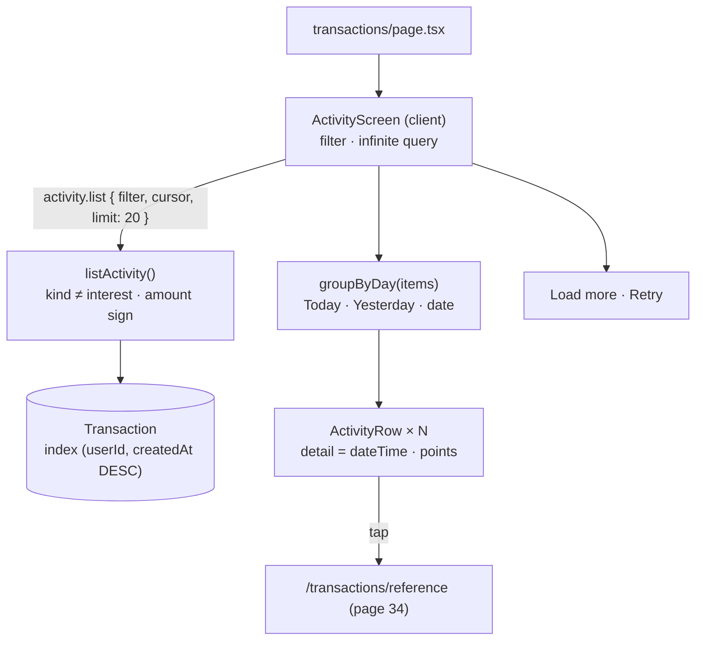

# 33 · Transaction history

**Transactions** (`/transactions`, "See all" on the dashboard) lists every movement of the **main account**, newest first, grouped under **Today**, **Yesterday** or a date. A switch filters **All / Incoming / Outgoing**. Each row shows what happened, the exact date and time (plus points if any), and the signed amount; tapping it opens the receipt ([34](34-receipts.md)). It loads 20 rows at a time with **Load more**.

## At a glance

| | |
| --- | --- |
| **Route** | `/transactions` |
| **Frontend** | page `gobank/src/app/(app)/transactions/page.tsx`; `activity-screen.tsx` (**client**: filter switch, day groups, paging), `activity-row.tsx`, `activity-icon.tsx` (shared with the dashboard), `activity.rules.ts` (`filterWhere`, `groupByDay`) |
| **API** | `activity.list({ filter, cursor, limit })` (protected query, infinite) |
| **Backend** | `activity.router.ts`, `activity.service.ts` (`listActivity`), `activity.fields.ts` (`activityFields`, `MAIN_ACCOUNT_KINDS`), `server/pagination.ts` |
| **Database** | reads the user's `Transaction` rows, except `interest`, filtered by the sign of `amount` |
| **Index** | `@@index([userId, createdAt(sort: Desc)])` |
| **Tests** | `e2e`/unit: none for this screen; checked in Chromium for this review |
| **Deep dive** | [Transactions and receipts](../05-features/10-transactions-and-receipts.md) |

## What the user can do

| Part | What it shows or does |
| --- | --- |
| **All · Incoming · Outgoing** | filter by the sign of the amount (`aria-pressed`) |
| day heading | "Today", "Yesterday", or "Nov 2, 2026" |
| row | icon, title ("Transfer to @dante"), detail ("Nov 4, 2026, 10:46 AM · +3 pts"), amount ("−₱150.00" in red, "+₱25.00" in green) |
| tap a row | `/transactions/<reference>` |
| **Load more** | the next 20 rows |
| empty | "No activity yet" / "No incoming yet" / "No outgoing yet" |

## How it works

1. `ActivityScreen` keeps the filter (`all` at first) and calls `activity.list.useInfiniteQuery({ filter, limit: 20 })`, always fresh (`staleTime: 0`, `refetchOnMount: "always"`).
2. `listActivity` reads the user's rows with `kind: { not: "interest" }`, adds `amount > 0` (Incoming) or `amount < 0` (Outgoing), and orders by `createdAt desc, id desc` with cursor paging.
3. The browser flattens the loaded pages and groups consecutive rows by **local** calendar day (`groupByDay`).
4. Each row is the same `ActivityRow` as on the dashboard, but its detail is the full date and time from `dateTime()`, plus " · +3 pts" when points changed.

## Structure



## Files and locations

| Layer | File | Role |
| --- | --- | --- |
| Page | `gobank/src/app/(app)/transactions/page.tsx` | renders the screen, tab title "Transactions" |
| Frontend (client) | `gobank/src/features/activity/components/activity-screen.tsx` | filter, groups, rows, paging |
| Frontend | `gobank/src/features/activity/components/activity-row.tsx` | one row ([11 §5](11-dashboard.md#5-signs-colors-and-icons-in-a-transaction-row)) |
| Frontend | `gobank/src/features/activity/components/activity-icon.tsx` | icon per kind |
| Rules | `gobank/src/features/activity/activity.rules.ts` | filters, day labels, grouping |
| Fields | `gobank/src/features/activity/activity.fields.ts` | columns and the "not interest" rule |
| API | `gobank/src/features/activity/activity.router.ts` | `list`, `transaction` |
| Service | `gobank/src/features/activity/activity.service.ts` | `listActivity`, `getTransaction` |
| Pagination | `gobank/src/server/pagination.ts` | `pageArgs`, `toPage` |

## Frontend

<!-- code: gobank/src/app/(app)/transactions/page.tsx -->
**`gobank/src/app/(app)/transactions/page.tsx`** · all 10 lines

```tsx
 1 │ import type { Metadata } from "next";
 2 │ import { ActivityScreen } from "~/features/activity/components/activity-screen";
 3 │
 4 │ export const metadata: Metadata = {
 5 │   title: "Transactions",
 6 │ };
 7 │
 8 │ export default function TransactionsPage() {
 9 │   return <ActivityScreen />;
10 │ }
```
<!-- /code -->

<!-- code: gobank/src/features/activity/components/activity-screen.tsx -->
**`gobank/src/features/activity/components/activity-screen.tsx`** · all 161 lines

```tsx
  1 │ "use client";
  2 │
  3 │ import { ReceiptText } from "lucide-react";
  4 │ import { useState } from "react";
  5 │ import { cn } from "~/shared/lib/cn";
  6 │ import { dateTime } from "~/shared/lib/format";
  7 │ import { Button } from "~/shared/ui/button";
  8 │ import { FormError } from "~/shared/ui/money-form-ui";
  9 │ import { PageHeader } from "~/shared/ui/page-header";
 10 │ import { errorMessage } from "~/trpc/error-message";
 11 │ import { api } from "~/trpc/react";
 12 │ import type { ActivityEntry } from "../activity.fields";
 13 │ import {
 14 │   ACTIVITY_FILTERS,
 15 │   FILTER_LABELS,
 16 │   groupByDay,
 17 │   type ActivityFilter,
 18 │ } from "../activity.rules";
 19 │ import { ActivityRow } from "./activity-row";
 20 │
 21 │ function pointsNote(points: number) {
 22 │   if (!points) return "";
 23 │
 24 │   const sign = points > 0 ? "+" : "";
 25 │   return ` · ${sign}${points.toLocaleString("en-PH")} pts`;
 26 │ }
 27 │
 28 │ const entryDetail = (entry: ActivityEntry) =>
 29 │   `${dateTime(entry.createdAt)}${pointsNote(entry.points)}`;
 30 │
 31 │ function FilterSwitch({
 32 │   selected,
 33 │   onSelect,
 34 │ }: {
 35 │   selected: ActivityFilter;
 36 │   onSelect: (filter: ActivityFilter) => void;
 37 │ }) {
 38 │   return (
 39 │     <div
 40 │       className="border-line bg-surface-sunken mb-5 grid grid-cols-3 gap-1 rounded-2xl border p-1"
 41 │       aria-label="Activity filter"
 42 │     >
 43 │       {ACTIVITY_FILTERS.map((filter) => (
 44 │         <button
 45 │           key={filter}
 46 │           type="button"
 47 │           aria-pressed={selected === filter}
 48 │           onClick={() => onSelect(filter)}
 49 │           className={cn(
 50 │             "h-11 rounded-xl text-[13px] font-medium transition-colors",
 51 │             selected === filter
 52 │               ? "bg-surface-raised text-ink"
 53 │               : "text-ink-muted hover:text-ink",
 54 │           )}
 55 │         >
 56 │           {FILTER_LABELS[filter]}
 57 │         </button>
 58 │       ))}
 59 │     </div>
 60 │   );
 61 │ }
 62 │
 63 │ function NoActivity({ filter }: { filter: ActivityFilter }) {
 64 │   const message =
 65 │     filter === "all"
 66 │       ? "No activity yet"
 67 │       : `No ${FILTER_LABELS[filter].toLowerCase()} yet`;
 68 │
 69 │   return (
 70 │     <div className="border-line flex flex-col items-center gap-4 rounded-2xl border px-5 py-10">
 71 │       <ReceiptText size={28} className="text-ink-muted" aria-hidden />
 72 │       <p className="text-ink-muted text-center text-[14px]">{message}</p>
 73 │     </div>
 74 │   );
 75 │ }
 76 │
 77 │ export function ActivityScreen() {
 78 │   const [filter, setFilter] = useState<ActivityFilter>("all");
 79 │
 80 │   const activity = api.activity.list.useInfiniteQuery(
 81 │     { filter, limit: 20 },
 82 │     {
 83 │       getNextPageParam: (page) => page.next ?? undefined,
 84 │       staleTime: 0,
 85 │       refetchOnMount: "always",
 86 │     },
 87 │   );
 88 │
 89 │   const items = activity.data?.pages.flatMap((page) => page.items) ?? [];
 90 │   const groups = groupByDay(items);
 91 │   const isEmpty = !activity.isLoading && !activity.error && items.length === 0;
 92 │
 93 │   const retry = () => {
 94 │     if (activity.isFetchNextPageError) void activity.fetchNextPage();
 95 │     else void activity.refetch();
 96 │   };
 97 │
 98 │   return (
 99 │     <div className="flex flex-1 flex-col">
100 │       <PageHeader title="Transactions" back="/dashboard" />
101 │
102 │       <div className="pt-7">
103 │         <FilterSwitch selected={filter} onSelect={setFilter} />
104 │
105 │         {activity.isLoading ? (
106 │           <p
107 │             role="status"
108 │             className="text-ink-muted py-8 text-center text-[14px]"
109 │           >
110 │             Loading activity…
111 │           </p>
112 │         ) : null}
113 │
114 │         {isEmpty ? <NoActivity filter={filter} /> : null}
115 │
116 │         {items.length > 0 ? (
117 │           <div className="space-y-6">
118 │             {groups.map((group) => (
119 │               <section key={group.key}>
120 │                 <h2 className="text-ink-muted mb-3 text-[12px] font-medium">
121 │                   {group.label}
122 │                 </h2>
123 │                 <ul className="space-y-4">
124 │                   {group.items.map((entry) => (
125 │                     <li key={entry.id}>
126 │                       <ActivityRow entry={entry} detail={entryDetail(entry)} />
127 │                     </li>
128 │                   ))}
129 │                 </ul>
130 │               </section>
131 │             ))}
132 │           </div>
133 │         ) : null}
134 │
135 │         {activity.error ? (
136 │           <div className="mt-5">
137 │             <FormError error={errorMessage(activity.error)} />
138 │             <Button
139 │               variant="ghost"
140 │               disabled={activity.isFetching}
141 │               onClick={retry}
142 │             >
143 │               {activity.isFetching ? "Retrying…" : "Retry"}
144 │             </Button>
145 │           </div>
146 │         ) : null}
147 │
148 │         {!activity.error && activity.hasNextPage ? (
149 │           <Button
150 │             variant="outline"
151 │             className="mt-5"
152 │             disabled={activity.isFetching}
153 │             onClick={() => void activity.fetchNextPage()}
154 │           >
155 │             {activity.isFetchingNextPage ? "Loading…" : "Load more"}
156 │           </Button>
157 │         ) : null}
158 │       </div>
159 │     </div>
160 │   );
161 │ }
```
<!-- /code -->

<!-- code: gobank/src/features/activity/activity.rules.ts -->
**`gobank/src/features/activity/activity.rules.ts`** · all 51 lines

```ts
 1 │ export const ACTIVITY_FILTERS = ["all", "in", "out"] as const;
 2 │ export type ActivityFilter = (typeof ACTIVITY_FILTERS)[number];
 3 │
 4 │ export const FILTER_LABELS: Record<ActivityFilter, string> = {
 5 │   all: "All",
 6 │   in: "Incoming",
 7 │   out: "Outgoing",
 8 │ };
 9 │
10 │ type AmountWhere = { amount?: { gt: number } | { lt: number } };
11 │
12 │ const FILTER_WHERE: Record<ActivityFilter, AmountWhere> = {
13 │   all: {},
14 │   in: { amount: { gt: 0 } },
15 │   out: { amount: { lt: 0 } },
16 │ };
17 │
18 │ export const filterWhere = (filter: ActivityFilter) => FILTER_WHERE[filter];
19 │
20 │ const dayKey = (date: Date) =>
21 │   `${date.getFullYear()}-${date.getMonth()}-${date.getDate()}`;
22 │
23 │ function dayLabel(date: Date, now: Date = new Date()) {
24 │   const yesterday = new Date(now);
25 │   yesterday.setDate(now.getDate() - 1);
26 │   if (dayKey(date) === dayKey(now)) return "Today";
27 │   if (dayKey(date) === dayKey(yesterday)) return "Yesterday";
28 │   return date.toLocaleDateString("en-PH", {
29 │     month: "short",
30 │     day: "numeric",
31 │     year: "numeric",
32 │   });
33 │ }
34 │
35 │ export function groupByDay<T extends { createdAt: Date }>(
36 │   items: T[],
37 │   now: Date = new Date(),
38 │ ) {
39 │   const groups: { key: string; label: string; items: T[] }[] = [];
40 │   for (const item of items) {
41 │     const key = dayKey(item.createdAt);
42 │     const last = groups.at(-1);
43 │     if (last?.key === key) {
44 │       last.items.push(item);
45 │     } else {
46 │       groups.push({ key, label: dayLabel(item.createdAt, now), items: [item] });
47 │     }
48 │   }
49 │
50 │   return groups;
51 │ }
```
<!-- /code -->

## Backend

<!-- code: gobank/src/features/activity/activity.router.ts -->
**`gobank/src/features/activity/activity.router.ts`** · all 22 lines

```ts
 1 │ import { z } from "zod";
 2 │ import { createTRPCRouter, protectedProcedure } from "~/server/trpc";
 3 │ import { ACTIVITY_FILTERS } from "./activity.rules";
 4 │ import { getTransaction, listActivity } from "./activity.service";
 5 │
 6 │ export const activityRouter = createTRPCRouter({
 7 │   list: protectedProcedure
 8 │     .input(
 9 │       z.object({
10 │         filter: z.enum(ACTIVITY_FILTERS).default("all"),
11 │         cursor: z.string().nullish(),
12 │         limit: z.number().int().min(1).max(50).default(20),
13 │       }),
14 │     )
15 │     .query(({ ctx, input }) =>
16 │       listActivity(ctx.userId, input.cursor, input.limit, input.filter),
17 │     ),
18 │
19 │   transaction: protectedProcedure
20 │     .input(z.object({ reference: z.string() }))
21 │     .query(({ ctx, input }) => getTransaction(ctx.userId, input.reference)),
22 │ });
```
<!-- /code -->

<!-- code: gobank/src/features/activity/activity.service.ts 1-20 -->
**`gobank/src/features/activity/activity.service.ts`** · lines 1–20

```ts
 1 │ import { db } from "~/server/db";
 2 │ import { pageArgs, toPage } from "~/server/pagination";
 3 │ import { activityFields, MAIN_ACCOUNT_KINDS } from "./activity.fields";
 4 │ import { filterWhere, type ActivityFilter } from "./activity.rules";
 5 │
 6 │ export async function listActivity(
 7 │   userId: string,
 8 │   cursor: string | null | undefined,
 9 │   limit: number,
10 │   filter: ActivityFilter = "all",
11 │ ) {
12 │   const rows = await db.transaction.findMany({
13 │     where: { userId, kind: MAIN_ACCOUNT_KINDS, ...filterWhere(filter) },
14 │     select: activityFields,
15 │     orderBy: [{ createdAt: "desc" }, { id: "desc" }],
16 │     ...pageArgs(cursor, limit),
17 │   });
18 │
19 │   return toPage(rows, limit);
20 │ }
```
<!-- /code -->

<!-- code: gobank/src/features/activity/activity.fields.ts -->
**`gobank/src/features/activity/activity.fields.ts`** · all 17 lines

```ts
 1 │ import type { Prisma } from "../../../generated/prisma";
 2 │
 3 │ export const activityFields = {
 4 │   id: true,
 5 │   reference: true,
 6 │   kind: true,
 7 │   title: true,
 8 │   amount: true,
 9 │   points: true,
10 │   createdAt: true,
11 │ } as const;
12 │
13 │ export const MAIN_ACCOUNT_KINDS = { not: "interest" } as const;
14 │
15 │ export type ActivityEntry = Prisma.TransactionGetPayload<{
16 │   select: typeof activityFields;
17 │ }>;
```
<!-- /code -->

## Database

| Filter | `where` |
| --- | --- |
| All | `userId = me AND kind <> 'interest'` |
| Incoming | … `AND amount > 0` |
| Outgoing | … `AND amount < 0` |

Order: `createdAt DESC, id DESC`; 21 rows per request (20 + 1 to know if there is more).

## The complicated parts, explained step by step

### 1. Filters are a lookup table, not `if`s

<!-- code: gobank/src/features/activity/activity.rules.ts 1-18 -->
**`gobank/src/features/activity/activity.rules.ts`** · lines 1–18

```ts
 1 │ export const ACTIVITY_FILTERS = ["all", "in", "out"] as const;
 2 │ export type ActivityFilter = (typeof ACTIVITY_FILTERS)[number];
 3 │
 4 │ export const FILTER_LABELS: Record<ActivityFilter, string> = {
 5 │   all: "All",
 6 │   in: "Incoming",
 7 │   out: "Outgoing",
 8 │ };
 9 │
10 │ type AmountWhere = { amount?: { gt: number } | { lt: number } };
11 │
12 │ const FILTER_WHERE: Record<ActivityFilter, AmountWhere> = {
13 │   all: {},
14 │   in: { amount: { gt: 0 } },
15 │   out: { amount: { lt: 0 } },
16 │ };
17 │
18 │ export const filterWhere = (filter: ActivityFilter) => FILTER_WHERE[filter];
```
<!-- /code -->

| Filter | `FILTER_WHERE[filter]` | Label |
| --- | --- | --- |
| `all` | `{}` | All |
| `in` | `{ amount: { gt: 0 } }` | Incoming |
| `out` | `{ amount: { lt: 0 } }` | Outgoing |

`ACTIVITY_FILTERS` is `as const`, so `z.enum(ACTIVITY_FILTERS)` in the router accepts exactly these three, and TypeScript forces `FILTER_LABELS` and `FILTER_WHERE` to have an entry for each. The filter is part of the query input, so each filter has its own cached pages, and switching back is instant.

Checked in Chromium (`@maricel`): **Incoming** showed 15 rows, all with "+"; **Outgoing** showed 20 rows (a full page), all with "−"; the pressed button had `aria-pressed="true"`.

### 2. What counts as "Incoming" and "Outgoing"

| Row | `amount` | In |
| --- | --- | --- |
| Cash deposit | + | Incoming |
| Transfer from @dante | + | Incoming |
| Cash back · 500 points | + | Incoming |
| GoalSave withdrawal (money back from a goal) | + | Incoming |
| Transfer to @dante, bills, load | − | Outgoing |
| GoalSave deposit (money into a goal) | − | Outgoing |
| Interest earned | (goal money) | **not listed** (`kind ≠ interest`) |

The sign is always from the **main account's** point of view, which is why moving money into a goal counts as "Outgoing" here. Interest is paid into goals, not the main account, so it is left out ([11 §1](11-dashboard.md#1-one-prisma-call-two-sql-statements)), and it stays out even after the goal is closed ([28 §2](28-goal-settings-and-close.md#2-the-history-survives-the-goal)).

### 3. Grouping by day, in the browser's time zone

<!-- code: gobank/src/features/activity/activity.rules.ts 20-51 -->
**`gobank/src/features/activity/activity.rules.ts`** · lines 20–51

```ts
20 │ const dayKey = (date: Date) =>
21 │   `${date.getFullYear()}-${date.getMonth()}-${date.getDate()}`;
22 │
23 │ function dayLabel(date: Date, now: Date = new Date()) {
24 │   const yesterday = new Date(now);
25 │   yesterday.setDate(now.getDate() - 1);
26 │   if (dayKey(date) === dayKey(now)) return "Today";
27 │   if (dayKey(date) === dayKey(yesterday)) return "Yesterday";
28 │   return date.toLocaleDateString("en-PH", {
29 │     month: "short",
30 │     day: "numeric",
31 │     year: "numeric",
32 │   });
33 │ }
34 │
35 │ export function groupByDay<T extends { createdAt: Date }>(
36 │   items: T[],
37 │   now: Date = new Date(),
38 │ ) {
39 │   const groups: { key: string; label: string; items: T[] }[] = [];
40 │   for (const item of items) {
41 │     const key = dayKey(item.createdAt);
42 │     const last = groups.at(-1);
43 │     if (last?.key === key) {
44 │       last.items.push(item);
45 │     } else {
46 │       groups.push({ key, label: dayLabel(item.createdAt, now), items: [item] });
47 │     }
48 │   }
49 │
50 │   return groups;
51 │ }
```
<!-- /code -->

`groupByDay` walks the rows **in order** and starts a new group whenever the day changes. It only compares with the **last** group (`groups.at(-1)`), which works because the rows are already sorted newest first.

| Row's local date (now = Nov 4) | `dayKey` | Label |
| --- | --- | --- |
| Nov 4, 11:12 AM | `2026-10-4` | **Today** |
| Nov 4, 10:46 AM | `2026-10-4` | (same group) |
| Nov 3, 9:00 PM | `2026-10-3` | **Yesterday** |
| Nov 2 | `2026-10-2` | **Nov 2, 2026** |

The key uses `getMonth()`, which counts from 0 (November = 10). That is fine for a key that is only compared, never shown. Because `ActivityScreen` is a **client** component, the days and the times in the rows follow the **device's** time zone. A transfer made at 10:46 AM in Manila shows "10:46 AM" here. In this review all of Maricel's rows were made on Nov 4 (Manila), so Chromium showed one group, **Today**.

### 4. "Load more", and keeping pages after an error

<!-- code: gobank/src/features/activity/components/activity-screen.tsx 80-96 -->
**`gobank/src/features/activity/components/activity-screen.tsx`** · lines 80–96

```tsx
80 │   const activity = api.activity.list.useInfiniteQuery(
81 │     { filter, limit: 20 },
82 │     {
83 │       getNextPageParam: (page) => page.next ?? undefined,
84 │       staleTime: 0,
85 │       refetchOnMount: "always",
86 │     },
87 │   );
88 │
89 │   const items = activity.data?.pages.flatMap((page) => page.items) ?? [];
90 │   const groups = groupByDay(items);
91 │   const isEmpty = !activity.isLoading && !activity.error && items.length === 0;
92 │
93 │   const retry = () => {
94 │     if (activity.isFetchNextPageError) void activity.fetchNextPage();
95 │     else void activity.refetch();
96 │   };
```
<!-- /code -->

| Step (checked in Chromium) | Rows |
| --- | --- |
| first page | 20, with **Load more** |
| **Load more** | 40 |

| State | Button |
| --- | --- |
| `hasNextPage` and no error | **Load more** (`Loading…` while fetching) |
| the next page failed (`isFetchNextPageError`) | **Retry** fetches only that page again; the 40 rows already shown stay |
| the first page failed | **Retry** reloads from the start |

The pages are fetched with a cursor (the last row's `id`, [16 §5](16-request-inbox.md#5-cursor-pagination-20-at-a-time-without-skipping-or-repeating)), so a payment made while scrolling does not shift the next page or show a row twice.

### 5. The row's detail line

<!-- code: gobank/src/features/activity/components/activity-screen.tsx 21-29 -->
**`gobank/src/features/activity/components/activity-screen.tsx`** · lines 21–29

```tsx
21 │ function pointsNote(points: number) {
22 │   if (!points) return "";
23 │
24 │   const sign = points > 0 ? "+" : "";
25 │   return ` · ${sign}${points.toLocaleString("en-PH")} pts`;
26 │ }
27 │
28 │ const entryDetail = (entry: ActivityEntry) =>
29 │   `${dateTime(entry.createdAt)}${pointsNote(entry.points)}`;
```
<!-- /code -->

Examples from payments made during this review:

| Row | `points` | Detail |
| --- | --- | --- |
| Transfer to @dante ₱150 | 3 | "Nov 4, 2026, 10:46 AM · +3 pts" |
| Cash back · 500 points | −500 | "Nov 4, 2026, 11:23 AM · -500 pts" (no sign is added; the plain hyphen comes from `(-500).toLocaleString()`, while the amounts on the right use the real minus sign `−`) |
| Mobile load | 0 | "Nov 4, 2026, 10:58 AM" (`!points` → nothing added) |

The dashboard uses the same `ActivityRow` with a short date only ([11](11-dashboard.md)).

## Rules and limits

| Rule | Value |
| --- | --- |
| Shown | every main-account movement except interest |
| Filters | All, Incoming (amount > 0), Outgoing (amount < 0) |
| Page size | 20 (router allows 1–50) |
| Order | newest first, ties broken by `id` |
| Day groups | the device's time zone |

## Messages

| Text | When |
| --- | --- |
| All · Incoming · Outgoing | filter |
| Today · Yesterday · Nov 2, 2026 | day headings |
| Loading activity… | first load |
| No activity yet / No incoming yet / No outgoing yet | empty |
| Load more / Loading… · Retry / Retrying… | paging and errors |

## Tests

No automated test covers this screen (the service's queries are exercised indirectly through `verify-core.ts` payments). **Checked in Chromium for this review** as `@maricel`: 20 rows and **Load more**, then 40; the three filters with their signs and `aria-pressed`; the day group; row details with points; opening a receipt from a row.
