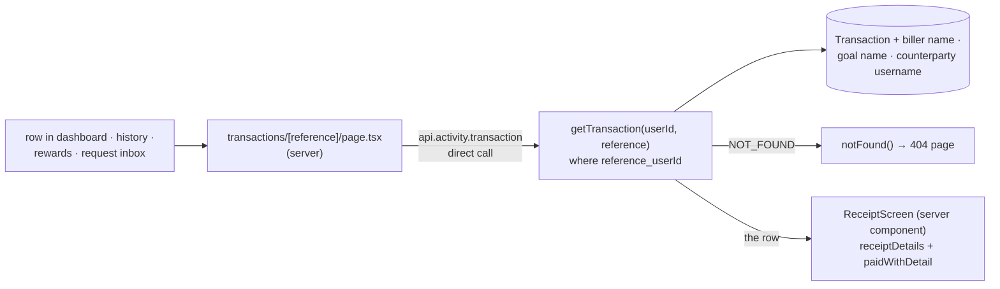

# 34 · Receipts

GoBank shows two kinds of receipt. The **immediate receipt** appears right after an action, inside its form ("Deposit successful", "Transfer successful", "Payment successful"…). The **history receipt** is a page, `/transactions/<reference>`, that can be opened later from the dashboard, the transaction history, the rewards history or a paid money request. Both are built from the saved `Transaction` row, never from the form's own numbers.

## At a glance

| | |
| --- | --- |
| **Route** | `/transactions/<reference>` (history receipt); immediate receipts have no route of their own |
| **Frontend** | page `gobank/src/app/(app)/transactions/[reference]/page.tsx` (**server**); `receipt-screen.tsx` (server component); `transaction-receipt.tsx`, `transaction-summary.tsx`, `money-form-ui.tsx` (`MoneySummary`), `card-label.ts` (`paidWithDetail`) |
| **API** | `activity.transaction({ reference })` (protected query, called on the server) |
| **Backend** | `activity.service.ts` (`getTransaction`) |
| **Database** | reads one `Transaction` by **(reference, userId)**, with the biller's name, the goal's name and the other person's username |
| **Tests** | `verify-core.ts` (`checkBillsAndLoad`: a receipt is found by its owner and **not** by another user); checked in Chromium for this review |
| **Deep dive** | [Transactions and receipts](../05-features/10-transactions-and-receipts.md) |

## What the user sees

**Immediate receipts** (from each feature's form):

| Action | Title | Rows |
| --- | --- | --- |
| Deposit ([13](13-deposit.md)) | Deposit successful | amount · Reference · Date · Balance after |
| Send money ([14](14-send-money.md)) | Transfer successful | amount · recipient · note · Reference · Date · Balance · Paid with |
| Request money ([15](15-request-money.md)) | Request sent | amount · payer · note · Status Pending · Date |
| Pay bills ([17](17-pay-bills.md)) | Payment successful | amount · biller · Account `******3344` · Reference · Date · Points earned · Balance · Paid with |
| Buy load ([18](18-buy-load.md)) | Load successful | amount · Mobile · Reference · Date · Balance · Paid with |
| Convert points ([31](31-rewards-and-convert.md)) | Cash back credited | amount · Points used · Reference · Date · Main balance |

**The history receipt** (`/transactions/<reference>`), for example the ₱150.00 transfer:

| Row | Value |
| --- | --- |
| amount | **-₱150.00** in red (or green for money in) |
| title | Transfer to @dante |
| Reference · Date · Balance after | GB2AKCYR8V · Nov 4, 2026, … · ₱900.00 |
| To / From | @dante |
| Biller / GoalSave | when the row has one |
| Points | 3 (when not 0) |
| Paid with | Physical · Discover •••• 8954 (card payments) |
| **Done** | back to the dashboard |

## How it works

1. A row in any list links to `/transactions/<reference>`.
2. The **server** page reads the reference from `params` and calls `api.activity.transaction({ reference })` directly (no HTTP from the browser).
3. `getTransaction(userId, reference)` uses the compound unique key **`reference_userId`**, so it can only find **the signed-in user's own** row. It includes the biller's name, the goal's name and the counterparty's username.
4. If there is no such row, the procedure fails with `NOT_FOUND` and the page calls Next.js's `notFound()`, which shows the "404 · This page could not be found." page.
5. `ReceiptScreen` (a server component) builds the rows and adds "Paid with" with `paidWithDetail`.

## Structure



## Files and locations

| Layer | File | Role |
| --- | --- | --- |
| Page (server) | `gobank/src/app/(app)/transactions/[reference]/page.tsx` | load, not found, render |
| Receipt (server) | `gobank/src/features/activity/components/receipt-screen.tsx` | the history receipt's rows |
| UI | `gobank/src/shared/ui/transaction-receipt.tsx` | immediate receipt frame: check icon, title, **Done** |
| UI | `gobank/src/shared/ui/transaction-summary.tsx` | amount + rows (`<dl>`) |
| UI | `gobank/src/shared/ui/money-form-ui.tsx` | `MoneySummary` (with the other person) |
| Label | `gobank/src/features/card/card-label.ts` | "Paid with" |
| API | `gobank/src/features/activity/activity.router.ts` | `transaction` |
| Service | `gobank/src/features/activity/activity.service.ts` | `getTransaction` |

## Frontend

<!-- code: gobank/src/app/(app)/transactions/[reference]/page.tsx -->
**`gobank/src/app/(app)/transactions/[reference]/page.tsx`** · all 28 lines

```tsx
 1 │ import type { Metadata } from "next";
 2 │ import { TRPCError } from "@trpc/server";
 3 │ import { notFound } from "next/navigation";
 4 │ import { ReceiptScreen } from "~/features/activity/components/receipt-screen";
 5 │ import { api } from "~/trpc/server";
 6 │
 7 │ export const metadata: Metadata = {
 8 │   title: "Receipt",
 9 │ };
10 │
11 │ export default async function ReceiptPage({
12 │   params,
13 │ }: {
14 │   params: Promise<{ reference: string }>;
15 │ }) {
16 │   const { reference } = await params;
17 │
18 │   try {
19 │     return (
20 │       <ReceiptScreen
21 │         transaction={await api.activity.transaction({ reference })}
22 │       />
23 │     );
24 │   } catch (error) {
25 │     if (error instanceof TRPCError && error.code === "NOT_FOUND") notFound();
26 │     throw error;
27 │   }
28 │ }
```
<!-- /code -->

<!-- code: gobank/src/features/activity/components/receipt-screen.tsx -->
**`gobank/src/features/activity/components/receipt-screen.tsx`** · all 58 lines

```tsx
 1 │ import Link from "next/link";
 2 │ import { cn } from "~/shared/lib/cn";
 3 │ import { dateTime, peso } from "~/shared/lib/format";
 4 │ import { buttonClass } from "~/shared/ui/button";
 5 │ import { PageHeader } from "~/shared/ui/page-header";
 6 │ import { TransactionSummary } from "~/shared/ui/transaction-summary";
 7 │ import type { RouterOutputs } from "~/trpc/react";
 8 │ import { paidWithDetail } from "~/features/card/card-label";
 9 │
10 │ type Transaction = RouterOutputs["activity"]["transaction"];
11 │ type Detail = { label: string; value: string };
12 │
13 │ function receiptDetails(transaction: Transaction): Detail[] {
14 │   const { counterparty, biller, savingsGoal, points } = transaction;
15 │
16 │   const details: Detail[] = [
17 │     { label: "Reference", value: transaction.reference },
18 │     { label: "Date", value: dateTime(transaction.createdAt) },
19 │     { label: "Balance after", value: peso(transaction.balanceAfter) },
20 │   ];
21 │
22 │   if (counterparty) {
23 │     const direction = transaction.amount < 0 ? "To" : "From";
24 │     details.push({ label: direction, value: `@${counterparty.username}` });
25 │   }
26 │
27 │   if (biller) details.push({ label: "Biller", value: biller.name });
28 │   if (savingsGoal) details.push({ label: "GoalSave", value: savingsGoal.name });
29 │   if (points) {
30 │     details.push({ label: "Points", value: points.toLocaleString("en-PH") });
31 │   }
32 │
33 │   return [...details, ...paidWithDetail(transaction.details)];
34 │ }
35 │
36 │ export function ReceiptScreen({ transaction }: { transaction: Transaction }) {
37 │   const spent = transaction.amount < 0;
38 │
39 │   return (
40 │     <div className="flex flex-1 flex-col gap-7">
41 │       <PageHeader title="Receipt" back="/transactions" />
42 │
43 │       <TransactionSummary
44 │         amount={transaction.amount}
45 │         amountClassName={spent ? "text-danger" : "text-brand"}
46 │         details={receiptDetails(transaction)}
47 │       >
48 │         <h2 className="text-ink text-[16px] font-medium">
49 │           {transaction.title}
50 │         </h2>
51 │       </TransactionSummary>
52 │
53 │       <Link href="/dashboard" className={cn(buttonClass(), "mt-auto")}>
54 │         Done
55 │       </Link>
56 │     </div>
57 │   );
58 │ }
```
<!-- /code -->

<!-- code: gobank/src/shared/ui/transaction-receipt.tsx -->
**`gobank/src/shared/ui/transaction-receipt.tsx`** · all 30 lines

```tsx
 1 │ "use client";
 2 │
 3 │ import { CheckCircle2 } from "lucide-react";
 4 │ import type { ReactNode } from "react";
 5 │ import { Button } from "./button";
 6 │
 7 │ export function TransactionReceipt({
 8 │   title,
 9 │   children,
10 │   onDone,
11 │ }: {
12 │   title: string;
13 │   children: ReactNode;
14 │   onDone: () => void;
15 │ }) {
16 │   return (
17 │     <div className="flex flex-1 flex-col gap-6 pt-5">
18 │       <header className="flex items-center gap-3">
19 │         <CheckCircle2 className="text-brand shrink-0" size={28} aria-hidden />
20 │         <h1 className="text-ink text-[20px] font-semibold">{title}</h1>
21 │       </header>
22 │
23 │       {children}
24 │
25 │       <div className="mt-auto pt-4">
26 │         <Button onClick={onDone}>Done</Button>
27 │       </div>
28 │     </div>
29 │   );
30 │ }
```
<!-- /code -->

<!-- code: gobank/src/shared/ui/transaction-summary.tsx -->
**`gobank/src/shared/ui/transaction-summary.tsx`** · all 48 lines

```tsx
 1 │ import type { ReactNode } from "react";
 2 │ import { cn } from "~/shared/lib/cn";
 3 │ import { peso } from "~/shared/lib/format";
 4 │
 5 │ type Detail = { label: string; value: string };
 6 │
 7 │ export function TransactionSummary({
 8 │   amount,
 9 │   amountClassName,
10 │   children,
11 │   details = [],
12 │ }: {
13 │   amount: number;
14 │   amountClassName?: string;
15 │   children?: ReactNode;
16 │   details?: Detail[];
17 │ }) {
18 │   return (
19 │     <section className="border-line bg-surface-sunken rounded-2xl border p-5">
20 │       <p
21 │         className={cn(
22 │           "text-[30px] font-semibold tracking-tight tabular-nums",
23 │           amountClassName ?? "text-ink",
24 │         )}
25 │       >
26 │         {peso(amount)}
27 │       </p>
28 │
29 │       {children ? <div className="mt-5">{children}</div> : null}
30 │
31 │       {details.length > 0 ? (
32 │         <dl className="border-line mt-5 space-y-3 border-t pt-4">
33 │           {details.map(({ label, value }) => (
34 │             <div
35 │               key={label}
36 │               className="grid grid-cols-[minmax(0,1fr)_minmax(0,1.8fr)] gap-3 text-[12px]"
37 │             >
38 │               <dt className="text-ink-muted">{label}</dt>
39 │               <dd className="text-ink min-w-0 text-right break-words">
40 │                 {value}
41 │               </dd>
42 │             </div>
43 │           ))}
44 │         </dl>
45 │       ) : null}
46 │     </section>
47 │   );
48 │ }
```
<!-- /code -->

## Backend

<!-- code: gobank/src/features/activity/activity.router.ts 19-21 -->
**`gobank/src/features/activity/activity.router.ts`** · lines 19–21

```ts
19 │   transaction: protectedProcedure
20 │     .input(z.object({ reference: z.string() }))
21 │     .query(({ ctx, input }) => getTransaction(ctx.userId, input.reference)),
```
<!-- /code -->

<!-- code: gobank/src/features/activity/activity.service.ts 22-30 -->
**`gobank/src/features/activity/activity.service.ts`** · lines 22–30

```ts
22 │ export const getTransaction = (userId: string, reference: string) =>
23 │   db.transaction.findUniqueOrThrow({
24 │     where: { reference_userId: { reference, userId } },
25 │     include: {
26 │       biller: { select: { name: true } },
27 │       savingsGoal: { select: { name: true } },
28 │       counterparty: { select: { username: true } },
29 │     },
30 │   });
```
<!-- /code -->

## Database

<!-- code: gobank/prisma/schema.prisma 185-185 -->
**`gobank/prisma/schema.prisma`** · line 185

```prisma
185 │   @@unique([reference, userId])
```
<!-- /code -->

| Lookup | Meaning |
| --- | --- |
| `reference_userId: { reference, userId }` | the compound unique key: one row per reference **per user** |
| `include: { biller: { name }, savingsGoal: { name }, counterparty: { username } }` | only the names needed on the receipt, nothing else about the other person |

## The complicated parts, explained step by step

### 1. One reference, two receipts, and nobody else's

A transfer writes **two** rows with the **same** reference ([14 §7](14-send-money.md#7-two-rows-one-reference)). The receipt lookup includes the user:

| Who opens `/transactions/GBFGYQERKR` | Row found | Shows |
| --- | --- | --- |
| Maricel (the sender) | her row | **-₱150.00** in red, "Transfer to @dante", To @dante, Points 3, Paid with … |
| Dante (the receiver) | his row | **₱150.00** in green (a positive amount gets no sign), "Transfer from @maricel", From @maricel, no "Paid with" line |
| a third user | none | 404 |

Checked for this review, signed in as Maricel:

| Reference | Result |
| --- | --- |
| her own transfer `GB2AKCYR8V` | the receipt |
| a made-up `GBNOTREAL1` | **"404 · This page could not be found."** |
| Dante's bill `GBAJN892LF` (a real reference, but not hers) | **the same 404**: the receipt data was not even in the server's response |

`verify-core.ts` checks the same rule: `getTransaction(owner, bill.reference)` returns the bill, and `getTransaction(other, bill.reference)` is refused with `NOT_FOUND`. A stranger cannot tell a wrong reference from someone else's.

### 2. "Not found" in a server page

<!-- code: gobank/src/app/(app)/transactions/[reference]/page.tsx 18-27 -->
**`gobank/src/app/(app)/transactions/[reference]/page.tsx`** · lines 18–27

```tsx
18 │   try {
19 │     return (
20 │       <ReceiptScreen
21 │         transaction={await api.activity.transaction({ reference })}
22 │       />
23 │     );
24 │   } catch (error) {
25 │     if (error instanceof TRPCError && error.code === "NOT_FOUND") notFound();
26 │     throw error;
27 │   }
```
<!-- /code -->

| Error from the procedure | What the page does |
| --- | --- |
| `TRPCError` with code `NOT_FOUND` (from `P2025` in `findUniqueOrThrow`) | `notFound()`: Next.js renders its not-found page |
| anything else (database down…) | rethrown: Next.js shows its error page |

Measured in Chromium: the 404 text appeared, but the HTTP status was **200** and the tab title stayed "Receipt · GoBank Express". The layout and the page head are streamed before the receipt is loaded, so the status line has already been sent. The response carries Next's not-found signal (`NEXT_HTTP_ERROR_FALLBACK;404`) instead of the receipt. The app has no custom not-found page ([Limitations](../09-defense/03-limitations-and-future-work.md#3-product-and-ux-limitations)).

### 3. Built from the row, rendered on the server

<!-- code: gobank/src/features/activity/components/receipt-screen.tsx 13-34 -->
**`gobank/src/features/activity/components/receipt-screen.tsx`** · lines 13–34

```tsx
13 │ function receiptDetails(transaction: Transaction): Detail[] {
14 │   const { counterparty, biller, savingsGoal, points } = transaction;
15 │
16 │   const details: Detail[] = [
17 │     { label: "Reference", value: transaction.reference },
18 │     { label: "Date", value: dateTime(transaction.createdAt) },
19 │     { label: "Balance after", value: peso(transaction.balanceAfter) },
20 │   ];
21 │
22 │   if (counterparty) {
23 │     const direction = transaction.amount < 0 ? "To" : "From";
24 │     details.push({ label: direction, value: `@${counterparty.username}` });
25 │   }
26 │
27 │   if (biller) details.push({ label: "Biller", value: biller.name });
28 │   if (savingsGoal) details.push({ label: "GoalSave", value: savingsGoal.name });
29 │   if (points) {
30 │     details.push({ label: "Points", value: points.toLocaleString("en-PH") });
31 │   }
32 │
33 │   return [...details, ...paidWithDetail(transaction.details)];
34 │ }
```
<!-- /code -->

| Row field | Receipt line | Shown when |
| --- | --- | --- |
| `reference`, `createdAt`, `balanceAfter` | Reference · Date · Balance after | always |
| `counterparty.username` + sign of `amount` | **To** @dante (money out) / **From** @maricel (money in) | transfers |
| `biller.name` | Biller | bills |
| `savingsGoal.name` | GoalSave | goal moves (while the goal exists) |
| `points` | Points | when not 0 |
| `details.card` | Paid with | card payments ([23 §4](23-pay-with-card.md#4-reading-json-from-the-database-safely)) |

`ReceiptScreen` has no `"use client"`, so it runs on the **server** and only its HTML reaches the browser. The row's `details` JSON, which for a bill includes the **full** biller account number, is never sent to the browser on this page.

### 4. Two receipts, two small differences

| Aspect | Immediate receipt (client) | History receipt (server) |
| --- | --- | --- |
| amount | `Math.abs(amount)`, e.g. **₱150.00** | the signed amount, e.g. **-₱150.00** (with the plain hyphen that `peso()` produces for a negative number) in red, or green for money in |
| date | formatted **in the browser**: "Nov 4, 2026, 10:46 AM" (Manila) | formatted **on the server**: on this review's UTC server, the same transfer showed "Nov 4, 2026, **2:46 AM**" |

The second difference is a real problem when the server runs in UTC: the history receipt is 8 hours off for users in the Philippines. Passing `timeZone: "Asia/Manila"` to the formatter in `format.ts` would fix it ([Limitations](../09-defense/03-limitations-and-future-work.md#4-technical-limitations)). The dashboard's short dates have the same cause ([11 §9](11-dashboard.md#9-dates-on-this-list-are-formatted-on-the-server)).

### 5. Interest receipts exist, but nothing links to them

Interest rows have references too, and `getTransaction` does not filter by kind, so `/transactions/<interest reference>` works. But the main history leaves interest out, and the goal's Transactions tab rows are not links. In practice an interest receipt is only reachable by typing its URL.

## Rules and limits

| Rule | Value |
| --- | --- |
| Who can open a receipt | only the user who owns that row |
| Unknown or foreign reference | Next's default 404 page (HTTP 200, see §2) |
| Rendered | on the server (the history receipt); in the browser (immediate receipts) |
| Sensitive details | bill account numbers are masked on the immediate receipt and absent from the history receipt |

## Messages

| Text | When |
| --- | --- |
| Receipt | history receipt header |
| Reference · Date · Balance after · To / From · Biller · GoalSave · Points · Paid with | history receipt rows |
| Done | both kinds |
| Deposit successful · Transfer successful · Request sent · Payment successful · Load successful · Cash back credited | immediate receipt titles |
| 404 · This page could not be found. | unknown or foreign reference |

## Tests

- `verify-core.ts` → `checkBillsAndLoad`: `getTransaction(owner.id, bill.reference)` returns the bill's row; `getTransaction(other.id, bill.reference)` is refused as not found.
- **Checked in Chromium for this review:** opening a receipt from the history (the rows in §3, the red signed amount, "Paid with"), the 404 for a made-up and for another user's reference, the HTTP 200 status, and the 2:46 AM / 10:46 AM time difference.
