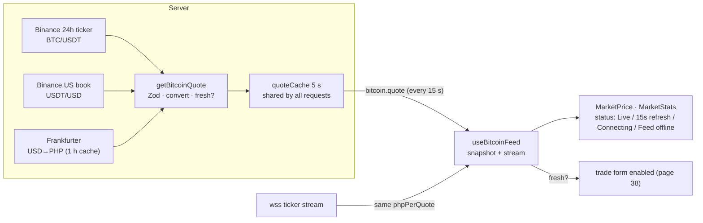

# 35 · Live Bitcoin price and market stats

The top of `/bitcoin` shows the **Bitcoin price in pesos** (for example **₱5,850,000.00**), the **24-hour change** ("+2.04% 24h"), the time of the last update, a feed status (**Live**, **15s refresh**, **Connecting** or **Feed offline**) that doubles as a refresh button, and three stats: **24h high**, **24h low**, **24h volume**. The server builds a peso price from three public sources. The browser then keeps it moving with a live WebSocket stream, and pauses trading whenever the price is not fresh.

## At a glance

| | |
| --- | --- |
| **Route** | `/bitcoin` (the Bitcoin card on the dashboard, the GO menu) |
| **Frontend** | page `gobank/src/app/(app)/bitcoin/page.tsx`; `bitcoin-screen.tsx` (**client**), `bitcoin-market.tsx` (`MarketPrice`, `MarketStats`), hook `use-bitcoin-feed.ts`, `live-socket.ts` |
| **API** | `bitcoin.quote` (protected query, refetched every 15 s) |
| **Backend** | `bitcoin-market.server.ts` (`getBitcoinQuote`), `bitcoin-fx.server.ts` (`getPhpRate`), `bitcoin-cache.ts` (`createRequestCache`), `bitcoin.types.ts` (`quoteIsFresh`, `money`) |
| **External** | Binance `data-api.binance.vision` (BTC/USDT 24-hour ticker), Binance.US (USDT/USD book), Frankfurter (USD→PHP reference rate); live: `wss://data-stream.binance.vision/ws/btcusdt@ticker` |
| **Database** | none |
| **Tests** | `bitcoin.test.ts` ("a price quote is only used while it is fresh"), `verify-bitcoin.ts`; checked with stand-in market data and in Chromium for this review |
| **Deep dive** | [Bitcoin §3 and §6](../05-features/12-bitcoin.md#3-where-the-php-price-comes-from) |

## What the user sees

| Part | Example (stand-in data: BTC $100,000, USD→PHP 58.50) |
| --- | --- |
| price | **5,850,000.00** PHP |
| 24h change | **+2.04%** 24h (green), or "−…%" in rose when down |
| status button | **Live** (green dot) · **15s refresh** · **Connecting** · **Feed offline** (amber dot); tap = refresh |
| updated | "Updated 11:31:05 AM" |
| stats | 24h high **5,908,500.00** · 24h low **5,703,750.00** · 24h volume · BTC **12.3K** |
| stale price | "Feed unavailable. Showing the last price; trading is paused until a fresh quote arrives." |
| no price at all | "Market data is unavailable. Use refresh to try again." |
| footer | the data sources, the rate date, and "External exchange orders and withdrawals are unavailable." |

## How it works

1. **Server, every 5 s at most** (`quoteCache`): `getBitcoinQuote` fetches, in parallel, the BTC/USDT 24-hour ticker, the USD→PHP rate (cached for 1 hour) and the USDT/USD bid/ask.
2. Each answer is checked with **Zod** (exact symbols, positive finite numbers, `ask ≥ bid`, a dated PHP rate no older than a week).
3. `phpPerQuote = USD→PHP × the middle of USDT's bid/ask`. Every price is `round(USDT price × phpPerQuote × 100)` centavos.
4. The result is refused if the price is out of range or the ticker is **not fresh** (older than 60 s, or more than 10 s in the future). Any failure gives one message: "Bitcoin market data is unavailable. Please try again shortly."
5. **Browser:** `useBitcoinFeed` shows the server's snapshot (refetched every 15 s). As soon as it has a `phpPerQuote`, it also opens the Binance **ticker WebSocket** and converts each message with the same rate, keeping whichever quote is newer.
6. The status and the "fresh" flag are recomputed every 5 s. A stream that is silent for 30 s is reconnected, and a dropped socket retries with back-off.

## Structure



## Files and locations

| Layer | File | Role |
| --- | --- | --- |
| Page | `gobank/src/app/(app)/bitcoin/page.tsx` | renders the screen, tab title "Bitcoin" |
| Frontend (client) | `gobank/src/features/bitcoin/components/bitcoin-screen.tsx` | layout, header, data sources |
| Frontend | `gobank/src/features/bitcoin/components/bitcoin-market.tsx` | price, change, status, stats |
| Hook | `gobank/src/features/bitcoin/hooks/use-bitcoin-feed.ts` | snapshot + live ticker, status |
| Socket | `gobank/src/features/bitcoin/live-socket.ts` | reconnecting WebSocket |
| Server | `gobank/src/features/bitcoin/bitcoin-market.server.ts` | the quote (and the chart, page 36) |
| Server | `gobank/src/features/bitcoin/bitcoin-fx.server.ts` | USD→PHP |
| Cache | `gobank/src/features/bitcoin/bitcoin-cache.ts` | time-limited, shared promises |
| Types | `gobank/src/features/bitcoin/bitcoin.types.ts` | `BitcoinQuote`, `quoteIsFresh`, `money`, limits |
| API | `gobank/src/features/bitcoin/bitcoin.router.ts` | `quote` |

## Frontend

<!-- code: gobank/src/app/(app)/bitcoin/page.tsx -->
**`gobank/src/app/(app)/bitcoin/page.tsx`** · all 10 lines

```tsx
 1 │ import type { Metadata } from "next";
 2 │ import { BitcoinScreen } from "~/features/bitcoin/components/bitcoin-screen";
 3 │
 4 │ export const metadata: Metadata = {
 5 │   title: "Bitcoin",
 6 │ };
 7 │
 8 │ export default function BitcoinPage() {
 9 │   return <BitcoinScreen />;
10 │ }
```
<!-- /code -->

<!-- code: gobank/src/features/bitcoin/components/bitcoin-screen.tsx -->
**`gobank/src/features/bitcoin/components/bitcoin-screen.tsx`** · all 113 lines

```tsx
  1 │ "use client";
  2 │
  3 │ import { BackButton } from "~/shared/ui/back-button";
  4 │ import { api } from "~/trpc/react";
  5 │ import type { BitcoinQuote } from "../bitcoin.types";
  6 │ import { useBitcoinFeed } from "../hooks/use-bitcoin-feed";
  7 │ import { BitcoinChart } from "./bitcoin-chart";
  8 │ import { BitcoinHistory } from "./bitcoin-history";
  9 │ import { BitcoinHoldings } from "./bitcoin-holdings";
 10 │ import { MarketPrice, MarketStats } from "./bitcoin-market";
 11 │ import { BitcoinTradeForm } from "./bitcoin-trade-form";
 12 │
 13 │ const PORTFOLIO_REFRESH = {
 14 │   staleTime: 10_000,
 15 │   refetchInterval: 30_000,
 16 │   retry: 1,
 17 │ };
 18 │
 19 │ function BitcoinHeader() {
 20 │   return (
 21 │     <header className="flex items-center justify-between">
 22 │       <div className="flex items-center gap-3">
 23 │         <BackButton href="/dashboard" label="Back to dashboard" />
 24 │         <div>
 25 │           <p className="text-ink-muted text-[9px] font-semibold tracking-[.2em] uppercase">
 26 │             GoBank Invest
 27 │           </p>
 28 │           <h1 className="mt-0.5 text-[19px] font-semibold tracking-tight">
 29 │             Bitcoin
 30 │           </h1>
 31 │         </div>
 32 │       </div>
 33 │       <span className="rounded-lg border border-amber-300/20 bg-amber-300/5 px-2.5 py-1.5 text-[9px] font-semibold tracking-wide text-amber-200 uppercase">
 34 │         BTC / PHP
 35 │       </span>
 36 │     </header>
 37 │   );
 38 │ }
 39 │
 40 │ function DataSources({ quote }: { quote: BitcoinQuote | undefined }) {
 41 │   return (
 42 │     <p className="text-ink-faint text-center text-[9px] leading-relaxed">
 43 │       Live Bitcoin market data from{" "}
 44 │       <a
 45 │         className="underline underline-offset-2"
 46 │         href="https://www.binance.com/en/trade/BTC_USDT"
 47 │         target="_blank"
 48 │         rel="noreferrer"
 49 │       >
 50 │         Binance
 51 │       </a>
 52 │       .<br />
 53 │       PHP pricing includes the current USDT/USD market rate and the{" "}
 54 │       <a
 55 │         href="https://frankfurter.dev/"
 56 │         target="_blank"
 57 │         rel="noreferrer"
 58 │         className="underline underline-offset-2"
 59 │       >
 60 │         Frankfurter
 61 │       </a>{" "}
 62 │       reference rate{quote ? ` dated ${quote.rateDate}` : ""}.<br />
 63 │       Charts use the current conversion rate.
 64 │       <br />
 65 │       Trades settle in your GoBank account. External exchange orders and
 66 │       withdrawals are unavailable.
 67 │     </p>
 68 │   );
 69 │ }
 70 │
 71 │ export function BitcoinScreen() {
 72 │   const feed = useBitcoinFeed();
 73 │   const portfolio = api.bitcoin.portfolio.useQuery(
 74 │     undefined,
 75 │     PORTFOLIO_REFRESH,
 76 │   );
 77 │
 78 │   return (
 79 │     <div className="bg-surface-sunken -mx-6 -mt-8 -mb-10 flex flex-1 flex-col gap-5 px-5 pt-7 pb-10">
 80 │       <BitcoinHeader />
 81 │
 82 │       <MarketPrice
 83 │         quote={feed.quote}
 84 │         fresh={feed.fresh}
 85 │         status={feed.status}
 86 │         refreshing={feed.isRefreshing}
 87 │         onRefresh={() => void feed.refresh()}
 88 │       />
 89 │
 90 │       <BitcoinChart quote={feed.quote} />
 91 │
 92 │       <MarketStats quote={feed.quote} />
 93 │
 94 │       <BitcoinHoldings
 95 │         portfolio={portfolio.data}
 96 │         quote={feed.quote}
 97 │         fresh={feed.fresh}
 98 │         failed={portfolio.isError}
 99 │         onRetry={() => void portfolio.refetch()}
100 │       />
101 │
102 │       <BitcoinTradeForm
103 │         portfolio={portfolio.data}
104 │         quote={feed.quote}
105 │         fresh={feed.fresh && !portfolio.isError}
106 │       />
107 │
108 │       <BitcoinHistory trades={portfolio.data?.trades ?? []} />
109 │
110 │       <DataSources quote={feed.quote} />
111 │     </div>
112 │   );
113 │ }
```
<!-- /code -->

<!-- code: gobank/src/features/bitcoin/components/bitcoin-market.tsx -->
**`gobank/src/features/bitcoin/components/bitcoin-market.tsx`** · all 146 lines

```tsx
  1 │ "use client";
  2 │
  3 │ import { ArrowDownLeft, ArrowUpRight, Bitcoin, RefreshCw } from "lucide-react";
  4 │ import { cn } from "~/shared/lib/cn";
  5 │ import { money, type BitcoinQuote } from "../bitcoin.types";
  6 │
  7 │ const COMPACT_NUMBER = new Intl.NumberFormat("en-US", {
  8 │   notation: "compact",
  9 │   maximumFractionDigits: 1,
 10 │ });
 11 │
 12 │ const CLOCK_TIME: Intl.DateTimeFormatOptions = {
 13 │   hour: "2-digit",
 14 │   minute: "2-digit",
 15 │   second: "2-digit",
 16 │ };
 17 │
 18 │ const dayChangePercent = (quote: BitcoinQuote) =>
 19 │   ((quote.unitPriceCentavos - quote.openCentavos) / quote.openCentavos) * 100;
 20 │
 21 │ function DayChange({ quote }: { quote: BitcoinQuote | undefined }) {
 22 │   if (!quote) {
 23 │     return <span className="text-ink-muted">Connecting to market…</span>;
 24 │   }
 25 │
 26 │   const change = dayChangePercent(quote);
 27 │   const up = change >= 0;
 28 │
 29 │   return (
 30 │     <span
 31 │       className={cn(
 32 │         "flex items-center gap-1",
 33 │         up ? "text-mint" : "text-rose-300",
 34 │       )}
 35 │     >
 36 │       {up ? <ArrowUpRight size={14} /> : <ArrowDownLeft size={14} />}
 37 │       {up ? "+" : ""}
 38 │       {change.toFixed(2)}%
 39 │       <span className="text-ink-faint ml-1 font-normal">24h</span>
 40 │     </span>
 41 │   );
 42 │ }
 43 │
 44 │ export function MarketPrice({
 45 │   quote,
 46 │   fresh,
 47 │   status,
 48 │   refreshing,
 49 │   onRefresh,
 50 │ }: {
 51 │   quote: BitcoinQuote | undefined;
 52 │   fresh: boolean;
 53 │   status: string;
 54 │   refreshing: boolean;
 55 │   onRefresh: () => void;
 56 │ }) {
 57 │   const updatedAt = quote
 58 │     ? `Updated ${new Date(quote.asOf).toLocaleTimeString("en-US", CLOCK_TIME)}`
 59 │     : "Binance market data";
 60 │
 61 │   return (
 62 │     <section aria-label="Bitcoin market price" className="pt-2">
 63 │       <div className="flex items-center justify-between gap-2">
 64 │         <div className="flex items-center gap-3">
 65 │           <span className="grid h-11 w-11 place-items-center rounded-2xl bg-[#f7931a] text-white shadow-[0_5px_22px_-8px_#f7931a80]">
 66 │             <Bitcoin size={28} />
 67 │           </span>
 68 │           <div>
 69 │             <h2 className="text-[16px] font-semibold">Bitcoin</h2>
 70 │             <p className="text-ink-muted mt-0.5 text-[11px]">BTC / PHP</p>
 71 │           </div>
 72 │         </div>
 73 │
 74 │         <button
 75 │           type="button"
 76 │           onClick={onRefresh}
 77 │           aria-label="Refresh Bitcoin price"
 78 │           className="text-ink-muted flex min-h-10 items-center gap-1.5 text-[10px]"
 79 │         >
 80 │           <span
 81 │             className={cn(
 82 │               "h-1.5 w-1.5 rounded-full",
 83 │               fresh ? "bg-mint" : "bg-amber-300",
 84 │             )}
 85 │           />
 86 │           {status}
 87 │           <RefreshCw size={12} className={refreshing ? "animate-spin" : ""} />
 88 │         </button>
 89 │       </div>
 90 │
 91 │       <div className="mt-5 flex items-baseline gap-2">
 92 │         <p className="text-[clamp(1.8rem,8vw,2.5rem)] font-semibold tracking-[-.06em] tabular-nums">
 93 │           {quote ? money(quote.unitPriceCentavos) : "—"}
 94 │         </p>
 95 │         <span className="text-ink-muted text-[11px] font-medium">PHP</span>
 96 │       </div>
 97 │
 98 │       <div className="mt-1.5 flex min-h-5 items-center justify-between gap-2">
 99 │         <p className="text-[12px] font-medium">
100 │           <DayChange quote={quote} />
101 │         </p>
102 │         <span className="text-ink-faint text-[9px]">{updatedAt}</span>
103 │       </div>
104 │
105 │       {quote && !fresh ? (
106 │         <p
107 │           role="status"
108 │           className="mt-3 rounded-xl bg-amber-300/5 p-3 text-[11px] text-amber-200"
109 │         >
110 │           Feed unavailable. Showing the last price; trading is paused until a
111 │           fresh quote arrives.
112 │         </p>
113 │       ) : null}
114 │
115 │       {!quote && status === "Feed offline" ? (
116 │         <p role="status" className="mt-3 text-[11px] text-amber-200">
117 │           Market data is unavailable. Use refresh to try again.
118 │         </p>
119 │       ) : null}
120 │     </section>
121 │   );
122 │ }
123 │
124 │ export function MarketStats({ quote }: { quote: BitcoinQuote | undefined }) {
125 │   const stats = [
126 │     { label: "24h high", value: quote ? money(quote.highCentavos) : "—" },
127 │     { label: "24h low", value: quote ? money(quote.lowCentavos) : "—" },
128 │     {
129 │       label: "24h volume · BTC",
130 │       value: quote ? COMPACT_NUMBER.format(quote.volume) : "—",
131 │     },
132 │   ];
133 │
134 │   return (
135 │     <dl className="grid grid-cols-3 gap-2 px-1 text-[10px]">
136 │       {stats.map(({ label, value }) => (
137 │         <div key={label}>
138 │           <dt className="text-ink-faint">{label}</dt>
139 │           <dd className="text-ink-soft mt-1.5 text-[12px] font-medium tabular-nums">
140 │             {value}
141 │           </dd>
142 │         </div>
143 │       ))}
144 │     </dl>
145 │   );
146 │ }
```
<!-- /code -->

<!-- code: gobank/src/features/bitcoin/hooks/use-bitcoin-feed.ts -->
**`gobank/src/features/bitcoin/hooks/use-bitcoin-feed.ts`** · all 124 lines

```ts
  1 │ "use client";
  2 │
  3 │ import { useEffect, useState } from "react";
  4 │ import { z } from "zod";
  5 │ import { api } from "~/trpc/react";
  6 │ import {
  7 │   MAX_CENTAVOS,
  8 │   quoteIsFresh,
  9 │   type BitcoinQuote,
 10 │ } from "../bitcoin.types";
 11 │ import { openLiveSocket } from "../live-socket";
 12 │
 13 │ const TICKER_URL = "wss://data-stream.binance.vision/ws/btcusdt@ticker";
 14 │ const CLOCK_TICK_MS = 5_000;
 15 │ const SILENCE_LIMIT_MS = 30_000;
 16 │
 17 │ const SNAPSHOT_REFRESH = {
 18 │   refetchInterval: 15_000,
 19 │   staleTime: 5_000,
 20 │   retry: 1,
 21 │ };
 22 │
 23 │ const price = z.coerce.number().finite().positive();
 24 │
 25 │ const binanceTicker = z.object({
 26 │   e: z.literal("24hrTicker"),
 27 │   s: z.literal("BTCUSDT"),
 28 │   E: z.number().int().positive(),
 29 │   c: price,
 30 │   o: price,
 31 │   h: price,
 32 │   l: price,
 33 │   v: z.coerce.number().finite().nonnegative(),
 34 │ });
 35 │
 36 │ function quoteFromTicker(
 37 │   message: unknown,
 38 │   phpPerQuote: number,
 39 │   rateDate: string,
 40 │ ): BitcoinQuote | null {
 41 │   const parsed = binanceTicker.safeParse(message);
 42 │   if (!parsed.success || !quoteIsFresh(parsed.data.E, Date.now())) return null;
 43 │
 44 │   const ticker = parsed.data;
 45 │   const toCentavos = (usdtPrice: number) =>
 46 │     Math.round(usdtPrice * phpPerQuote * 100);
 47 │
 48 │   const unitPriceCentavos = toCentavos(ticker.c);
 49 │   if (unitPriceCentavos <= 0 || unitPriceCentavos > MAX_CENTAVOS) return null;
 50 │
 51 │   return {
 52 │     unitPriceCentavos,
 53 │     openCentavos: toCentavos(ticker.o),
 54 │     highCentavos: toCentavos(ticker.h),
 55 │     lowCentavos: toCentavos(ticker.l),
 56 │     volume: ticker.v,
 57 │     asOf: ticker.E,
 58 │     phpPerQuote,
 59 │     rateDate,
 60 │   };
 61 │ }
 62 │
 63 │ const newerQuote = (current: BitcoinQuote | null, next: BitcoinQuote) =>
 64 │   current && current.asOf > next.asOf ? current : next;
 65 │
 66 │ function feedStatus(fresh: boolean, live: boolean, loading: boolean) {
 67 │   if (fresh) return live ? "Live" : "15s refresh";
 68 │   return loading ? "Connecting" : "Feed offline";
 69 │ }
 70 │
 71 │ export function useBitcoinFeed() {
 72 │   const snapshot = api.bitcoin.quote.useQuery(undefined, SNAPSHOT_REFRESH);
 73 │   const [stream, setStream] = useState<BitcoinQuote | null>(null);
 74 │   const [connected, setConnected] = useState(false);
 75 │   const [now, setNow] = useState(() => Date.now());
 76 │
 77 │   const phpPerQuote = snapshot.data?.phpPerQuote;
 78 │   const rateDate = snapshot.data?.rateDate;
 79 │
 80 │   useEffect(() => {
 81 │     if (!phpPerQuote || !rateDate) return;
 82 │
 83 │     let lastMessageAt = Date.now();
 84 │
 85 │     const live = openLiveSocket(TICKER_URL, {
 86 │       onMessage: (message) => {
 87 │         const quote = quoteFromTicker(message, phpPerQuote, rateDate);
 88 │         if (!quote) return;
 89 │
 90 │         lastMessageAt = Date.now();
 91 │         setConnected(true);
 92 │         setStream((current) => newerQuote(current, quote));
 93 │       },
 94 │       onDisconnect: () => setConnected(false),
 95 │     });
 96 │
 97 │     const clock = setInterval(() => {
 98 │       setNow(Date.now());
 99 │       if (Date.now() - lastMessageAt > SILENCE_LIMIT_MS) live.reconnect();
100 │     }, CLOCK_TICK_MS);
101 │
102 │     return () => {
103 │       clearInterval(clock);
104 │       live.stop();
105 │     };
106 │   }, [phpPerQuote, rateDate]);
107 │
108 │   const streamIsNewer =
109 │     stream !== null &&
110 │     stream.phpPerQuote === snapshot.data?.phpPerQuote &&
111 │     stream.asOf > (snapshot.data?.asOf ?? 0);
112 │
113 │   const quote = streamIsNewer ? stream : snapshot.data;
114 │   const fresh = quote !== undefined && quoteIsFresh(quote.asOf, now);
115 │   const live = connected && stream !== null && quoteIsFresh(stream.asOf, now);
116 │
117 │   return {
118 │     quote,
119 │     fresh,
120 │     status: feedStatus(fresh, live, snapshot.isPending),
121 │     refresh: snapshot.refetch,
122 │     isRefreshing: snapshot.isFetching,
123 │   };
124 │ }
```
<!-- /code -->

<!-- code: gobank/src/features/bitcoin/live-socket.ts -->
**`gobank/src/features/bitcoin/live-socket.ts`** · all 57 lines

```ts
 1 │ const FIRST_RETRY_MS = 1_000;
 2 │ const MAX_RETRY_MS = 30_000;
 3 │
 4 │ type LiveSocketHandlers = {
 5 │   onMessage: (message: unknown) => void;
 6 │   onDisconnect?: () => void;
 7 │ };
 8 │
 9 │ export function openLiveSocket(url: string, handlers: LiveSocketHandlers) {
10 │   let stopped = false;
11 │   let socket: WebSocket | undefined;
12 │   let retryTimer: ReturnType<typeof setTimeout> | undefined;
13 │   let retryDelay = FIRST_RETRY_MS;
14 │
15 │   const readMessage = (event: MessageEvent) => {
16 │     if (stopped) return;
17 │
18 │     try {
19 │       handlers.onMessage(JSON.parse(String(event.data)) as unknown);
20 │     } catch {
21 │       return;
22 │     }
23 │   };
24 │
25 │   const retryLater = () => {
26 │     if (stopped) return;
27 │
28 │     handlers.onDisconnect?.();
29 │     retryTimer = setTimeout(connect, retryDelay);
30 │     retryDelay = Math.min(retryDelay * 2, MAX_RETRY_MS);
31 │   };
32 │
33 │   function connect() {
34 │     if (stopped) return;
35 │
36 │     socket = new WebSocket(url);
37 │     socket.onopen = () => {
38 │       retryDelay = FIRST_RETRY_MS;
39 │     };
40 │     socket.onmessage = readMessage;
41 │     socket.onerror = () => socket?.close();
42 │     socket.onclose = retryLater;
43 │   }
44 │
45 │   connect();
46 │
47 │   return {
48 │     reconnect: () => {
49 │       if (socket && socket.readyState !== WebSocket.CLOSED) socket.close();
50 │     },
51 │     stop: () => {
52 │       stopped = true;
53 │       clearTimeout(retryTimer);
54 │       socket?.close();
55 │     },
56 │   };
57 │ }
```
<!-- /code -->

## Backend

<!-- code: gobank/src/features/bitcoin/bitcoin.router.ts 24-25 -->
**`gobank/src/features/bitcoin/bitcoin.router.ts`** · lines 24–25

```ts
24 │ export const bitcoinRouter = createTRPCRouter({
25 │   quote: protectedProcedure.query(() => getBitcoinQuote()),
```
<!-- /code -->

<!-- code: gobank/src/features/bitcoin/bitcoin-market.server.ts 1-105 -->
**`gobank/src/features/bitcoin/bitcoin-market.server.ts`** · lines 1–105

```ts
  1 │ import "server-only";
  2 │ import { z } from "zod";
  3 │ import { fail } from "~/server/errors";
  4 │ import { createRequestCache } from "./bitcoin-cache";
  5 │ import { getPhpRate } from "./bitcoin-fx.server";
  6 │ import {
  7 │   MAX_CENTAVOS,
  8 │   BITCOIN_CANDLES,
  9 │   quoteIsFresh,
 10 │   type BitcoinCandle,
 11 │   type BitcoinQuote,
 12 │   type BitcoinRange,
 13 │ } from "./bitcoin.types";
 14 │
 15 │ const numeric = z.coerce.number().finite().positive();
 16 │ const ticker = z.object({
 17 │   symbol: z.literal("BTCUSDT"),
 18 │   lastPrice: numeric,
 19 │   openPrice: numeric,
 20 │   highPrice: numeric,
 21 │   lowPrice: numeric,
 22 │   volume: z.coerce.number().finite().nonnegative(),
 23 │   closeTime: z.number().int().positive(),
 24 │ });
 25 │ const conversionQuote = z
 26 │   .object({
 27 │     symbol: z.literal("USDTUSD"),
 28 │     bidPrice: numeric,
 29 │     askPrice: numeric,
 30 │   })
 31 │   .refine((value) => value.askPrice >= value.bidPrice);
 32 │ const candle = z
 33 │   .tuple([
 34 │     z.number().int().positive(),
 35 │     numeric,
 36 │     numeric,
 37 │     numeric,
 38 │     numeric,
 39 │     z.coerce.number().finite().nonnegative(),
 40 │   ])
 41 │   .rest(z.unknown());
 42 │
 43 │ const FEED_ERROR =
 44 │   "Bitcoin market data is unavailable. Please try again shortly.";
 45 │
 46 │ const quoteCache = createRequestCache<string, BitcoinQuote>(() => 5_000);
 47 │ const chartCache = createRequestCache<BitcoinRange, BitcoinCandle[]>((range) =>
 48 │   range === "1MIN" ? 2_000 : 5_000,
 49 │ );
 50 │
 51 │ async function read<T>(
 52 │   path: string,
 53 │   schema: z.ZodType<T>,
 54 │   base = "https://data-api.binance.vision/api/v3",
 55 │ ): Promise<T> {
 56 │   try {
 57 │     const response = await fetch(`${base}/${path}`, {
 58 │       cache: "no-store",
 59 │       signal: AbortSignal.timeout(8_000),
 60 │       headers: { Accept: "application/json" },
 61 │     });
 62 │     if (!response.ok) throw new Error("Market feed request failed");
 63 │     return schema.parse(await response.json());
 64 │   } catch {
 65 │     return fail("BAD_REQUEST", FEED_ERROR);
 66 │   }
 67 │ }
 68 │
 69 │ export function getBitcoinQuote(): Promise<BitcoinQuote> {
 70 │   return quoteCache("BTCUSDT", () =>
 71 │     Promise.all([
 72 │       read("ticker/24hr?symbol=BTCUSDT", ticker),
 73 │       getPhpRate(),
 74 │       read(
 75 │         "ticker/bookTicker?symbol=USDTUSD",
 76 │         conversionQuote,
 77 │         "https://api.binance.us/api/v3",
 78 │       ),
 79 │     ]).then(([value, fx, peg]) => {
 80 │       const phpPerQuote = (fx.rate * (peg.bidPrice + peg.askPrice)) / 2;
 81 │       const toCentavos = (price: number) =>
 82 │         Math.round(price * phpPerQuote * 100);
 83 │
 84 │       const result = {
 85 │         unitPriceCentavos: toCentavos(value.lastPrice),
 86 │         openCentavos: toCentavos(value.openPrice),
 87 │         highCentavos: toCentavos(value.highPrice),
 88 │         lowCentavos: toCentavos(value.lowPrice),
 89 │         volume: value.volume,
 90 │         asOf: value.closeTime,
 91 │         phpPerQuote,
 92 │         rateDate: fx.date,
 93 │       };
 94 │
 95 │       const priceInRange =
 96 │         result.unitPriceCentavos > 0 &&
 97 │         result.unitPriceCentavos <= MAX_CENTAVOS;
 98 │       if (!priceInRange || !quoteIsFresh(result.asOf, Date.now())) {
 99 │         fail("BAD_REQUEST", FEED_ERROR);
100 │       }
101 │
102 │       return result;
103 │     }),
104 │   );
105 │ }
```
<!-- /code -->

<!-- code: gobank/src/features/bitcoin/bitcoin-fx.server.ts -->
**`gobank/src/features/bitcoin/bitcoin-fx.server.ts`** · all 46 lines

```ts
 1 │ import "server-only";
 2 │ import { z } from "zod";
 3 │ import { fail } from "~/server/errors";
 4 │ import { createRequestCache } from "./bitcoin-cache";
 5 │
 6 │ const schema = z.object({
 7 │   date: z.string().regex(/^\d{4}-\d{2}-\d{2}$/),
 8 │   base: z.literal("USD"),
 9 │   quote: z.literal("PHP"),
10 │   rate: z.number().finite().positive().max(10_000),
11 │ });
12 │
13 │ type PhpRate = { rate: number; date: string };
14 │
15 │ const rateCache = createRequestCache<string, PhpRate>(() => 60 * 60_000);
16 │
17 │ const fresh = (date: string) => {
18 │   const age = Date.now() - Date.parse(`${date}T00:00:00Z`);
19 │   return Number.isFinite(age) && age > -86_400_000 && age < 7 * 86_400_000;
20 │ };
21 │
22 │ export async function getPhpRate(): Promise<PhpRate> {
23 │   const value = await rateCache("USD/PHP", async () => {
24 │     try {
25 │       const response = await fetch(
26 │         "https://api.frankfurter.dev/v2/rate/USD/PHP",
27 │         { cache: "no-store", signal: AbortSignal.timeout(8_000) },
28 │       );
29 │       if (!response.ok) throw new Error("Rate unavailable");
30 │       const rate = schema.parse(await response.json());
31 │       if (!fresh(rate.date)) throw new Error("Rate expired");
32 │       return { rate: rate.rate, date: rate.date };
33 │     } catch {
34 │       return fail(
35 │         "BAD_REQUEST",
36 │         "PHP market pricing is unavailable. Try again shortly.",
37 │       );
38 │     }
39 │   });
40 │
41 │   if (!fresh(value.date)) {
42 │     fail("BAD_REQUEST", "PHP market pricing has expired. Try again later.");
43 │   }
44 │
45 │   return value;
46 │ }
```
<!-- /code -->

<!-- code: gobank/src/features/bitcoin/bitcoin-cache.ts -->
**`gobank/src/features/bitcoin/bitcoin-cache.ts`** · all 39 lines

```ts
 1 │ type CacheEntry<Value> = {
 2 │   expiresAt: number | null;
 3 │   promise: Promise<Value>;
 4 │ };
 5 │
 6 │ export function createRequestCache<Key, Value>(
 7 │   ttlMs: (key: Key) => number,
 8 │   now: () => number = Date.now,
 9 │ ) {
10 │   const entries = new Map<Key, CacheEntry<Value>>();
11 │
12 │   const stillLoading = (entry: CacheEntry<Value>) => entry.expiresAt === null;
13 │   const notExpired = (entry: CacheEntry<Value>) =>
14 │     entry.expiresAt !== null && entry.expiresAt > now();
15 │
16 │   return (key: Key, load: () => Promise<Value>): Promise<Value> => {
17 │     const existing = entries.get(key);
18 │     if (existing && (stillLoading(existing) || notExpired(existing))) {
19 │       return existing.promise;
20 │     }
21 │
22 │     const entry: CacheEntry<Value> = {
23 │       expiresAt: null,
24 │       promise: Promise.resolve()
25 │         .then(load)
26 │         .then((value) => {
27 │           entry.expiresAt = now() + ttlMs(key);
28 │           return value;
29 │         })
30 │         .catch((error: unknown) => {
31 │           entries.delete(key);
32 │           throw error;
33 │         }),
34 │     };
35 │
36 │     entries.set(key, entry);
37 │     return entry.promise;
38 │   };
39 │ }
```
<!-- /code -->

<!-- code: gobank/src/features/bitcoin/bitcoin.types.ts 20-62 -->
**`gobank/src/features/bitcoin/bitcoin.types.ts`** · lines 20–62

```ts
20 │ export type BitcoinQuote = {
21 │   unitPriceCentavos: number;
22 │   openCentavos: number;
23 │   highCentavos: number;
24 │   lowCentavos: number;
25 │   volume: number;
26 │   asOf: number;
27 │   phpPerQuote: number;
28 │   rateDate: string;
29 │ };
30 │
31 │ export type BitcoinCandle = {
32 │   time: number;
33 │   open: number;
34 │   high: number;
35 │   low: number;
36 │   close: number;
37 │   volume: number;
38 │ };
39 │
40 │ export const UNITS_PER_BITCOIN = 100_000_000n;
41 │ export const MAX_CENTAVOS = 2_000_000_000;
42 │ export const BITCOIN_FEE_CENTAVOS = 1_000;
43 │
44 │ const QUOTE_MAX_AGE_MS = 60_000;
45 │ const QUOTE_MAX_CLOCK_AHEAD_MS = 10_000;
46 │
47 │ export const quoteIsFresh = (asOf: number, now: number) => {
48 │   const age = now - asOf;
49 │
50 │   return (
51 │     Number.isFinite(asOf) &&
52 │     age < QUOTE_MAX_AGE_MS &&
53 │     -age < QUOTE_MAX_CLOCK_AHEAD_MS
54 │   );
55 │ };
56 │
57 │ const PHP_AMOUNT = new Intl.NumberFormat("en-PH", {
58 │   minimumFractionDigits: 2,
59 │   maximumFractionDigits: 2,
60 │ });
61 │
62 │ export const money = (centavos: number) => PHP_AMOUNT.format(centavos / 100);
```
<!-- /code -->

## Database

None. Prices are never stored, except the price each trade was filled at, which is saved on that trade ([38](38-bitcoin-trading.md), [39](39-bitcoin-trade-history.md)).

## The complicated parts, explained step by step

### 1. From three sources to one peso price

<!-- code: gobank/src/features/bitcoin/bitcoin-market.server.ts 79-93 -->
**`gobank/src/features/bitcoin/bitcoin-market.server.ts`** · lines 79–93

```ts
79 │     ]).then(([value, fx, peg]) => {
80 │       const phpPerQuote = (fx.rate * (peg.bidPrice + peg.askPrice)) / 2;
81 │       const toCentavos = (price: number) =>
82 │         Math.round(price * phpPerQuote * 100);
83 │
84 │       const result = {
85 │         unitPriceCentavos: toCentavos(value.lastPrice),
86 │         openCentavos: toCentavos(value.openPrice),
87 │         highCentavos: toCentavos(value.highPrice),
88 │         lowCentavos: toCentavos(value.lowPrice),
89 │         volume: value.volume,
90 │         asOf: value.closeTime,
91 │         phpPerQuote,
92 │         rateDate: fx.date,
93 │       };
```
<!-- /code -->

With the stand-in data used for this review (BTC/USDT 100,000.00; USDT/USD bid 0.9998, ask 1.0002; USD/PHP 58.50):

| Step | Value |
| --- | --- |
| USDT's middle price | (0.9998 + 1.0002) ÷ 2 = **1.0000** USD |
| `phpPerQuote` | 58.50 × 1.0000 = **58.5** pesos per USDT |
| price | round(100,000.00 × 58.5 × 100) = **585,000,000** centavos = ₱5,850,000.00 |
| open (98,000), high (101,000), low (97,500) | ₱5,733,000.00 · ₱5,908,500.00 · ₱5,703,750.00 |
| 24h change shown (`dayChangePercent`) | (585,000,000 − 573,300,000) ÷ 573,300,000 = **+2.04%** |
| volume (`notation: "compact"`) | 12,345.678 → **12.3K** |

The returned quote, as the service produced it: `{"unitPriceCentavos":585000000,"openCentavos":573300000,"highCentavos":590850000,"lowCentavos":570375000,"volume":12345.678,…,"phpPerQuote":58.5,"rateDate":"2026-11-04"}`.

Binance quotes Bitcoin in **USDT** (a dollar stablecoin), not in dollars. Multiplying by USDT's own dollar price makes the conversion honest even if USDT drifts a little from $1.00.

### 2. Never trust a feed blindly

<!-- code: gobank/src/features/bitcoin/bitcoin-market.server.ts 15-31 -->
**`gobank/src/features/bitcoin/bitcoin-market.server.ts`** · lines 15–31

```ts
15 │ const numeric = z.coerce.number().finite().positive();
16 │ const ticker = z.object({
17 │   symbol: z.literal("BTCUSDT"),
18 │   lastPrice: numeric,
19 │   openPrice: numeric,
20 │   highPrice: numeric,
21 │   lowPrice: numeric,
22 │   volume: z.coerce.number().finite().nonnegative(),
23 │   closeTime: z.number().int().positive(),
24 │ });
25 │ const conversionQuote = z
26 │   .object({
27 │     symbol: z.literal("USDTUSD"),
28 │     bidPrice: numeric,
29 │     askPrice: numeric,
30 │   })
31 │   .refine((value) => value.askPrice >= value.bidPrice);
```
<!-- /code -->

| Check | Refuses |
| --- | --- |
| `symbol: z.literal("BTCUSDT")` / `"USDTUSD"` | an answer about the wrong market |
| `z.coerce.number().finite().positive()` | `"abc"`, `0`, `Infinity` (Binance sends numbers as strings) |
| `askPrice >= bidPrice` | an impossible order book |
| Frankfurter `rate` ≤ 10,000, a `YYYY-MM-DD` date not older than 7 days | a broken or stale exchange rate |
| price > 0 and ≤ 2,000,000,000 centavos | an absurd price |
| `quoteIsFresh(closeTime, now)` | an old ticker |
| `AbortSignal.timeout(8_000)` | a request that hangs |

Every failure becomes the **same** friendly error (`FEED_ERROR`). The screen then shows "Feed offline", and the trade form says "Waiting for a fresh price".

### 3. What "fresh" means

<!-- code: gobank/src/features/bitcoin/bitcoin.types.ts 44-55 -->
**`gobank/src/features/bitcoin/bitcoin.types.ts`** · lines 44–55

```ts
44 │ const QUOTE_MAX_AGE_MS = 60_000;
45 │ const QUOTE_MAX_CLOCK_AHEAD_MS = 10_000;
46 │
47 │ export const quoteIsFresh = (asOf: number, now: number) => {
48 │   const age = now - asOf;
49 │
50 │   return (
51 │     Number.isFinite(asOf) &&
52 │     age < QUOTE_MAX_AGE_MS &&
53 │     -age < QUOTE_MAX_CLOCK_AHEAD_MS
54 │   );
55 │ };
```
<!-- /code -->

Run with the project's function:

| `asOf` compared with now | Fresh? |
| --- | --- |
| 59 s old | **yes** |
| 60 s old | **no** (`age < 60 000` is strict) |
| 9 s in the future | yes (small clock differences are tolerated) |
| 10 s in the future | **no** |
| `NaN` | no |

The same rule is used everywhere a price is accepted: when the server builds a quote, when the browser accepts a ticker or candle message, when the screen decides whether trading is allowed, and once more inside the trade transaction ([38](38-bitcoin-trading.md)).

### 4. A cache that shares one request

<!-- code: gobank/src/features/bitcoin/bitcoin-cache.ts 16-38 -->
**`gobank/src/features/bitcoin/bitcoin-cache.ts`** · lines 16–38

```ts
16 │   return (key: Key, load: () => Promise<Value>): Promise<Value> => {
17 │     const existing = entries.get(key);
18 │     if (existing && (stillLoading(existing) || notExpired(existing))) {
19 │       return existing.promise;
20 │     }
21 │
22 │     const entry: CacheEntry<Value> = {
23 │       expiresAt: null,
24 │       promise: Promise.resolve()
25 │         .then(load)
26 │         .then((value) => {
27 │           entry.expiresAt = now() + ttlMs(key);
28 │           return value;
29 │         })
30 │         .catch((error: unknown) => {
31 │           entries.delete(key);
32 │           throw error;
33 │         }),
34 │     };
35 │
36 │     entries.set(key, entry);
37 │     return entry.promise;
38 │   };
```
<!-- /code -->

| Situation (run with the real function, 5 s time-to-live) | Loads |
| --- | --- |
| two calls at the same moment | **1**: the second gets the first one's promise (`stillLoading`) |
| a call 4.999 s after the answer | still 1 (`notExpired`) |
| a call 5.001 s after | 2 (expired → load again) |
| a load that fails, then another call | 2: failures are **removed** from the cache (`entries.delete`), so the next call tries again instead of repeating the error |

| Cache | Time to live |
| --- | --- |
| quote | 5 s |
| chart | 2 s for 1 min, 5 s for the others ([36](36-bitcoin-chart.md)) |
| USD→PHP rate | 1 hour |

With many users on the Bitcoin screen, the server asks Binance at most once every 5 s for a quote, not once per user.

### 5. Snapshot plus live stream in the browser

<!-- code: gobank/src/features/bitcoin/hooks/use-bitcoin-feed.ts 71-123 -->
**`gobank/src/features/bitcoin/hooks/use-bitcoin-feed.ts`** · lines 71–123

```ts
 71 │ export function useBitcoinFeed() {
 72 │   const snapshot = api.bitcoin.quote.useQuery(undefined, SNAPSHOT_REFRESH);
 73 │   const [stream, setStream] = useState<BitcoinQuote | null>(null);
 74 │   const [connected, setConnected] = useState(false);
 75 │   const [now, setNow] = useState(() => Date.now());
 76 │
 77 │   const phpPerQuote = snapshot.data?.phpPerQuote;
 78 │   const rateDate = snapshot.data?.rateDate;
 79 │
 80 │   useEffect(() => {
 81 │     if (!phpPerQuote || !rateDate) return;
 82 │
 83 │     let lastMessageAt = Date.now();
 84 │
 85 │     const live = openLiveSocket(TICKER_URL, {
 86 │       onMessage: (message) => {
 87 │         const quote = quoteFromTicker(message, phpPerQuote, rateDate);
 88 │         if (!quote) return;
 89 │
 90 │         lastMessageAt = Date.now();
 91 │         setConnected(true);
 92 │         setStream((current) => newerQuote(current, quote));
 93 │       },
 94 │       onDisconnect: () => setConnected(false),
 95 │     });
 96 │
 97 │     const clock = setInterval(() => {
 98 │       setNow(Date.now());
 99 │       if (Date.now() - lastMessageAt > SILENCE_LIMIT_MS) live.reconnect();
100 │     }, CLOCK_TICK_MS);
101 │
102 │     return () => {
103 │       clearInterval(clock);
104 │       live.stop();
105 │     };
106 │   }, [phpPerQuote, rateDate]);
107 │
108 │   const streamIsNewer =
109 │     stream !== null &&
110 │     stream.phpPerQuote === snapshot.data?.phpPerQuote &&
111 │     stream.asOf > (snapshot.data?.asOf ?? 0);
112 │
113 │   const quote = streamIsNewer ? stream : snapshot.data;
114 │   const fresh = quote !== undefined && quoteIsFresh(quote.asOf, now);
115 │   const live = connected && stream !== null && quoteIsFresh(stream.asOf, now);
116 │
117 │   return {
118 │     quote,
119 │     fresh,
120 │     status: feedStatus(fresh, live, snapshot.isPending),
121 │     refresh: snapshot.refetch,
122 │     isRefreshing: snapshot.isFetching,
123 │   };
```
<!-- /code -->

| Situation | `quote` used | Status |
| --- | --- | --- |
| loading the first snapshot | none | **Connecting** |
| snapshot fresh, stream silent or blocked | snapshot (refetched every 15 s) | **15s refresh** |
| stream messages arriving (seen in Chromium with the stream fed by the test) | the stream, if newer and converted with the same `phpPerQuote` | **Live** |
| nothing fresh for 60 s | the last price stays on screen, with the amber dot and the "Feed unavailable…" notice | **Feed offline** |

Details that keep it correct:

| Code | Why |
| --- | --- |
| the socket opens only after the snapshot gave `phpPerQuote` and `rateDate` (line 81) | a stream message cannot be converted without the server's rate |
| `newerQuote` (line 63) | a late message never replaces a newer price |
| `stream.phpPerQuote === snapshot.phpPerQuote` (line 110) | after the rate changes, old stream prices are not mixed with the new rate |
| silence > 30 s → `live.reconnect()` (line 99) | a "connected" socket that stopped sending is restarted |
| a 5-second clock tick | "fresh" and "Live" expire on time even when no message arrives |

### 6. Reconnecting with back-off

<!-- code: gobank/src/features/bitcoin/live-socket.ts 25-43 -->
**`gobank/src/features/bitcoin/live-socket.ts`** · lines 25–43

```ts
25 │   const retryLater = () => {
26 │     if (stopped) return;
27 │
28 │     handlers.onDisconnect?.();
29 │     retryTimer = setTimeout(connect, retryDelay);
30 │     retryDelay = Math.min(retryDelay * 2, MAX_RETRY_MS);
31 │   };
32 │
33 │   function connect() {
34 │     if (stopped) return;
35 │
36 │     socket = new WebSocket(url);
37 │     socket.onopen = () => {
38 │       retryDelay = FIRST_RETRY_MS;
39 │     };
40 │     socket.onmessage = readMessage;
41 │     socket.onerror = () => socket?.close();
42 │     socket.onclose = retryLater;
43 │   }
```
<!-- /code -->

| Disconnect # | Wait before the next try |
| --- | --- |
| 1 | 1 s |
| 2 | 2 s |
| 3 | 4 s |
| 4 | 8 s |
| 5 | 16 s |
| 6 and later | **30 s** (the maximum) |
| after a successful `onopen` | back to 1 s |

Doubling the wait (with a ceiling) avoids hammering a feed that is down, but still reconnects quickly after a short drop. `stop()` (when the component unmounts) sets `stopped` and clears the timer, so no socket outlives the screen. In development, React's Strict Mode runs effects twice, which is why Chromium saw the candle socket opened twice.

## Rules and limits

| Rule | Value |
| --- | --- |
| Quote cache (server) | 5 s, shared by all users |
| Snapshot refresh (browser) | every 15 s |
| Fresh | at most 60 s old, at most 10 s in the future |
| Reconnect | 1 s doubling to 30 s; after 30 s of silence |
| Feed timeout | 8 s per request |
| Trading | only with a fresh quote ([38](38-bitcoin-trading.md)) |

## Messages

| Text | When |
| --- | --- |
| Live · 15s refresh · Connecting · Feed offline | status |
| Connecting to market… | no quote yet (24h change) |
| Feed unavailable. Showing the last price; trading is paused until a fresh quote arrives. | stale quote |
| Market data is unavailable. Use refresh to try again. | no quote |
| Bitcoin market data is unavailable. Please try again shortly. | server: any feed failure |
| PHP market pricing is unavailable. Try again shortly. / PHP market pricing has expired. Try again later. | server: the USD→PHP rate |

## Tests

- `bitcoin.test.ts` → "a price quote is only used while it is fresh".
- `verify-bitcoin.ts` (integration): a quote exists, is fresh, and has a sensible PHP rate. **Passed** for this review with stand-in market data ([`experiments/mock-market.mjs`](../experiments/mock-market.mjs)), because the environment blocks the real APIs.
- **Checked in Chromium for this review** with the same stand-in data, and the ticker stream fed by the test: "5,850,000.00 PHP", "+2.04% 24h", status **Live**, "Updated …", and the three stats.
- **Run with the project's functions:** §3 and §4.
