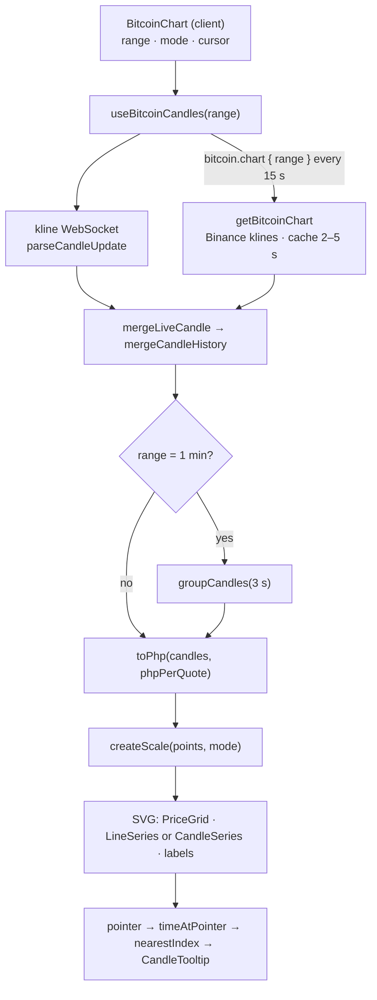

# 36 · Bitcoin price chart

Under the price, a chart shows Bitcoin's recent history in pesos as **candlesticks** (the default) or a **line**, over five ranges: **1 min, 1 hr, 1 wk, 1 mo, 1 yr**. The header shows the change over the range ("−0.40% past hour"). Moving a finger or the mouse over the chart shows a tooltip with that candle's open, high, low and close. Candles are loaded from the server, then kept moving by a live WebSocket stream. The whole chart is a hand-drawn SVG, with no chart library.

## At a glance

| | |
| --- | --- |
| **Route** | `/bitcoin` (the "Bitcoin price chart" box) |
| **Frontend** | `bitcoin-chart.tsx` (**client**: `BitcoinChart`, `PriceGrid`, `LineSeries`, `CandleSeries`, `CandleTooltip`, `ModeSwitch`, `RangeSwitch`), `bitcoin-chart-geometry.ts` (scales and shapes), `bitcoin-candles.ts` (live updates), hook `use-bitcoin-candles.ts`, `live-socket.ts` |
| **API** | `bitcoin.chart({ range })` (protected query, refetched every 15 s) |
| **Backend** | `bitcoin-market.server.ts` (`getBitcoinChart`: Binance `klines`, cached 2–5 s), `bitcoin.types.ts` (`BITCOIN_RANGES`, `BITCOIN_CANDLES`) |
| **External** | `data-api.binance.vision/api/v3/klines`; live: `wss://data-stream.binance.vision/ws/btcusdt@kline_<interval>` |
| **Database** | none |
| **Tests** | `bitcoin-chart-geometry.test.ts` (5 tests), `verify-bitcoin.ts` (the 1-hour chart has candles); checked in Chromium with stand-in data for this review |
| **Deep dive** | [Bitcoin §6–7](../05-features/12-bitcoin.md#7-drawing-the-chart-bitcoin-chart-geometryts) |

## What the user can do

| Control | Choices | Effect |
| --- | --- | --- |
| mode | **Candlestick chart** (default) · **Line chart** (`aria-pressed`) | redraws the same data |
| range | **1 min · 1 hr** (default) **· 1 wk · 1 mo · 1 yr** | loads other candles; the subtitle says which |
| pointer | move over the chart | a vertical line and a tooltip: "5,812,066.26 PHP · 11:08 AM · O … · H … · L … · C …" |
| leave | | the tooltip disappears |
| **Retry chart** | when no candles could load | refetches |

| Range | Candle size (from Binance) | Count | Subtitle |
| --- | --- | --- | --- |
| 1 min | 1 second, **grouped into 3 seconds** | 60 → 20 | "3-second candles · last 60 seconds" |
| 1 hr | 1 minute | 60 | "1-minute candles" |
| 1 wk | 1 hour | 168 | "1-hour candles" |
| 1 mo | 4 hours | 180 | "4-hour candles" |
| 1 yr | 1 day | 365 | "1-day candles" |

## How it works

1. `BitcoinChart` keeps `range` (`1H`), `mode` (`candles`) and the pointer's candle (`cursor`).
2. `useBitcoinCandles(range)` loads `bitcoin.chart({ range })` (the server asks Binance for `klines` and caches the answer 2–5 s). It also opens the matching **kline WebSocket**, which sends the candle currently forming.
3. Live candles are merged into the loaded history (`mergeLiveCandle`, then `mergeCandleHistory`) and trimmed to the range's count.
4. For **1 min**, the 60 one-second candles are grouped into 3-second candles (`groupCandles`), so each one is wide enough to see.
5. Prices are converted to pesos with the **current** quote's `phpPerQuote` (`toPhp`). Older candles are therefore shown at today's exchange rate, as the screen's footer says.
6. `createScale` maps time to x and price to y. The SVG draws a grid with peso labels, then candles or a filled line, then the first and last time labels.

## Structure



## Files and locations

| Layer | File | Role |
| --- | --- | --- |
| Frontend (client) | `gobank/src/features/bitcoin/components/bitcoin-chart.tsx` | the chart and its controls |
| Geometry | `gobank/src/features/bitcoin/bitcoin-chart-geometry.ts` | sizes, scales, paths, candle shapes, pointer math (pure, tested) |
| Live candles | `gobank/src/features/bitcoin/bitcoin-candles.ts` | parse, merge, group |
| Hook | `gobank/src/features/bitcoin/hooks/use-bitcoin-candles.ts` | query + socket |
| Socket | `gobank/src/features/bitcoin/live-socket.ts` | reconnecting WebSocket ([35 §6](35-bitcoin-price.md#6-reconnecting-with-back-off)) |
| Server | `gobank/src/features/bitcoin/bitcoin-market.server.ts` | `getBitcoinChart` |
| Types | `gobank/src/features/bitcoin/bitcoin.types.ts` | ranges and candle settings |
| Tests | `gobank/src/features/bitcoin/bitcoin-chart-geometry.test.ts` | geometry |

## Frontend

<!-- code: gobank/src/features/bitcoin/components/bitcoin-chart.tsx -->
**`gobank/src/features/bitcoin/components/bitcoin-chart.tsx`** · all 483 lines

```tsx
  1 │ "use client";
  2 │
  3 │ import { useId, useState, type PointerEvent, type ReactNode } from "react";
  4 │ import { CandlestickChart, ChartNoAxesCombined, RefreshCw } from "lucide-react";
  5 │ import { cn } from "~/shared/lib/cn";
  6 │ import { useBitcoinCandles } from "../hooks/use-bitcoin-candles";
  7 │ import { groupCandles } from "../bitcoin-candles";
  8 │ import {
  9 │   BITCOIN_CANDLES,
 10 │   BITCOIN_RANGES,
 11 │   money,
 12 │   type BitcoinCandle,
 13 │   type BitcoinQuote,
 14 │   type BitcoinRange,
 15 │ } from "../bitcoin.types";
 16 │ import {
 17 │   candleShape,
 18 │   CHART,
 19 │   createScale,
 20 │   DOWN_COLOR,
 21 │   FLAT_COLOR,
 22 │   gapPath,
 23 │   linePath,
 24 │   nearestIndex,
 25 │   PLOT_BOTTOM,
 26 │   timeAtPointer,
 27 │   toPhp,
 28 │   UP_COLOR,
 29 │   type ChartMode,
 30 │   type ChartScale,
 31 │ } from "../bitcoin-chart-geometry";
 32 │
 33 │ const AXIS_COLOR = "#878792";
 34 │ const GRID_LINES = [0, 1, 2, 3];
 35 │ const ONE_MINUTE_BUCKET_MS = 3_000;
 36 │
 37 │ const RANGE_BUTTON: Record<BitcoinRange, string> = {
 38 │   "1MIN": "1 min",
 39 │   "1H": "1 hr",
 40 │   "1W": "1 wk",
 41 │   "1M": "1 mo",
 42 │   "1Y": "1 yr",
 43 │ };
 44 │
 45 │ const RANGE_PERIOD: Record<BitcoinRange, string> = {
 46 │   "1MIN": "minute",
 47 │   "1H": "hour",
 48 │   "1W": "week",
 49 │   "1M": "30 days",
 50 │   "1Y": "year",
 51 │ };
 52 │
 53 │ const MODES: { id: ChartMode; label: string }[] = [
 54 │   { id: "line", label: "Line chart" },
 55 │   { id: "candles", label: "Candlestick chart" },
 56 │ ];
 57 │
 58 │ const CLOCK_TIME: Intl.DateTimeFormatOptions = {
 59 │   hour: "2-digit",
 60 │   minute: "2-digit",
 61 │   second: "2-digit",
 62 │ };
 63 │
 64 │ const centavos = (pesos: number) => Math.round(pesos * 100);
 65 │
 66 │ function timeLabel(time: number, range: BitcoinRange) {
 67 │   if (range === "1MIN") {
 68 │     return new Date(time).toLocaleString("en-US", {
 69 │       hour: "numeric",
 70 │       minute: "2-digit",
 71 │       second: "2-digit",
 72 │     });
 73 │   }
 74 │
 75 │   if (range === "1H") {
 76 │     return new Date(time).toLocaleString("en-US", {
 77 │       hour: "numeric",
 78 │       minute: "2-digit",
 79 │     });
 80 │   }
 81 │
 82 │   return new Date(time).toLocaleString("en-US", {
 83 │     month: "short",
 84 │     day: "numeric",
 85 │   });
 86 │ }
 87 │
 88 │ function priceAxisLabel(price: number, range: BitcoinRange) {
 89 │   const compact = new Intl.NumberFormat("en-US", {
 90 │     notation: "compact",
 91 │     maximumFractionDigits: range === "1MIN" ? 6 : 3,
 92 │   });
 93 │
 94 │   return `₱${compact.format(price)}`;
 95 │ }
 96 │
 97 │ function PriceGrid({
 98 │   scale,
 99 │   range,
100 │ }: {
101 │   scale: ChartScale;
102 │   range: BitcoinRange;
103 │ }) {
104 │   return GRID_LINES.map((index) => {
105 │     const price = scale.maximum - ((scale.maximum - scale.minimum) * index) / 3;
106 │     const lineY = scale.y(price);
107 │
108 │     return (
109 │       <g key={index}>
110 │         <line
111 │           x1={CHART.left}
112 │           x2={CHART.width - CHART.right}
113 │           y1={lineY}
114 │           y2={lineY}
115 │           stroke="#ffffff"
116 │           strokeOpacity=".065"
117 │         />
118 │         <text
119 │           x={CHART.width - CHART.right + 8}
120 │           y={lineY + 3}
121 │           fill={AXIS_COLOR}
122 │           fontSize="9"
123 │         >
124 │           {priceAxisLabel(price, range)}
125 │         </text>
126 │       </g>
127 │     );
128 │   });
129 │ }
130 │
131 │ function LineSeries({
132 │   points,
133 │   scale,
134 │   color,
135 │   gradientId,
136 │ }: {
137 │   points: BitcoinCandle[];
138 │   scale: ChartScale;
139 │   color: string;
140 │   gradientId: string;
141 │ }) {
142 │   const first = points[0];
143 │   const last = points.at(-1);
144 │   if (!first || !last) return null;
145 │
146 │   const path = linePath(points, scale);
147 │   const area = `${path} L${scale.x(last)},${PLOT_BOTTOM} L${scale.x(first)},${PLOT_BOTTOM} Z`;
148 │
149 │   return (
150 │     <>
151 │       <path d={area} fill={`url(#${gradientId})`} />
152 │       <path
153 │         d={path}
154 │         fill="none"
155 │         stroke={color}
156 │         strokeWidth="2"
157 │         strokeLinejoin="round"
158 │       />
159 │     </>
160 │   );
161 │ }
162 │
163 │ function CandleSeries({
164 │   points,
165 │   scale,
166 │ }: {
167 │   points: BitcoinCandle[];
168 │   scale: ChartScale;
169 │ }) {
170 │   return (
171 │     <>
172 │       <path
173 │         d={gapPath(points, scale)}
174 │         fill="none"
175 │         stroke={FLAT_COLOR}
176 │         strokeWidth="1.5"
177 │         strokeOpacity=".8"
178 │         strokeLinejoin="round"
179 │       />
180 │
181 │       {points.map((point) => {
182 │         const shape = candleShape(point, scale);
183 │         const centerX = scale.x(point);
184 │
185 │         return (
186 │           <g key={point.time} stroke={shape.color} fill={shape.color}>
187 │             <line
188 │               x1={centerX}
189 │               x2={centerX}
190 │               y1={scale.y(point.high)}
191 │               y2={scale.y(point.low)}
192 │               strokeWidth="1"
193 │             />
194 │             <rect
195 │               x={centerX - shape.bodyWidth / 2}
196 │               y={shape.bodyTop}
197 │               width={shape.bodyWidth}
198 │               height={shape.bodyHeight}
199 │               stroke="none"
200 │             />
201 │           </g>
202 │         );
203 │       })}
204 │     </>
205 │   );
206 │ }
207 │
208 │ function CandleTooltip({
209 │   candle,
210 │   range,
211 │ }: {
212 │   candle: BitcoinCandle;
213 │   range: BitcoinRange;
214 │ }) {
215 │   return (
216 │     <div className="bg-tile pointer-events-none absolute top-0 left-2 rounded-lg border border-white/10 px-2.5 py-1.5 text-[10px] shadow-lg">
217 │       <p className="font-semibold text-white">
218 │         {money(centavos(candle.close))} PHP
219 │       </p>
220 │       <p className="text-ink-muted">{timeLabel(candle.time, range)}</p>
221 │       <p className="text-ink-muted mt-1 text-[9px]">
222 │         O {money(centavos(candle.open))} · H {money(centavos(candle.high))}
223 │         <br />L {money(centavos(candle.low))} · C{" "}
224 │         {money(centavos(candle.close))}
225 │       </p>
226 │       {candle.volume === 0 ? (
227 │         <p className="text-ink-faint mt-1 text-[9px]">
228 │           No trades in this candle
229 │         </p>
230 │       ) : null}
231 │     </div>
232 │   );
233 │ }
234 │
235 │ function ModeSwitch({
236 │   selected,
237 │   onSelect,
238 │ }: {
239 │   selected: ChartMode;
240 │   onSelect: (mode: ChartMode) => void;
241 │ }) {
242 │   return (
243 │     <div className="flex rounded-lg bg-white/[.04] p-0.5">
244 │       {MODES.map(({ id, label }) => (
245 │         <button
246 │           key={id}
247 │           type="button"
248 │           aria-label={label}
249 │           aria-pressed={selected === id}
250 │           onClick={() => onSelect(id)}
251 │           className={cn(
252 │             "grid h-8 w-8 place-items-center rounded-md",
253 │             selected === id ? "bg-white/10 text-white" : "text-ink-muted",
254 │           )}
255 │         >
256 │           {id === "line" ? (
257 │             <ChartNoAxesCombined size={15} />
258 │           ) : (
259 │             <CandlestickChart size={15} />
260 │           )}
261 │         </button>
262 │       ))}
263 │     </div>
264 │   );
265 │ }
266 │
267 │ function RangeSwitch({
268 │   selected,
269 │   onSelect,
270 │ }: {
271 │   selected: BitcoinRange;
272 │   onSelect: (range: BitcoinRange) => void;
273 │ }) {
274 │   return (
275 │     <div
276 │       className="mt-1 flex justify-between gap-1"
277 │       aria-label="Chart time range"
278 │     >
279 │       {BITCOIN_RANGES.map((range) => (
280 │         <button
281 │           key={range}
282 │           type="button"
283 │           onClick={() => onSelect(range)}
284 │           aria-pressed={selected === range}
285 │           className={cn(
286 │             "min-h-10 flex-1 rounded-xl text-[11px] font-semibold transition-colors",
287 │             selected === range
288 │               ? "bg-mint/10 text-mint"
289 │               : "text-ink-muted hover:bg-white/5",
290 │           )}
291 │         >
292 │           {RANGE_BUTTON[range]}
293 │         </button>
294 │       ))}
295 │     </div>
296 │   );
297 │ }
298 │
299 │ function ChartMessage({ children }: { children: ReactNode }) {
300 │   return (
301 │     <div className="text-ink-muted grid h-[216px] place-items-center text-center text-[12px]">
302 │       {children}
303 │     </div>
304 │   );
305 │ }
306 │
307 │ export function BitcoinChart({ quote }: { quote?: BitcoinQuote }) {
308 │   const [range, setRange] = useState<BitcoinRange>("1H");
309 │   const [mode, setMode] = useState<ChartMode>("candles");
310 │   const [cursor, setCursor] = useState<number | null>(null);
311 │   const gradientId = useId().replaceAll(":", "");
312 │
313 │   const { chart, points: history, updatedAt } = useBitcoinCandles(range);
314 │
315 │   const candles =
316 │     range === "1MIN" ? groupCandles(history, ONE_MINUTE_BUCKET_MS) : history;
317 │   const points = quote ? toPhp(candles, quote.phpPerQuote) : [];
318 │   const first = points[0];
319 │   const last = points.at(-1);
320 │
321 │   const scale = createScale(points, mode);
322 │   const rising = Boolean(first && last && last.close >= first.close);
323 │   const color = rising ? UP_COLOR : DOWN_COLOR;
324 │   const change =
325 │     first && last ? ((last.close - first.open) / first.open) * 100 : null;
326 │   const selected =
327 │     cursor === null ? undefined : points[Math.min(cursor, points.length - 1)];
328 │
329 │   const loading = chart.isPending || (!quote && !chart.isError);
330 │   const subtitle =
331 │     range === "1MIN"
332 │       ? "3-second candles · last 60 seconds"
333 │       : BITCOIN_CANDLES[range].label;
334 │
335 │   const changeRange = (next: BitcoinRange) => {
336 │     setRange(next);
337 │     setCursor(null);
338 │   };
339 │
340 │   const changeMode = (next: ChartMode) => {
341 │     setMode(next);
342 │     setCursor(null);
343 │   };
344 │
345 │   const followPointer = (event: PointerEvent<SVGSVGElement>) => {
346 │     if (!first || !last) return;
347 │
348 │     const bounds = event.currentTarget.getBoundingClientRect();
349 │     const time = timeAtPointer(event.clientX, bounds, first.time, last.time);
350 │     setCursor(nearestIndex(points, time));
351 │   };
352 │
353 │   return (
354 │     <section
355 │       className="bg-card rounded-[24px] border border-white/[.07] p-4"
356 │       aria-label="Bitcoin price chart"
357 │     >
358 │       <div className="mb-3 flex items-center justify-between gap-2">
359 │         <p className="text-ink-muted text-[11px]">
360 │           {change === null ? (
361 │             "Price history"
362 │           ) : (
363 │             <>
364 │               <span style={{ color }}>
365 │                 {change >= 0 ? "+" : ""}
366 │                 {change.toFixed(2)}%
367 │               </span>{" "}
368 │               <span className="ml-1">past {RANGE_PERIOD[range]}</span>
369 │             </>
370 │           )}
371 │         </p>
372 │         <ModeSwitch selected={mode} onSelect={changeMode} />
373 │       </div>
374 │
375 │       <div className="mb-3 flex items-center justify-between gap-2 text-[9px]">
376 │         <span className="text-ink-faint">{subtitle}</span>
377 │       </div>
378 │
379 │       <div className="relative min-h-[216px]">
380 │         {loading ? (
381 │           <ChartMessage>
382 │             <span className="animate-pulse">Loading PHP market history…</span>
383 │           </ChartMessage>
384 │         ) : null}
385 │
386 │         {!loading && (!first || !last) ? (
387 │           <ChartMessage>
388 │             <div>
389 │               <p>Chart unavailable</p>
390 │               <button
391 │                 type="button"
392 │                 onClick={() => void chart.refetch()}
393 │                 className="text-mint mt-3 inline-flex items-center gap-2"
394 │               >
395 │                 <RefreshCw size={14} /> Retry chart
396 │               </button>
397 │             </div>
398 │           </ChartMessage>
399 │         ) : null}
400 │
401 │         {!loading && first && last ? (
402 │           <>
403 │             <svg
404 │               viewBox={`0 0 ${CHART.width} ${CHART.height}`}
405 │               className="w-full touch-pan-y"
406 │               role="img"
407 │               aria-label={`Bitcoin ${range} ${mode} chart. First close ${money(centavos(first.close))}, latest close ${money(centavos(last.close))} PHP.`}
408 │               onPointerLeave={() => setCursor(null)}
409 │               onPointerMove={followPointer}
410 │             >
411 │               <defs>
412 │                 <linearGradient id={gradientId} x1="0" y1="0" x2="0" y2="1">
413 │                   <stop offset="0%" stopColor={color} stopOpacity=".22" />
414 │                   <stop offset="100%" stopColor={color} stopOpacity="0" />
415 │                 </linearGradient>
416 │               </defs>
417 │
418 │               <PriceGrid scale={scale} range={range} />
419 │
420 │               {mode === "line" ? (
421 │                 <LineSeries
422 │                   points={points}
423 │                   scale={scale}
424 │                   color={color}
425 │                   gradientId={gradientId}
426 │                 />
427 │               ) : (
428 │                 <CandleSeries points={points} scale={scale} />
429 │               )}
430 │
431 │               <text
432 │                 x={CHART.left}
433 │                 y={CHART.height - 4}
434 │                 fill={AXIS_COLOR}
435 │                 fontSize="9"
436 │               >
437 │                 {timeLabel(first.time, range)}
438 │               </text>
439 │               <text
440 │                 x={CHART.width - CHART.right}
441 │                 y={CHART.height - 4}
442 │                 textAnchor="end"
443 │                 fill={AXIS_COLOR}
444 │                 fontSize="9"
445 │               >
446 │                 {timeLabel(last.time, range)}
447 │               </text>
448 │
449 │               {selected ? (
450 │                 <line
451 │                   x1={scale.x(selected)}
452 │                   x2={scale.x(selected)}
453 │                   y1={CHART.top}
454 │                   y2={PLOT_BOTTOM}
455 │                   stroke="#ffffff"
456 │                   strokeOpacity=".4"
457 │                 />
458 │               ) : null}
459 │             </svg>
460 │
461 │             {selected ? (
462 │               <CandleTooltip candle={selected} range={range} />
463 │             ) : null}
464 │           </>
465 │         ) : null}
466 │       </div>
467 │
468 │       <RangeSwitch selected={range} onSelect={changeRange} />
469 │
470 │       {updatedAt > 0 ? (
471 │         <p className="text-ink-faint mt-2 text-[9px]">
472 │           Updated {new Date(updatedAt).toLocaleTimeString("en-US", CLOCK_TIME)}
473 │         </p>
474 │       ) : null}
475 │
476 │       {chart.isError && chart.data ? (
477 │         <p className="mt-2 text-[10px] text-amber-300">
478 │           Chart refresh failed. Showing the last loaded history.
479 │         </p>
480 │       ) : null}
481 │     </section>
482 │   );
483 │ }
```
<!-- /code -->

<!-- code: gobank/src/features/bitcoin/bitcoin-chart-geometry.ts -->
**`gobank/src/features/bitcoin/bitcoin-chart-geometry.ts`** · all 136 lines

```ts
  1 │ import type { BitcoinCandle } from "./bitcoin.types";
  2 │
  3 │ export type ChartMode = "line" | "candles";
  4 │
  5 │ export const CHART = {
  6 │   width: 360,
  7 │   height: 216,
  8 │   left: 12,
  9 │   right: 68,
 10 │   top: 16,
 11 │   bottom: 26,
 12 │ };
 13 │
 14 │ const PLOT_WIDTH = CHART.width - CHART.left - CHART.right;
 15 │ export const PLOT_BOTTOM = CHART.height - CHART.bottom;
 16 │
 17 │ const PLOT_HEIGHT = CHART.height - CHART.top - CHART.bottom;
 18 │ const PADDING_RATIO = 0.12;
 19 │ const FLAT_PIXELS = 1.5;
 20 │
 21 │ export const UP_COLOR = "#56e3b1";
 22 │ export const DOWN_COLOR = "#fb7185";
 23 │ export const FLAT_COLOR = "#87b9a5";
 24 │
 25 │ const clamp = (value: number, min: number, max: number) =>
 26 │   Math.min(max, Math.max(min, value));
 27 │
 28 │ export const toPhp = (candles: BitcoinCandle[], phpPerQuote: number) =>
 29 │   candles.map((candle) => ({
 30 │     ...candle,
 31 │     open: candle.open * phpPerQuote,
 32 │     high: candle.high * phpPerQuote,
 33 │     low: candle.low * phpPerQuote,
 34 │     close: candle.close * phpPerQuote,
 35 │   }));
 36 │
 37 │ export function createScale(points: BitcoinCandle[], mode: ChartMode) {
 38 │   const lows = points.map((point) =>
 39 │     mode === "candles" ? point.low : point.close,
 40 │   );
 41 │   const highs = points.map((point) =>
 42 │     mode === "candles" ? point.high : point.close,
 43 │   );
 44 │   const low = Math.min(...lows);
 45 │   const high = Math.max(...highs);
 46 │
 47 │   const spread = Math.max(high - low, high * 0.00001, 0.01);
 48 │   const minimum = low - spread * PADDING_RATIO;
 49 │   const maximum = high + spread * PADDING_RATIO;
 50 │
 51 │   const firstTime = points[0]?.time ?? 0;
 52 │   const lastTime = points.at(-1)?.time ?? 0;
 53 │   const timeSpan = Math.max(1, lastTime - firstTime);
 54 │
 55 │   const y = (price: number) =>
 56 │     CHART.top + ((maximum - price) / (maximum - minimum)) * PLOT_HEIGHT;
 57 │
 58 │   const x = (point: BitcoinCandle) =>
 59 │     CHART.left + ((point.time - firstTime) / timeSpan) * PLOT_WIDTH;
 60 │
 61 │   const slot = PLOT_WIDTH / Math.max(points.length - 1, 1);
 62 │   const candleWidth = Math.min(12, Math.max(1, slot * 0.72));
 63 │
 64 │   return { x, y, minimum, maximum, slot, candleWidth };
 65 │ }
 66 │
 67 │ export type ChartScale = ReturnType<typeof createScale>;
 68 │
 69 │ export const linePath = (points: BitcoinCandle[], scale: ChartScale) =>
 70 │   points
 71 │     .map((point, index) => {
 72 │       const command = index === 0 ? "M" : "L";
 73 │       return `${command}${scale.x(point).toFixed(2)},${scale.y(point.close).toFixed(2)}`;
 74 │     })
 75 │     .join(" ");
 76 │
 77 │ export function gapPath(points: BitcoinCandle[], scale: ChartScale) {
 78 │   return points
 79 │     .map((point, index) => {
 80 │       const previous = points[index - 1];
 81 │       if (!previous) return "";
 82 │
 83 │       const jump = Math.abs(scale.y(point.open) - scale.y(previous.close));
 84 │       if (jump >= FLAT_PIXELS) return "";
 85 │
 86 │       return `M${scale.x(previous)},${scale.y(previous.close)} L${scale.x(point)},${scale.y(point.open)}`;
 87 │     })
 88 │     .join(" ");
 89 │ }
 90 │
 91 │ export function candleShape(point: BitcoinCandle, scale: ChartScale) {
 92 │   const openY = scale.y(point.open);
 93 │   const closeY = scale.y(point.close);
 94 │
 95 │   const flat =
 96 │     Math.abs(openY - closeY) < FLAT_PIXELS &&
 97 │     Math.abs(scale.y(point.high) - scale.y(point.low)) < FLAT_PIXELS * 2;
 98 │
 99 │   const bodyWidth = flat ? Math.min(20, scale.slot + 0.5) : scale.candleWidth;
100 │   const bodyHeight = flat ? FLAT_PIXELS : Math.max(3, Math.abs(openY - closeY));
101 │
102 │   let color = point.close >= point.open ? UP_COLOR : DOWN_COLOR;
103 │   if (flat) color = FLAT_COLOR;
104 │
105 │   return {
106 │     color,
107 │     bodyWidth,
108 │     bodyHeight,
109 │     bodyTop: (openY + closeY - bodyHeight) / 2,
110 │   };
111 │ }
112 │
113 │ export function timeAtPointer(
114 │   clientX: number,
115 │   bounds: DOMRect,
116 │   firstTime: number,
117 │   lastTime: number,
118 │ ) {
119 │   const chartX = ((clientX - bounds.left) / bounds.width) * CHART.width;
120 │   const position = clamp((chartX - CHART.left) / PLOT_WIDTH, 0, 1);
121 │
122 │   return firstTime + position * (lastTime - firstTime);
123 │ }
124 │
125 │ export function nearestIndex(points: BitcoinCandle[], time: number) {
126 │   let nearest = 0;
127 │
128 │   points.forEach((point, index) => {
129 │     const best = points[nearest];
130 │     if (best && Math.abs(point.time - time) < Math.abs(best.time - time)) {
131 │       nearest = index;
132 │     }
133 │   });
134 │
135 │   return nearest;
136 │ }
```
<!-- /code -->

<!-- code: gobank/src/features/bitcoin/bitcoin-candles.ts -->
**`gobank/src/features/bitcoin/bitcoin-candles.ts`** · all 113 lines

```ts
  1 │ import { z } from "zod";
  2 │ import { quoteIsFresh, type BitcoinCandle } from "./bitcoin.types";
  3 │
  4 │ const price = z.coerce.number().finite().positive();
  5 │
  6 │ const binanceKlineMessage = z.object({
  7 │   e: z.literal("kline"),
  8 │   E: z.number().int().positive(),
  9 │   s: z.literal("BTCUSDT"),
 10 │   k: z.object({
 11 │     t: z.number().int().positive(),
 12 │     s: z.literal("BTCUSDT"),
 13 │     i: z.string(),
 14 │     o: price,
 15 │     h: price,
 16 │     l: price,
 17 │     c: price,
 18 │     v: z.coerce.number().finite().nonnegative(),
 19 │   }),
 20 │ });
 21 │
 22 │ export function parseCandleUpdate(
 23 │   value: unknown,
 24 │   interval: string,
 25 │   now: number,
 26 │ ) {
 27 │   const parsed = binanceKlineMessage.safeParse(value);
 28 │   if (!parsed.success) return null;
 29 │
 30 │   const { E: sentAt, k: kline } = parsed.data;
 31 │   const candle: BitcoinCandle = {
 32 │     time: kline.t,
 33 │     open: kline.o,
 34 │     high: kline.h,
 35 │     low: kline.l,
 36 │     close: kline.c,
 37 │     volume: kline.v,
 38 │   };
 39 │
 40 │   const wrongInterval = kline.i !== interval;
 41 │   const stale = !quoteIsFresh(sentAt, now);
 42 │   const startsAfterItWasSent = candle.time > sentAt;
 43 │   const impossibleRange =
 44 │     candle.low > Math.min(candle.open, candle.close) ||
 45 │     candle.high < Math.max(candle.open, candle.close);
 46 │
 47 │   if (wrongInterval || stale || startsAfterItWasSent || impossibleRange) {
 48 │     return null;
 49 │   }
 50 │
 51 │   return { asOf: sentAt, candle };
 52 │ }
 53 │
 54 │ export function mergeLiveCandle(
 55 │   points: BitcoinCandle[],
 56 │   candle: BitcoinCandle,
 57 │   limit: number,
 58 │ ) {
 59 │   const last = points.at(-1);
 60 │   if (!last) return [candle];
 61 │
 62 │   if (candle.time < last.time) {
 63 │     return points.map((point) => (point.time === candle.time ? candle : point));
 64 │   }
 65 │
 66 │   const replacesLast = candle.time === last.time;
 67 │   const merged = replacesLast
 68 │     ? [...points.slice(0, -1), candle]
 69 │     : [...points, candle];
 70 │
 71 │   return merged.slice(-limit);
 72 │ }
 73 │
 74 │ export function mergeCandleHistory(
 75 │   history: BitcoinCandle[],
 76 │   updates: BitcoinCandle[],
 77 │   limit: number,
 78 │ ) {
 79 │   const byTime = new Map(history.map((point) => [point.time, point]));
 80 │
 81 │   for (const update of updates) {
 82 │     const existing = byTime.get(update.time);
 83 │     const isNewer = !existing || update.volume >= existing.volume;
 84 │
 85 │     if (isNewer) byTime.set(update.time, update);
 86 │   }
 87 │
 88 │   return [...byTime.values()].sort((a, b) => a.time - b.time).slice(-limit);
 89 │ }
 90 │
 91 │ export function groupCandles(points: BitcoinCandle[], intervalMs: number) {
 92 │   const groups = new Map<number, BitcoinCandle>();
 93 │
 94 │   for (const point of points) {
 95 │     const bucket = Math.floor(point.time / intervalMs) * intervalMs;
 96 │     const existing = groups.get(bucket);
 97 │
 98 │     if (!existing) {
 99 │       groups.set(bucket, { ...point });
100 │       continue;
101 │     }
102 │
103 │     groups.set(bucket, {
104 │       ...existing,
105 │       high: Math.max(existing.high, point.high),
106 │       low: Math.min(existing.low, point.low),
107 │       close: point.close,
108 │       volume: existing.volume + point.volume,
109 │     });
110 │   }
111 │
112 │   return [...groups.values()];
113 │ }
```
<!-- /code -->

<!-- code: gobank/src/features/bitcoin/hooks/use-bitcoin-candles.ts -->
**`gobank/src/features/bitcoin/hooks/use-bitcoin-candles.ts`** · all 76 lines

```ts
 1 │ "use client";
 2 │
 3 │ import { useEffect, useMemo, useState } from "react";
 4 │ import { api } from "~/trpc/react";
 5 │ import {
 6 │   mergeCandleHistory,
 7 │   mergeLiveCandle,
 8 │   parseCandleUpdate,
 9 │ } from "../bitcoin-candles";
10 │ import {
11 │   BITCOIN_CANDLES,
12 │   type BitcoinCandle,
13 │   type BitcoinRange,
14 │ } from "../bitcoin.types";
15 │ import { openLiveSocket } from "../live-socket";
16 │
17 │ type LiveUpdates = {
18 │   range: BitcoinRange;
19 │   points: BitcoinCandle[];
20 │   asOf: number;
21 │ };
22 │
23 │ const CHART_REFRESH = {
24 │   staleTime: 15_000,
25 │   refetchInterval: 15_000,
26 │   retry: 1,
27 │ };
28 │
29 │ const klineUrl = (interval: string) =>
30 │   `wss://data-stream.binance.vision/ws/btcusdt@kline_${interval}`;
31 │
32 │ export function useBitcoinCandles(range: BitcoinRange) {
33 │   const chart = api.bitcoin.chart.useQuery({ range }, CHART_REFRESH);
34 │   const [updates, setUpdates] = useState<LiveUpdates | null>(null);
35 │   const { interval, limit } = BITCOIN_CANDLES[range];
36 │
37 │   useEffect(() => {
38 │     let latestEvent = 0;
39 │
40 │     const live = openLiveSocket(klineUrl(interval), {
41 │       onMessage: (message) => {
42 │         const result = parseCandleUpdate(message, interval, Date.now());
43 │         if (!result || result.asOf <= latestEvent) return;
44 │
45 │         latestEvent = result.asOf;
46 │         setUpdates((previous) => {
47 │           const sameRange = previous?.range === range ? previous.points : [];
48 │
49 │           return {
50 │             range,
51 │             points: mergeLiveCandle(sameRange, result.candle, limit),
52 │             asOf: result.asOf,
53 │           };
54 │         });
55 │       },
56 │     });
57 │
58 │     return () => live.stop();
59 │   }, [range, interval, limit]);
60 │
61 │   const liveForThisRange = updates?.range === range ? updates : null;
62 │
63 │   const points = useMemo(
64 │     () =>
65 │       mergeCandleHistory(
66 │         chart.data ?? [],
67 │         liveForThisRange?.points ?? [],
68 │         limit,
69 │       ),
70 │     [chart.data, liveForThisRange, limit],
71 │   );
72 │
73 │   const updatedAt = Math.max(chart.dataUpdatedAt, liveForThisRange?.asOf ?? 0);
74 │
75 │   return { chart, points, updatedAt };
76 │ }
```
<!-- /code -->

## Backend

<!-- code: gobank/src/features/bitcoin/bitcoin.router.ts 26-28 -->
**`gobank/src/features/bitcoin/bitcoin.router.ts`** · lines 26–28

```ts
26 │   chart: protectedProcedure
27 │     .input(z.object({ range: z.enum(BITCOIN_RANGES) }))
28 │     .query(({ input }) => getBitcoinChart(input.range)),
```
<!-- /code -->

<!-- code: gobank/src/features/bitcoin/bitcoin-market.server.ts 107-126 -->
**`gobank/src/features/bitcoin/bitcoin-market.server.ts`** · lines 107–126

```ts
107 │ export function getBitcoinChart(range: BitcoinRange) {
108 │   const { interval, limit } = BITCOIN_CANDLES[range];
109 │   return chartCache(range, () =>
110 │     read(
111 │       `klines?symbol=BTCUSDT&interval=${interval}&limit=${limit}`,
112 │       z.array(candle).min(2),
113 │     ).then((rows) =>
114 │       rows
115 │         .map(([time, open, high, low, close, volume]) => ({
116 │           time,
117 │           open,
118 │           high,
119 │           low,
120 │           close,
121 │           volume,
122 │         }))
123 │         .sort((a, b) => a.time - b.time),
124 │     ),
125 │   );
126 │ }
```
<!-- /code -->

<!-- code: gobank/src/features/bitcoin/bitcoin.types.ts 1-18 -->
**`gobank/src/features/bitcoin/bitcoin.types.ts`** · lines 1–18

```ts
 1 │ export const BITCOIN_RANGES = ["1MIN", "1H", "1W", "1M", "1Y"] as const;
 2 │
 3 │ export type BitcoinRange = (typeof BITCOIN_RANGES)[number];
 4 │
 5 │ export const BITCOIN_CANDLES: Record<
 6 │   BitcoinRange,
 7 │   { interval: string; limit: number; label: string }
 8 │ > = {
 9 │   "1MIN": {
10 │     interval: "1s",
11 │     limit: 60,
12 │     label: "1-second candles · last 60 seconds",
13 │   },
14 │   "1H": { interval: "1m", limit: 60, label: "1-minute candles" },
15 │   "1W": { interval: "1h", limit: 168, label: "1-hour candles" },
16 │   "1M": { interval: "4h", limit: 180, label: "4-hour candles" },
17 │   "1Y": { interval: "1d", limit: 365, label: "1-day candles" },
18 │ };
```
<!-- /code -->

## Database

None. Candles come from Binance every time (through a short cache) and are never stored.

## The complicated parts, explained step by step

### 1. From prices to pixels

<!-- code: gobank/src/features/bitcoin/bitcoin-chart-geometry.ts 5-17 -->
**`gobank/src/features/bitcoin/bitcoin-chart-geometry.ts`** · lines 5–17

```ts
 5 │ export const CHART = {
 6 │   width: 360,
 7 │   height: 216,
 8 │   left: 12,
 9 │   right: 68,
10 │   top: 16,
11 │   bottom: 26,
12 │ };
13 │
14 │ const PLOT_WIDTH = CHART.width - CHART.left - CHART.right;
15 │ export const PLOT_BOTTOM = CHART.height - CHART.bottom;
16 │
17 │ const PLOT_HEIGHT = CHART.height - CHART.top - CHART.bottom;
```
<!-- /code -->

<!-- code: gobank/src/features/bitcoin/bitcoin-chart-geometry.ts 37-65 -->
**`gobank/src/features/bitcoin/bitcoin-chart-geometry.ts`** · lines 37–65

```ts
37 │ export function createScale(points: BitcoinCandle[], mode: ChartMode) {
38 │   const lows = points.map((point) =>
39 │     mode === "candles" ? point.low : point.close,
40 │   );
41 │   const highs = points.map((point) =>
42 │     mode === "candles" ? point.high : point.close,
43 │   );
44 │   const low = Math.min(...lows);
45 │   const high = Math.max(...highs);
46 │
47 │   const spread = Math.max(high - low, high * 0.00001, 0.01);
48 │   const minimum = low - spread * PADDING_RATIO;
49 │   const maximum = high + spread * PADDING_RATIO;
50 │
51 │   const firstTime = points[0]?.time ?? 0;
52 │   const lastTime = points.at(-1)?.time ?? 0;
53 │   const timeSpan = Math.max(1, lastTime - firstTime);
54 │
55 │   const y = (price: number) =>
56 │     CHART.top + ((maximum - price) / (maximum - minimum)) * PLOT_HEIGHT;
57 │
58 │   const x = (point: BitcoinCandle) =>
59 │     CHART.left + ((point.time - firstTime) / timeSpan) * PLOT_WIDTH;
60 │
61 │   const slot = PLOT_WIDTH / Math.max(points.length - 1, 1);
62 │   const candleWidth = Math.min(12, Math.max(1, slot * 0.72));
63 │
64 │   return { x, y, minimum, maximum, slot, candleWidth };
65 │ }
```
<!-- /code -->

The SVG is 360 × 216 units, and the **plot** is the inside: x from 12 to 292 (280 wide, room for the price labels on the right), y from 16 to 190 (174 tall). A trace with three candles closing at 100, 110 and 105, run with the project's function:

| Step | Line mode | Candle mode |
| --- | --- | --- |
| lowest / highest value used | closes: 100 / 110 | lows and highs: 99 / 111 |
| spread × 12% padding | 10 × 0.12 = 1.2 | 12 × 0.12 = 1.44 |
| `minimum` / `maximum` | **98.80 / 111.20** | 97.56 / 112.44 |
| `y(maximum)` / `y(minimum)` | **16** (top) / **190** (bottom) | same |
| `x(first)` / `x(last)` | **12** / **292** | same |

`y` is "upside down" on purpose: SVG's y grows **downward**, so `(maximum − price) / (maximum − minimum)` puts high prices near the top. The real line path for the three closes:

```text
M12.00,173.16 L152.00,32.84 L292.00,103.00
```

The 12% padding keeps the highest candle off the top edge. `Math.max(high − low, high × 0.00001, 0.01)` keeps a perfectly flat range from dividing by zero.

### 2. Candle shapes and colors

<!-- code: gobank/src/features/bitcoin/bitcoin-chart-geometry.ts 91-111 -->
**`gobank/src/features/bitcoin/bitcoin-chart-geometry.ts`** · lines 91–111

```ts
 91 │ export function candleShape(point: BitcoinCandle, scale: ChartScale) {
 92 │   const openY = scale.y(point.open);
 93 │   const closeY = scale.y(point.close);
 94 │
 95 │   const flat =
 96 │     Math.abs(openY - closeY) < FLAT_PIXELS &&
 97 │     Math.abs(scale.y(point.high) - scale.y(point.low)) < FLAT_PIXELS * 2;
 98 │
 99 │   const bodyWidth = flat ? Math.min(20, scale.slot + 0.5) : scale.candleWidth;
100 │   const bodyHeight = flat ? FLAT_PIXELS : Math.max(3, Math.abs(openY - closeY));
101 │
102 │   let color = point.close >= point.open ? UP_COLOR : DOWN_COLOR;
103 │   if (flat) color = FLAT_COLOR;
104 │
105 │   return {
106 │     color,
107 │     bodyWidth,
108 │     bodyHeight,
109 │     bodyTop: (openY + closeY - bodyHeight) / 2,
110 │   };
111 │ }
```
<!-- /code -->

| Candle | Color | Body |
| --- | --- | --- |
| close ≥ open (100 → 110) | **#56e3b1** (mint, up) | from open to close, at least 3 units tall |
| close < open (110 → 105) | **#fb7185** (rose, down) | |
| open ≈ close **and** high ≈ low (less than 1.5 and 3 units apart) | **#87b9a5** (muted, flat) | a thin bar 1.5 units tall, wider (up to 20) so it stays visible |

The width: `slot = 280 ÷ (count − 1)` and `candleWidth = min(12, max(1, slot × 0.72))`. With 60 candles, slot = 4.75 and width = **3.42**. With 3 candles, the width is capped at 12. In Chromium, the 1-hour chart drew **60** candles. The thin "wick" line goes from `y(high)` to `y(low)`. `gapPath` (lines 77–89) draws a faint connector where a candle opens almost exactly at the previous close, so flat stretches still read as one line.

### 3. The live candle: merge, don't duplicate

<!-- code: gobank/src/features/bitcoin/bitcoin-candles.ts 54-89 -->
**`gobank/src/features/bitcoin/bitcoin-candles.ts`** · lines 54–89

```ts
54 │ export function mergeLiveCandle(
55 │   points: BitcoinCandle[],
56 │   candle: BitcoinCandle,
57 │   limit: number,
58 │ ) {
59 │   const last = points.at(-1);
60 │   if (!last) return [candle];
61 │
62 │   if (candle.time < last.time) {
63 │     return points.map((point) => (point.time === candle.time ? candle : point));
64 │   }
65 │
66 │   const replacesLast = candle.time === last.time;
67 │   const merged = replacesLast
68 │     ? [...points.slice(0, -1), candle]
69 │     : [...points, candle];
70 │
71 │   return merged.slice(-limit);
72 │ }
73 │
74 │ export function mergeCandleHistory(
75 │   history: BitcoinCandle[],
76 │   updates: BitcoinCandle[],
77 │   limit: number,
78 │ ) {
79 │   const byTime = new Map(history.map((point) => [point.time, point]));
80 │
81 │   for (const update of updates) {
82 │     const existing = byTime.get(update.time);
83 │     const isNewer = !existing || update.volume >= existing.volume;
84 │
85 │     if (isNewer) byTime.set(update.time, update);
86 │   }
87 │
88 │   return [...byTime.values()].sort((a, b) => a.time - b.time).slice(-limit);
89 │ }
```
<!-- /code -->

The kline stream sends the **current** candle again and again as it grows. Results from the project's functions:

| Live message | `mergeLiveCandle` result |
| --- | --- |
| same `time` as the last candle | **replaces** the last candle (closes `1,2` → `1,3`) |
| a newer `time` | **appended** (times 0, 1 → 0, 1, 2) |
| beyond the range's count (limit 3 here) | the oldest drops off (0, 1, 2, 3 → 1, 2, 3) |
| an older `time` | replaces that candle in place |

`mergeCandleHistory` then merges these live candles into the server's history **by time**. If both have a candle for the same minute, the one with the **larger volume** wins, because a forming candle only gains volume. An update with less volume is older news: a history candle with volume 10 kept its close 1 against a live one with volume 4.

<!-- code: gobank/src/features/bitcoin/bitcoin-candles.ts 22-52 -->
**`gobank/src/features/bitcoin/bitcoin-candles.ts`** · lines 22–52

```ts
22 │ export function parseCandleUpdate(
23 │   value: unknown,
24 │   interval: string,
25 │   now: number,
26 │ ) {
27 │   const parsed = binanceKlineMessage.safeParse(value);
28 │   if (!parsed.success) return null;
29 │
30 │   const { E: sentAt, k: kline } = parsed.data;
31 │   const candle: BitcoinCandle = {
32 │     time: kline.t,
33 │     open: kline.o,
34 │     high: kline.h,
35 │     low: kline.l,
36 │     close: kline.c,
37 │     volume: kline.v,
38 │   };
39 │
40 │   const wrongInterval = kline.i !== interval;
41 │   const stale = !quoteIsFresh(sentAt, now);
42 │   const startsAfterItWasSent = candle.time > sentAt;
43 │   const impossibleRange =
44 │     candle.low > Math.min(candle.open, candle.close) ||
45 │     candle.high < Math.max(candle.open, candle.close);
46 │
47 │   if (wrongInterval || stale || startsAfterItWasSent || impossibleRange) {
48 │     return null;
49 │   }
50 │
51 │   return { asOf: sentAt, candle };
52 │ }
```
<!-- /code -->

`parseCandleUpdate` drops any message that is for another interval, stale (by the 60-second rule, [35 §3](35-bitcoin-price.md#3-what-fresh-means)), "starts after it was sent", or impossible (a high below the close, a low above the open). All four were checked with the real function: a good message passed, and each bad one returned `null`.

### 4. The 1-minute view groups seconds into 3-second candles

<!-- code: gobank/src/features/bitcoin/bitcoin-candles.ts 91-113 -->
**`gobank/src/features/bitcoin/bitcoin-candles.ts`** · lines 91–113

```ts
 91 │ export function groupCandles(points: BitcoinCandle[], intervalMs: number) {
 92 │   const groups = new Map<number, BitcoinCandle>();
 93 │
 94 │   for (const point of points) {
 95 │     const bucket = Math.floor(point.time / intervalMs) * intervalMs;
 96 │     const existing = groups.get(bucket);
 97 │
 98 │     if (!existing) {
 99 │       groups.set(bucket, { ...point });
100 │       continue;
101 │     }
102 │
103 │     groups.set(bucket, {
104 │       ...existing,
105 │       high: Math.max(existing.high, point.high),
106 │       low: Math.min(existing.low, point.low),
107 │       close: point.close,
108 │       volume: existing.volume + point.volume,
109 │     });
110 │   }
111 │
112 │   return [...groups.values()];
113 │ }
```
<!-- /code -->

| Input | Output |
| --- | --- |
| 60 one-second candles | **20** candles (`Math.floor(time / 3000) × 3000` buckets) |
| a bucket's candles at 0 s, 1 s, 2 s | open of the first, highest high, lowest low, **close of the last**, volumes added: `{"time":0,"open":100,"high":103,"low":99,"close":102.5,"volume":3}` |

Sixty bars in 280 units would be under 3.5 units each. Twenty are wide enough to read.

### 5. The pointer finds the nearest candle

<!-- code: gobank/src/features/bitcoin/bitcoin-chart-geometry.ts 113-136 -->
**`gobank/src/features/bitcoin/bitcoin-chart-geometry.ts`** · lines 113–136

```ts
113 │ export function timeAtPointer(
114 │   clientX: number,
115 │   bounds: DOMRect,
116 │   firstTime: number,
117 │   lastTime: number,
118 │ ) {
119 │   const chartX = ((clientX - bounds.left) / bounds.width) * CHART.width;
120 │   const position = clamp((chartX - CHART.left) / PLOT_WIDTH, 0, 1);
121 │
122 │   return firstTime + position * (lastTime - firstTime);
123 │ }
124 │
125 │ export function nearestIndex(points: BitcoinCandle[], time: number) {
126 │   let nearest = 0;
127 │
128 │   points.forEach((point, index) => {
129 │     const best = points[nearest];
130 │     if (best && Math.abs(point.time - time) < Math.abs(best.time - time)) {
131 │       nearest = index;
132 │     }
133 │   });
134 │
135 │   return nearest;
136 │ }
```
<!-- /code -->

With the chart 360 px wide on screen and candles at 0, 60 s and 120 s:

| Pointer x (px) | Chart x | Position in the plot | Time | Nearest candle |
| --- | --- | --- | --- | --- |
| 0 | 0 | clamped to 0 | 0 | #0 |
| 12 | 12 | 0 | 0 | #0 |
| 152 | 152 | 0.5 | 60,000 | **#1** |
| 292 | 292 | 1 | 120,000 | #2 |
| 360 | 360 | clamped to 1 | 120,000 | #2 |

`clientX` is first scaled from **screen** pixels to **chart** units (`× CHART.width ÷ bounds.width`), so it works at any size. `touch-pan-y` lets a finger still scroll the page up and down while moving sideways over the chart. In Chromium, hovering the middle showed a tooltip like "5,812,066.26 PHP · 11:08 AM · O 5,820,061.46 · H 5,823,571.46 · L 5,808,556.26 · C 5,812,066.26".

### 6. Accessible, even though it is a drawing

<!-- code: gobank/src/features/bitcoin/components/bitcoin-chart.tsx 401-410 -->
**`gobank/src/features/bitcoin/components/bitcoin-chart.tsx`** · lines 401–410

```tsx
401 │         {!loading && first && last ? (
402 │           <>
403 │             <svg
404 │               viewBox={`0 0 ${CHART.width} ${CHART.height}`}
405 │               className="w-full touch-pan-y"
406 │               role="img"
407 │               aria-label={`Bitcoin ${range} ${mode} chart. First close ${money(centavos(first.close))}, latest close ${money(centavos(last.close))} PHP.`}
408 │               onPointerLeave={() => setCursor(null)}
409 │               onPointerMove={followPointer}
410 │             >
```
<!-- /code -->

The SVG is `role="img"` with a sentence for screen readers. In Chromium it read: "Bitcoin 1H candles chart. First close 5,838,984.45, latest close 5,807,203.74 PHP." The mode buttons have names ("Line chart", "Candlestick chart") and `aria-pressed`. The range buttons have `aria-pressed`. Their container's label is one of the labels on an element without a role ([Limitations](../09-defense/03-limitations-and-future-work.md#3-product-and-ux-limitations)).

## Rules and limits

| Rule | Value |
| --- | --- |
| Ranges | 1 min (60 × 1 s → 20 × 3 s), 1 hr (60 × 1 min), 1 wk (168 × 1 h), 1 mo (180 × 4 h), 1 yr (365 × 1 day) |
| Server cache | 2 s for 1 min, 5 s for the others |
| Browser refresh | every 15 s, plus the live candle stream |
| Conversion | the **current** USD→PHP rate for every candle |
| Default | 1 hr, candlesticks |

## Messages

| Text | When |
| --- | --- |
| −0.40% past hour · Price history | header (with data, seen in Chromium · while loading) |
| 1-minute candles · 3-second candles · last 60 seconds · … | subtitle |
| Loading PHP market history… | loading |
| Chart unavailable · Retry chart | no candles |
| Chart refresh failed. Showing the last loaded history. | a refresh failed after an earlier success |
| Updated 11:31:05 AM | last update |
| No trades in this candle | tooltip of a candle with zero volume |

## Tests

`bitcoin-chart-geometry.test.ts` (unit):

| Test | Checks |
| --- | --- |
| the first and last candles sit at the edges of the plot | `x(first) = CHART.left` (12), `x(last) = CHART.width − CHART.right` (292) |
| higher prices are drawn higher on the chart | `y` decreases as the price rises |
| the pointer picks the closest candle in time | candles at 0 and 1,000 ms: time 100 → #0, time 900 → #1 |
| the pointer time stays inside the chart range | at the plot's left edge → 0; far past the right edge → 1,000 (clamped) |
| candles are colored by direction, and flat ones are muted | 100 → 150 up (mint), 150 → 100 down (rose), 150 → 150 flat (muted) |

- `verify-bitcoin.ts`: the 1-hour chart has candles (passed with stand-in data for this review).
- **Checked in Chromium for this review** (stand-in history, live candles fed by the test): 60 candles at 1 hr, the tooltip, the line mode, the 1 wk range ("1-hour candles"), and the SVG's label. All traces above were computed with the project's functions.
