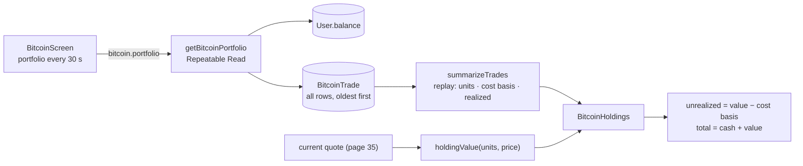

# 37 · Bitcoin holdings and profit

**Your holdings** shows how much Bitcoin the user owns (to 8 decimals, for example **0.00017094 BTC**), what it is worth now in pesos, the **unrealized** profit or loss on it (value − what it cost), the PHP account balance, the fixed fee, the **total portfolio value** (cash + Bitcoin), and the **realized** profit or loss from past sales. None of these numbers is a database column. They are recomputed every time by **replaying the user's trades** (event sourcing), with exact integer math.

## At a glance

| | |
| --- | --- |
| **Route** | `/bitcoin` (the "Your holdings" card) |
| **Frontend** | `bitcoin-holdings.tsx` (**client**: `BitcoinHoldings`, `ProfitLoss`, `Stat`), `bitcoin-screen.tsx` (loads the portfolio every 30 s) |
| **API** | `bitcoin.portfolio` (protected query) |
| **Backend** | `bitcoin.service.ts` (`getBitcoinPortfolio`, a **Repeatable Read** transaction), `bitcoin.rules.ts` (`summarizeTrades`, `applyTrade`), `bitcoin.types.ts` (`holdingValue`, `btc`, `money`) |
| **Database** | reads `User.balance` and **all** of the user's `BitcoinTrade` rows |
| **Tests** | `bitcoin.test.ts` ("replaying the saved trades gives the same result", "selling everything back records the loss from fees", "Bitcoin amounts keep every decimal place"); traces and the browser were run for this review |
| **Deep dive** | [Bitcoin §4](../05-features/12-bitcoin.md#holdings-are-a-replay-not-a-column-summarizetrades-lines-7076) |

## What the user sees

Real values from the browser test (stand-in price ₱5,850,000.00), after buying for ₱1,000 (₱1,010.00 with the fee):

| Line | Value |
| --- | --- |
| amount held | **0.00017094 BTC** |
| value now | **999.99 PHP value** ("last value" when the price is not fresh) |
| unrealized profit / loss | **−10.01 (−0.99%)** in rose (green when ≥ 0) |
| PHP account balance | 7,602.19 PHP (the **main** balance) |
| Fee | 10.00 PHP |
| Total portfolio value | 8,602.18 PHP (cash + Bitcoin value) |
| Realized profit / loss | +0.00 PHP |

After selling everything again: 0.00000000 BTC, "0.00 PHP value", and **Realized −20.01 PHP** (the two ₱10 fees plus 1 centavo of rounding).

## How it works

1. `BitcoinScreen` calls `bitcoin.portfolio` (fresh for 10 s, refetched every 30 s, and after every trade).
2. `getBitcoinPortfolio` opens a **Repeatable Read** transaction: it reads the main balance, then **all** trades in order (`createdAt`, then `id`). Both reads see the same moment.
3. `summarizeTrades` replays them from zero: a **buy** adds Bitcoin and its full cost (fee included) to the cost basis. A **sell** removes Bitcoin, removes the **average** cost of the part sold, and adds the difference to the realized profit.
4. The response is the replay result, `cashCentavos` (the main balance) and the **latest 20 trades** for the history ([39](39-bitcoin-trade-history.md)).
5. The card computes the value with the current quote (`holdingValue`), the unrealized profit (value − cost basis) and its percentage.

## Structure



## Files and locations

| Layer | File | Role |
| --- | --- | --- |
| Frontend (client) | `gobank/src/features/bitcoin/components/bitcoin-holdings.tsx` | the card |
| Frontend | `gobank/src/features/bitcoin/components/bitcoin-screen.tsx` | loads the portfolio, passes the quote |
| Service | `gobank/src/features/bitcoin/bitcoin.service.ts` | `getBitcoinPortfolio` |
| Rules | `gobank/src/features/bitcoin/bitcoin.rules.ts` | `summarizeTrades`, `applyTrade` |
| Types | `gobank/src/features/bitcoin/bitcoin.types.ts` | `UNITS_PER_BITCOIN`, `holdingValue`, `btc`, `money` |
| API | `gobank/src/features/bitcoin/bitcoin.router.ts` | `portfolio` |

## Frontend

<!-- code: gobank/src/features/bitcoin/components/bitcoin-holdings.tsx -->
**`gobank/src/features/bitcoin/components/bitcoin-holdings.tsx`** · all 151 lines

```tsx
  1 │ "use client";
  2 │
  3 │ import { Wallet } from "lucide-react";
  4 │ import type { ReactNode } from "react";
  5 │ import { cn } from "~/shared/lib/cn";
  6 │ import type { RouterOutputs } from "~/trpc/react";
  7 │ import {
  8 │   BITCOIN_FEE_CENTAVOS,
  9 │   btc,
 10 │   holdingValue,
 11 │   money,
 12 │   type BitcoinQuote,
 13 │ } from "../bitcoin.types";
 14 │
 15 │ type Portfolio = RouterOutputs["bitcoin"]["portfolio"];
 16 │
 17 │ const signedMoney = (centavos: number) =>
 18 │   `${centavos >= 0 ? "+" : "−"}${money(Math.abs(centavos))}`;
 19 │
 20 │ function Stat({
 21 │   label,
 22 │   children,
 23 │   className,
 24 │ }: {
 25 │   label: string;
 26 │   children: ReactNode;
 27 │   className?: string;
 28 │ }) {
 29 │   return (
 30 │     <div>
 31 │       <dt className="text-mint-muted">{label}</dt>
 32 │       <dd className={cn("mt-1 text-[13px] font-semibold", className)}>
 33 │         {children}
 34 │       </dd>
 35 │     </div>
 36 │   );
 37 │ }
 38 │
 39 │ function Php() {
 40 │   return (
 41 │     <span className="text-mint-muted ml-1 text-[9px] font-normal">PHP</span>
 42 │   );
 43 │ }
 44 │
 45 │ function ProfitLoss({ pnl, costBasis }: { pnl: number; costBasis: number }) {
 46 │   const percent =
 47 │     costBasis > 0 ? ` (${((pnl / costBasis) * 100).toFixed(2)}%)` : "";
 48 │
 49 │   return (
 50 │     <span className={pnl >= 0 ? "text-mint" : "text-rose-300"}>
 51 │       {signedMoney(pnl)}
 52 │       {percent}
 53 │     </span>
 54 │   );
 55 │ }
 56 │
 57 │ export function BitcoinHoldings({
 58 │   portfolio,
 59 │   quote,
 60 │   fresh,
 61 │   failed,
 62 │   onRetry,
 63 │ }: {
 64 │   portfolio: Portfolio | undefined;
 65 │   quote: BitcoinQuote | undefined;
 66 │   fresh: boolean;
 67 │   failed: boolean;
 68 │   onRetry: () => void;
 69 │ }) {
 70 │   const value =
 71 │     portfolio && quote
 72 │       ? holdingValue(portfolio.bitcoinUnits, quote.unitPriceCentavos)
 73 │       : null;
 74 │
 75 │   const valueLabel =
 76 │     value === null
 77 │       ? "Start your Bitcoin portfolio"
 78 │       : `${money(value)} PHP ${fresh ? "value" : "last value"}`;
 79 │
 80 │   const lostMoney = portfolio !== undefined && portfolio.realizedCentavos < 0;
 81 │
 82 │   return (
 83 │     <section
 84 │       className="border-mint/15 rounded-[24px] border bg-linear-to-br from-[#182820] to-[#151b18] p-5"
 85 │       aria-label="Bitcoin holdings"
 86 │     >
 87 │       <div className="flex items-center justify-between">
 88 │         <h2 className="flex items-center gap-2 text-[13px] font-semibold">
 89 │           <Wallet size={16} className="text-mint" />
 90 │           Your holdings
 91 │         </h2>
 92 │         <span className="text-mint-muted text-[9px]">Account holdings</span>
 93 │       </div>
 94 │
 95 │       <p className="mt-4 text-[24px] font-semibold tracking-tight tabular-nums">
 96 │         {portfolio ? btc(portfolio.bitcoinUnits) : "—"}
 97 │         <span className="text-mint-muted ml-2 text-[11px] font-medium">
 98 │           BTC
 99 │         </span>
100 │       </p>
101 │
102 │       <div className="mt-1 flex items-center justify-between gap-2 text-[11px]">
103 │         <span className="text-mint-muted">{valueLabel}</span>
104 │         {portfolio && value !== null ? (
105 │           <ProfitLoss
106 │             pnl={value - portfolio.costBasisCentavos}
107 │             costBasis={portfolio.costBasisCentavos}
108 │           />
109 │         ) : null}
110 │       </div>
111 │
112 │       <dl className="mt-5 grid grid-cols-2 gap-x-3 gap-y-4 border-t border-white/10 pt-4 text-[10px]">
113 │         <Stat label="PHP account balance">
114 │           {portfolio ? money(portfolio.cashCentavos) : "—"}
115 │           <Php />
116 │         </Stat>
117 │         <Stat label="Fee">
118 │           {money(BITCOIN_FEE_CENTAVOS)}
119 │           <Php />
120 │         </Stat>
121 │         <Stat label="Total portfolio value" className="text-[12px]">
122 │           {portfolio && value !== null
123 │             ? `${money(portfolio.cashCentavos + value)} PHP`
124 │             : "—"}
125 │         </Stat>
126 │         <Stat
127 │           label="Realized profit / loss"
128 │           className={cn(
129 │             "text-[12px]",
130 │             lostMoney ? "text-rose-300" : "text-mint",
131 │           )}
132 │         >
133 │           {portfolio ? `${signedMoney(portfolio.realizedCentavos)} PHP` : "—"}
134 │         </Stat>
135 │       </dl>
136 │
137 │       {failed ? (
138 │         <div role="alert" className="mt-4 text-[11px] text-amber-200">
139 │           <p>Couldn’t load your portfolio.</p>
140 │           <button
141 │             type="button"
142 │             onClick={onRetry}
143 │             className="mt-2 underline underline-offset-4"
144 │           >
145 │             Try again
146 │           </button>
147 │         </div>
148 │       ) : null}
149 │     </section>
150 │   );
151 │ }
```
<!-- /code -->

<!-- code: gobank/src/features/bitcoin/components/bitcoin-screen.tsx 13-17 -->
**`gobank/src/features/bitcoin/components/bitcoin-screen.tsx`** · lines 13–17

```tsx
13 │ const PORTFOLIO_REFRESH = {
14 │   staleTime: 10_000,
15 │   refetchInterval: 30_000,
16 │   retry: 1,
17 │ };
```
<!-- /code -->

## Backend

<!-- code: gobank/src/features/bitcoin/bitcoin.router.ts 29-31 -->
**`gobank/src/features/bitcoin/bitcoin.router.ts`** · lines 29–31

```ts
29 │   portfolio: protectedProcedure.query(({ ctx }) =>
30 │     getBitcoinPortfolio(ctx.userId),
31 │   ),
```
<!-- /code -->

<!-- code: gobank/src/features/bitcoin/bitcoin.service.ts 22-42 -->
**`gobank/src/features/bitcoin/bitcoin.service.ts`** · lines 22–42

```ts
22 │ export async function getBitcoinPortfolio(userId: string) {
23 │   return db.$transaction(
24 │     async (tx) => {
25 │       const user = await tx.user.findUniqueOrThrow({
26 │         where: { id: userId },
27 │         select: { balance: true },
28 │       });
29 │       const trades = await tx.bitcoinTrade.findMany({
30 │         where: { userId },
31 │         orderBy: [{ createdAt: "asc" }, { id: "asc" }],
32 │       });
33 │
34 │       return {
35 │         ...summarizeTrades(trades),
36 │         cashCentavos: user.balance,
37 │         trades: trades.slice(-20).reverse(),
38 │       };
39 │     },
40 │     { isolationLevel: "RepeatableRead" },
41 │   );
42 │ }
```
<!-- /code -->

<!-- code: gobank/src/features/bitcoin/bitcoin.rules.ts 7-76 -->
**`gobank/src/features/bitcoin/bitcoin.rules.ts`** · lines 7–76

```ts
 7 │ export type TradingBalances = {
 8 │   cashCentavos: number;
 9 │   bitcoinUnits: bigint;
10 │   costBasisCentavos: number;
11 │   realizedCentavos: number;
12 │ };
13 │
14 │ export type BitcoinTrade =
15 │   | { action: "buy"; cashCentavos: number }
16 │   | { action: "sell"; bitcoinUnits: bigint };
17 │
18 │ type Holdings = Omit<TradingBalances, "cashCentavos">;
19 │
20 │ type SettledTrade = {
21 │   action: string;
22 │   bitcoinUnits: bigint;
23 │   amountCentavos: number;
24 │ };
25 │
26 │ const MIN_BUY_CENTAVOS = 100;
27 │
28 │ const isPositiveAmount = (value: number) =>
29 │   Number.isSafeInteger(value) && value > 0 && value <= MAX_CENTAVOS;
30 │
31 │ const withinAccountLimit = (value: number) =>
32 │   Number.isSafeInteger(value) && Math.abs(value) <= MAX_CENTAVOS;
33 │
34 │ function applyTrade(holdings: Holdings, trade: SettledTrade): Holdings {
35 │   if (trade.action !== "buy" && trade.action !== "sell") {
36 │     throw new Error("Unknown Bitcoin trade type.");
37 │   }
38 │
39 │   const validAmount =
40 │     trade.bitcoinUnits > 0n &&
41 │     Number.isSafeInteger(trade.amountCentavos) &&
42 │     trade.amountCentavos > 0;
43 │   if (!validAmount) throw new Error("Invalid Bitcoin trade amount.");
44 │
45 │   if (trade.action === "buy") {
46 │     return {
47 │       bitcoinUnits: holdings.bitcoinUnits + trade.bitcoinUnits,
48 │       costBasisCentavos: holdings.costBasisCentavos + trade.amountCentavos,
49 │       realizedCentavos: holdings.realizedCentavos,
50 │     };
51 │   }
52 │
53 │   if (trade.bitcoinUnits > holdings.bitcoinUnits) {
54 │     throw new Error("Not enough Bitcoin to sell.");
55 │   }
56 │
57 │   const soldCostBasis = Number(
58 │     (BigInt(holdings.costBasisCentavos) * trade.bitcoinUnits) /
59 │       holdings.bitcoinUnits,
60 │   );
61 │
62 │   return {
63 │     bitcoinUnits: holdings.bitcoinUnits - trade.bitcoinUnits,
64 │     costBasisCentavos: holdings.costBasisCentavos - soldCostBasis,
65 │     realizedCentavos:
66 │       holdings.realizedCentavos + trade.amountCentavos - soldCostBasis,
67 │   };
68 │ }
69 │
70 │ export function summarizeTrades(trades: readonly SettledTrade[]): Holdings {
71 │   return trades.reduce(applyTrade, {
72 │     bitcoinUnits: 0n,
73 │     costBasisCentavos: 0,
74 │     realizedCentavos: 0,
75 │   });
76 │ }
```
<!-- /code -->

<!-- code: gobank/src/features/bitcoin/bitcoin.types.ts 40-42 -->
**`gobank/src/features/bitcoin/bitcoin.types.ts`** · lines 40–42

```ts
40 │ export const UNITS_PER_BITCOIN = 100_000_000n;
41 │ export const MAX_CENTAVOS = 2_000_000_000;
42 │ export const BITCOIN_FEE_CENTAVOS = 1_000;
```
<!-- /code -->

<!-- code: gobank/src/features/bitcoin/bitcoin.types.ts 62-74 -->
**`gobank/src/features/bitcoin/bitcoin.types.ts`** · lines 62–74

```ts
62 │ export const money = (centavos: number) => PHP_AMOUNT.format(centavos / 100);
63 │
64 │ export const btc = (bitcoinUnits: bigint) => {
65 │   const whole = bitcoinUnits / UNITS_PER_BITCOIN;
66 │   const fraction = (bitcoinUnits % UNITS_PER_BITCOIN)
67 │     .toString()
68 │     .padStart(8, "0");
69 │
70 │   return `${whole}.${fraction}`;
71 │ };
72 │
73 │ export const holdingValue = (bitcoinUnits: bigint, unitPriceCentavos: number) =>
74 │   Number((bitcoinUnits * BigInt(unitPriceCentavos)) / UNITS_PER_BITCOIN);
```
<!-- /code -->

## Database

<!-- code: gobank/prisma/schema.prisma 77-91 -->
**`gobank/prisma/schema.prisma`** · lines 77–91

```prisma
77 │ model BitcoinTrade {
78 │   id                String   @id @default(cuid())
79 │   userId            String
80 │   submissionId      String
81 │   reference         String?  @unique
82 │   action            String
83 │   bitcoinUnits      BigInt
84 │   amountCentavos    Int
85 │   unitPriceCentavos Int
86 │   createdAt         DateTime @default(now())
87 │   user              User     @relation(fields: [userId], references: [id], onDelete: Cascade)
88 │
89 │   @@unique([userId, submissionId])
90 │   @@index([userId, createdAt(sort: Desc)])
91 │ }
```
<!-- /code -->

| Read | Why |
| --- | --- |
| `User.balance` | the PHP side **is** the main balance; there is no separate Bitcoin cash wallet |
| every `BitcoinTrade` of the user, oldest first | replayed into holdings, cost basis and realized profit |

**There is no "Bitcoin balance" column.** The trade list is the only source of truth, so the holdings can never disagree with the history ([Migration history](../03-database/02-migration-history.md#12-bitcoin_trade_history-from-wallets-to-event-sourcing)).

## The complicated parts, explained step by step

### 1. Satoshis, `BigInt` and 8 decimals

<!-- code: gobank/src/features/bitcoin/bitcoin.types.ts 64-74 -->
**`gobank/src/features/bitcoin/bitcoin.types.ts`** · lines 64–74

```ts
64 │ export const btc = (bitcoinUnits: bigint) => {
65 │   const whole = bitcoinUnits / UNITS_PER_BITCOIN;
66 │   const fraction = (bitcoinUnits % UNITS_PER_BITCOIN)
67 │     .toString()
68 │     .padStart(8, "0");
69 │
70 │   return `${whole}.${fraction}`;
71 │ };
72 │
73 │ export const holdingValue = (bitcoinUnits: bigint, unitPriceCentavos: number) =>
74 │   Number((bitcoinUnits * BigInt(unitPriceCentavos)) / UNITS_PER_BITCOIN);
```
<!-- /code -->

| Value | Stored as | Why |
| --- | --- | --- |
| Bitcoin | **satoshis** (1 BTC = 100,000,000), a `BigInt` in JavaScript and `BIGINT` in PostgreSQL | whole numbers only; no floating-point drift |
| pesos | **centavos**, an integer | the same rule as the rest of the bank |

`btc(17094n)` builds the text by integer division and remainder: whole = 17094 ÷ 10⁸ = 0, fraction = "17094" padded to `00017094` → **"0.00017094"**. A `Number` would print `0.00017094` here too, but `BigInt` keeps **every** satoshi exact for any amount, which the unit test "Bitcoin amounts keep every decimal place" checks.

`holdingValue(units, price) = units × price ÷ 10⁸`, in `BigInt`, rounded **down**:

| Holding | Price (centavos) | Value |
| --- | --- | --- |
| 17,094 sats | 585,000,000 | ⌊ 99,999.9 ⌋ = **99,999** → ₱999.99 |
| 1 BTC | 585,000,000 | ₱5,850,000.00 |
| 1 sat | 585,000,000 | 5 centavos |

### 2. Replaying the trades: average cost

<!-- code: gobank/src/features/bitcoin/bitcoin.rules.ts 34-68 -->
**`gobank/src/features/bitcoin/bitcoin.rules.ts`** · lines 34–68

```ts
34 │ function applyTrade(holdings: Holdings, trade: SettledTrade): Holdings {
35 │   if (trade.action !== "buy" && trade.action !== "sell") {
36 │     throw new Error("Unknown Bitcoin trade type.");
37 │   }
38 │
39 │   const validAmount =
40 │     trade.bitcoinUnits > 0n &&
41 │     Number.isSafeInteger(trade.amountCentavos) &&
42 │     trade.amountCentavos > 0;
43 │   if (!validAmount) throw new Error("Invalid Bitcoin trade amount.");
44 │
45 │   if (trade.action === "buy") {
46 │     return {
47 │       bitcoinUnits: holdings.bitcoinUnits + trade.bitcoinUnits,
48 │       costBasisCentavos: holdings.costBasisCentavos + trade.amountCentavos,
49 │       realizedCentavos: holdings.realizedCentavos,
50 │     };
51 │   }
52 │
53 │   if (trade.bitcoinUnits > holdings.bitcoinUnits) {
54 │     throw new Error("Not enough Bitcoin to sell.");
55 │   }
56 │
57 │   const soldCostBasis = Number(
58 │     (BigInt(holdings.costBasisCentavos) * trade.bitcoinUnits) /
59 │       holdings.bitcoinUnits,
60 │   );
61 │
62 │   return {
63 │     bitcoinUnits: holdings.bitcoinUnits - trade.bitcoinUnits,
64 │     costBasisCentavos: holdings.costBasisCentavos - soldCostBasis,
65 │     realizedCentavos:
66 │       holdings.realizedCentavos + trade.amountCentavos - soldCostBasis,
67 │   };
68 │ }
```
<!-- /code -->

Run with the project's `summarizeTrades`:

| Trades | BTC | Cost basis | Realized |
| --- | --- | --- | --- |
| buy 17,094 sats for 101,000 (₱1,000 + ₱10 fee) | 0.00017094 | **1,010.00** | 0.00 |
| then sell all for 98,999 (₱999.99 − ₱10 fee) | 0 | 0.00 | **−20.01** |
| buy 0.001 BTC for ₱70, buy 0.001 BTC for ₱90 | 0.002 | 160.00 | 0.00 |
| then sell 0.0005 BTC for ₱50 | 0.0015 | **120.00** | **+10.00** |
| buy 3 sats for ₱1.00, sell 1 sat for ₱0.30 | 2 sats | 0.67 | −0.03 |

The share of cost removed by a sale is `⌊ costBasis × sold ÷ held ⌋` (line 57–60). In the last row, ⌊ 100 × 1 ÷ 3 ⌋ = **33** centavos leave with the sold satoshi and **67** stay, which adds up to 100 exactly. Rounding down never creates or loses a centavo of basis; it only decides which side the leftover centavo stays on.

**The fees are part of the cost basis** (`amountCentavos` of a buy is the total paid). So after a buy, the value is already below the basis by about the fee: −₱10.01 right after buying, as the browser showed.

### 3. One consistent snapshot

<!-- code: gobank/src/features/bitcoin/bitcoin.service.ts 22-42 -->
**`gobank/src/features/bitcoin/bitcoin.service.ts`** · lines 22–42

```ts
22 │ export async function getBitcoinPortfolio(userId: string) {
23 │   return db.$transaction(
24 │     async (tx) => {
25 │       const user = await tx.user.findUniqueOrThrow({
26 │         where: { id: userId },
27 │         select: { balance: true },
28 │       });
29 │       const trades = await tx.bitcoinTrade.findMany({
30 │         where: { userId },
31 │         orderBy: [{ createdAt: "asc" }, { id: "asc" }],
32 │       });
33 │
34 │       return {
35 │         ...summarizeTrades(trades),
36 │         cashCentavos: user.balance,
37 │         trades: trades.slice(-20).reverse(),
38 │       };
39 │     },
40 │     { isolationLevel: "RepeatableRead" },
41 │   );
42 │ }
```
<!-- /code -->

`getBitcoinPortfolio` reads two things: the balance and the trades. Under PostgreSQL's default isolation (Read Committed) each statement sees its own moment. A trade committed **between** the two reads would show the new Bitcoin with the **old** balance, or the other way round, and the total would be briefly wrong. `isolationLevel: "RepeatableRead"` gives both reads the **same** snapshot. It only reads, so it never needs to retry.

### 4. Unrealized, realized, and the percentage

<!-- code: gobank/src/features/bitcoin/components/bitcoin-holdings.tsx 17-55 -->
**`gobank/src/features/bitcoin/components/bitcoin-holdings.tsx`** · lines 17–55

```tsx
17 │ const signedMoney = (centavos: number) =>
18 │   `${centavos >= 0 ? "+" : "−"}${money(Math.abs(centavos))}`;
19 │
20 │ function Stat({
21 │   label,
22 │   children,
23 │   className,
24 │ }: {
25 │   label: string;
26 │   children: ReactNode;
27 │   className?: string;
28 │ }) {
29 │   return (
30 │     <div>
31 │       <dt className="text-mint-muted">{label}</dt>
32 │       <dd className={cn("mt-1 text-[13px] font-semibold", className)}>
33 │         {children}
34 │       </dd>
35 │     </div>
36 │   );
37 │ }
38 │
39 │ function Php() {
40 │   return (
41 │     <span className="text-mint-muted ml-1 text-[9px] font-normal">PHP</span>
42 │   );
43 │ }
44 │
45 │ function ProfitLoss({ pnl, costBasis }: { pnl: number; costBasis: number }) {
46 │   const percent =
47 │     costBasis > 0 ? ` (${((pnl / costBasis) * 100).toFixed(2)}%)` : "";
48 │
49 │   return (
50 │     <span className={pnl >= 0 ? "text-mint" : "text-rose-300"}>
51 │       {signedMoney(pnl)}
52 │       {percent}
53 │     </span>
54 │   );
55 │ }
```
<!-- /code -->

| Number | Formula | Browser test |
| --- | --- | --- |
| value | `holdingValue(units, price)` | 999.99 |
| unrealized | value − cost basis | 999.99 − 1,010.00 = **−10.01** |
| percentage | unrealized ÷ cost basis (only when the basis > 0) | −10.01 ÷ 1,010.00 = **−0.99%** |
| total portfolio | main balance + value | 7,602.19 + 999.99 = **8,602.18** |
| realized | from the replay | +0.00, then −20.01 after selling |

`signedMoney` prints "+" or the real minus sign "−" before the absolute amount. Colors: mint when ≥ 0, rose when < 0.

### 5. When there is nothing, or no price

| Situation | Card shows |
| --- | --- |
| portfolio or quote not loaded | "—" and "Start your Bitcoin portfolio" (`value === null`) |
| loaded, no Bitcoin | "0.00000000 BTC", "**0.00 PHP value**", "+0.00": the value is 0, not missing |
| price not fresh | "… PHP **last value**" |
| portfolio request failed | "Couldn’t load your portfolio." and **Try again** (`role="alert"`) |

## Rules and limits

| Rule | Value |
| --- | --- |
| Precision | 1 satoshi (0.00000001 BTC); 1 centavo |
| Cost method | average cost; fees included in the basis |
| Rounding | values and sold basis rounded **down** |
| Refresh | every 30 s, and after every trade |
| Cash side | the main GoBank balance |

## Messages

| Text | When |
| --- | --- |
| Your holdings · Account holdings | card title |
| … PHP value / … PHP last value / Start your Bitcoin portfolio | value line |
| PHP account balance · Fee · Total portfolio value · Realized profit / loss | stats |
| Couldn’t load your portfolio. · Try again | load error |

## Tests

`bitcoin.test.ts` (unit):

| Test | Checks |
| --- | --- |
| replaying the saved trades gives the same result | a buy and a full sell computed with `calculateTrade`, then replayed with `summarizeTrades`: both give realized **−2,001** centavos |
| selling everything back records the loss from fees | buy ₱100 at ₱100,000.01, sell it all at the same price: cash 997,999, no Bitcoin, no basis, realized **−₱20.01** |
| Bitcoin amounts keep every decimal place | `parseUnits("0.00000001", 8)` = 1n, `btc(123456789n)` = "1.23456789"; `-1`, `1e8`, `1.001` (with 2 decimals) are refused |

- `verify-bitcoin.ts`: after buying and selling everything, the holdings are back to 0 (passed with stand-in data for this review).
- **Checked in Chromium for this review** (stand-in price): the card before trading, after a ₱1,000 buy (value 999.99, −10.01 (−0.99%), total 8,602.18), and after selling all (realized −20.01).
- **Run with the project's functions:** every row of §1 and §2.
