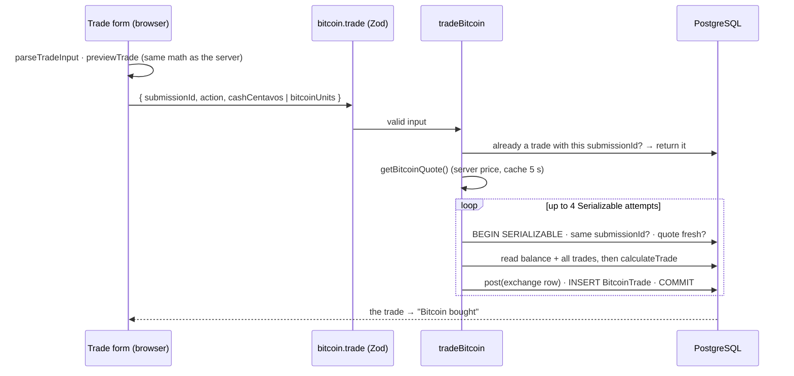

# 38 · Buying and selling Bitcoin

The trade box switches between **Buy Bitcoin** (type pesos) and **Sell Bitcoin** (type Bitcoin, up to 8 decimals). Presets fill **25% · 50% · 75% · Max**, and a live preview says what you get ("You receive ≈ 0.00017094 BTC · Total 1,010.00 PHP"). **Review** opens a confirmation dialog, and **Confirm** trades. Each trade costs a fixed **₱10.00 fee**. It settles in the **main GoBank balance** at the **server's** price, exactly once even if the request is sent twice, and only while the price is fresh.

## At a glance

| | |
| --- | --- |
| **Route** | `/bitcoin` (the "Bitcoin trading" box) |
| **Frontend** | `bitcoin-trade-form.tsx` (**client**), `bitcoin-trade-review.tsx` (the dialog), `bitcoin-trade-input.ts` (`parseTradeInput`, `previewTrade`, `presetAmount`) |
| **API** | `bitcoin.trade` (protected mutation): `{ submissionId, action: "buy", cashCentavos }` or `{ submissionId, action: "sell", bitcoinUnits: "<satoshis>" }` |
| **Backend** | `bitcoin.router.ts` (Zod discriminated union), `bitcoin.service.ts` (`tradeBitcoin`, `recordTrade`: Serializable, idempotent), `bitcoin.rules.ts` (`calculateTrade`, `priceBuy`, `priceSell`), ledger `post()` |
| **Database** | `User.balance` (via `post()`), one `Transaction` (`kind = exchange`), one `BitcoinTrade` (`@@unique([userId, submissionId])`) |
| **Tests** | `bitcoin.test.ts`, `bitcoin-trade-input.test.ts` (9), `verify-bitcoin.ts` (fees, idempotency, settlement, rollback); idempotency and the "sell everything" race were run on the test database, the screen in Chromium |
| **Deep dive** | [Bitcoin §4, §5, §8](../05-features/12-bitcoin.md#4-the-trade-math-bitcoinrulests) |

## What the user can do

| Step | Buy (stand-in price ₱5,850,000.00) | Sell |
| --- | --- | --- |
| type | `1000` (pesos, up to 2 decimals) | `0.00017094` (BTC, up to 8 decimals) |
| or a preset | 25% · 50% · 75% · Max of **(cash − ₱10 fee)** | 25% · 50% · 75% · Max of the Bitcoin held |
| preview | "You receive ≈ 0.00017094 BTC · Total 1,010.00 PHP" | "You receive ≈ 989.99 PHP" |
| **Review buy** | dialog: Bitcoin 0.00017094 BTC · Estimated Bitcoin value 1,000.00 PHP · Trading fee 10.00 PHP · **Total to pay 1,010.00 PHP** | … · **Net proceeds 989.99 PHP** |
| **Confirm buy** | "Bitcoin bought · 0.00017094 BTC · 1,010.00 PHP" | "Bitcoin sold · …" |
| without a fresh price | the button says **Waiting for a fresh price** and is disabled | same |

## How it works

1. `parseTradeInput` turns the text into a trade. Buys are in centavos (2 decimals), sells in satoshis (8 decimals), both with `BigInt`, never floating point.
2. With the portfolio and the current quote, `previewTrade` runs the **same** `calculateTrade` the server uses. The preview is exact, and any problem ("Not enough PHP in your account.") is shown before review.
3. **Review** opens `TradeReviewDialog`. **Confirm** creates a `submissionId` (a random UUID) **once** for this review and sends `bitcoin.trade`. A sell sends satoshis as a **string**.
4. The server returns the existing trade if this `submissionId` was already used. Otherwise it takes its **own** quote (cached ≤ 5 s) and tries up to 4 **Serializable** transactions.
5. Inside one transaction (`recordTrade`): check the submission again → check the quote is **fresh** → read the balance and the whole trade history → `calculateTrade` → `post()` an `exchange` row (−total for a buy, +net for a sell) → insert the `BitcoinTrade` with the same reference.
6. Success: the form shows the result, clears, refreshes the server data, and the portfolio, history and balances reload.

## Structure



## Files and locations

| Layer | File | Role |
| --- | --- | --- |
| Frontend (client) | `gobank/src/features/bitcoin/components/bitcoin-trade-form.tsx` | switch, input, presets, preview, review, submit |
| Frontend | `gobank/src/features/bitcoin/components/bitcoin-trade-review.tsx` | the modal dialog |
| Input rules | `gobank/src/features/bitcoin/bitcoin-trade-input.ts` | text → trade, preview, presets |
| Trade math | `gobank/src/features/bitcoin/bitcoin.rules.ts` | `calculateTrade` (used by **both** sides) |
| API | `gobank/src/features/bitcoin/bitcoin.router.ts` | the `trade` input |
| Service | `gobank/src/features/bitcoin/bitcoin.service.ts` | `tradeBitcoin`, `recordTrade`, `priceTrade` |
| Ledger | `gobank/src/server/ledger.ts` | `post()` |
| Types | `gobank/src/features/bitcoin/bitcoin.types.ts` | `BITCOIN_FEE_CENTAVOS`, `MAX_CENTAVOS`, `parseUnits` |

## Frontend

<!-- code: gobank/src/features/bitcoin/components/bitcoin-trade-form.tsx -->
**`gobank/src/features/bitcoin/components/bitcoin-trade-form.tsx`** · all 303 lines

```tsx
  1 │ "use client";
  2 │
  3 │ import { ArrowDownLeft, ArrowUpRight, Check } from "lucide-react";
  4 │ import { useRouter } from "next/navigation";
  5 │ import { useRef, useState } from "react";
  6 │ import { cn } from "~/shared/lib/cn";
  7 │ import { api, type RouterOutputs } from "~/trpc/react";
  8 │ import {
  9 │   BITCOIN_FEE_CENTAVOS,
 10 │   btc,
 11 │   money,
 12 │   type BitcoinQuote,
 13 │ } from "../bitcoin.types";
 14 │ import {
 15 │   parseTradeInput,
 16 │   presetAmount,
 17 │   previewTrade,
 18 │   type TradeAction,
 19 │   type TradePreview,
 20 │ } from "../bitcoin-trade-input";
 21 │ import { TradeReviewDialog } from "./bitcoin-trade-review";
 22 │
 23 │ type Portfolio = RouterOutputs["bitcoin"]["portfolio"];
 24 │ type Order = RouterOutputs["bitcoin"]["trade"];
 25 │
 26 │ const ACTIONS: TradeAction[] = ["buy", "sell"];
 27 │ const PRESET_PERCENTS = [25, 50, 75, 100];
 28 │
 29 │ const ACTION_STYLE: Record<TradeAction, string> = {
 30 │   buy: "bg-mint/10 text-mint",
 31 │   sell: "bg-rose-400/10 text-rose-300",
 32 │ };
 33 │
 34 │ const SUBMIT_STYLE: Record<TradeAction, string> = {
 35 │   buy: "bg-mint text-on-mint hover:bg-[#75edc3]",
 36 │   sell: "bg-rose-300 text-[#35151d] hover:bg-rose-200",
 37 │ };
 38 │
 39 │ function availableLabel(portfolio: Portfolio | undefined, action: TradeAction) {
 40 │   if (!portfolio) return "Loading balance…";
 41 │
 42 │   return action === "buy"
 43 │     ? `${money(portfolio.cashCentavos)} PHP available`
 44 │     : `${btc(portfolio.bitcoinUnits)} BTC available`;
 45 │ }
 46 │
 47 │ function previewLabel(preview: TradePreview, action: TradeAction) {
 48 │   if (action === "sell") {
 49 │     return `You receive ≈ ${money(preview.cashCentavos)} PHP`;
 50 │   }
 51 │
 52 │   return `You receive ≈ ${btc(preview.bitcoinUnits)} BTC · Total ${money(preview.cashCentavos)} PHP`;
 53 │ }
 54 │
 55 │ function idleHint(action: TradeAction) {
 56 │   return action === "sell"
 57 │     ? "You can sell any fraction of your Bitcoin."
 58 │     : "Buy directly with PHP from your account.";
 59 │ }
 60 │
 61 │ function ActionSwitch({
 62 │   selected,
 63 │   disabled,
 64 │   onSelect,
 65 │ }: {
 66 │   selected: TradeAction;
 67 │   disabled: boolean;
 68 │   onSelect: (action: TradeAction) => void;
 69 │ }) {
 70 │   return (
 71 │     <div className="bg-surface-sunken mb-5 flex rounded-xl p-1">
 72 │       {ACTIONS.map((action) => (
 73 │         <button
 74 │           key={action}
 75 │           type="button"
 76 │           disabled={disabled}
 77 │           aria-pressed={selected === action}
 78 │           onClick={() => onSelect(action)}
 79 │           className={cn(
 80 │             "flex min-h-11 flex-1 items-center justify-center gap-2 rounded-lg text-[13px] font-semibold",
 81 │             selected === action ? ACTION_STYLE[action] : "text-ink-muted",
 82 │           )}
 83 │         >
 84 │           {action === "buy" ? (
 85 │             <ArrowDownLeft size={16} />
 86 │           ) : (
 87 │             <ArrowUpRight size={16} />
 88 │           )}
 89 │           {action === "buy" ? "Buy Bitcoin" : "Sell Bitcoin"}
 90 │         </button>
 91 │       ))}
 92 │     </div>
 93 │   );
 94 │ }
 95 │
 96 │ function TradeSuccess({ order }: { order: Order }) {
 97 │   return (
 98 │     <div
 99 │       role="status"
100 │       className="bg-mint/10 text-mint mt-4 flex items-start gap-2 rounded-xl p-3 text-[12px]"
101 │     >
102 │       <Check size={16} className="mt-0.5 shrink-0" />
103 │       <div>
104 │         <p className="font-semibold">
105 │           {order.action === "buy" ? "Bitcoin bought" : "Bitcoin sold"}
106 │         </p>
107 │         <p className="mt-1 text-[11px]">
108 │           {btc(order.bitcoinUnits)} BTC · {money(order.amountCentavos)} PHP
109 │         </p>
110 │       </div>
111 │     </div>
112 │   );
113 │ }
114 │
115 │ export function BitcoinTradeForm({
116 │   portfolio,
117 │   quote,
118 │   fresh,
119 │ }: {
120 │   portfolio?: Portfolio;
121 │   quote?: BitcoinQuote;
122 │   fresh: boolean;
123 │ }) {
124 │   const router = useRouter();
125 │   const [action, setAction] = useState<TradeAction>("buy");
126 │   const [amount, setAmount] = useState("");
127 │   const [attempted, setAttempted] = useState(false);
128 │   const [reviewing, setReviewing] = useState(false);
129 │   const [lastOrder, setLastOrder] = useState<Order | null>(null);
130 │   const submissionId = useRef<string | null>(null);
131 │
132 │   const tradeMutation = api.bitcoin.trade.useMutation({
133 │     onSuccess: (order) => {
134 │       setLastOrder(order);
135 │       setReviewing(false);
136 │       setAmount("");
137 │       setAttempted(false);
138 │       submissionId.current = null;
139 │       router.refresh();
140 │     },
141 │   });
142 │
143 │   const input = parseTradeInput(amount, action);
144 │   const checked =
145 │     portfolio && quote && input.trade
146 │       ? previewTrade(portfolio, input.trade, quote.unitPriceCentavos)
147 │       : null;
148 │   const preview = checked?.preview ?? null;
149 │
150 │   const nothingToSell = action === "sell" && portfolio?.bitcoinUnits === 0n;
151 │   let problem = input.problem;
152 │   if (checked?.problem && attempted) problem = checked.problem;
153 │   if (nothingToSell)
154 │     problem = "Buy some Bitcoin before making your first sale.";
155 │
156 │   const busy = tradeMutation.isPending;
157 │   const canReview =
158 │     Boolean(input.trade && portfolio && quote && fresh) && !busy;
159 │
160 │   const changeAmount = (value: string) => {
161 │     setAmount(value);
162 │     setAttempted(false);
163 │     setLastOrder(null);
164 │     tradeMutation.reset();
165 │     submissionId.current = null;
166 │   };
167 │
168 │   const switchAction = (next: TradeAction) => {
169 │     setAction(next);
170 │     changeAmount("");
171 │   };
172 │
173 │   const openReview = () => {
174 │     setAttempted(true);
175 │     if (!preview || !fresh) return;
176 │
177 │     tradeMutation.reset();
178 │     setReviewing(true);
179 │   };
180 │
181 │   const confirm = () => {
182 │     const trade = input.trade;
183 │     if (!trade || !preview || !fresh || busy) return;
184 │
185 │     submissionId.current ??= crypto.randomUUID();
186 │     const id = submissionId.current;
187 │
188 │     tradeMutation.mutate(
189 │       trade.action === "buy"
190 │         ? { ...trade, submissionId: id }
191 │         : {
192 │             action: "sell",
193 │             bitcoinUnits: trade.bitcoinUnits.toString(),
194 │             submissionId: id,
195 │           },
196 │     );
197 │   };
198 │
199 │   return (
200 │     <section
201 │       className="bg-card rounded-[24px] border border-white/[.07] p-5"
202 │       aria-label="Bitcoin trading"
203 │     >
204 │       <ActionSwitch selected={action} disabled={busy} onSelect={switchAction} />
205 │
206 │       <form
207 │         onSubmit={(event) => {
208 │           event.preventDefault();
209 │           openReview();
210 │         }}
211 │       >
212 │         <div className="mb-2 flex items-center justify-between gap-2 text-[11px]">
213 │           <label htmlFor="bitcoin-amount" className="text-ink-soft">
214 │             {action === "buy" ? "Bitcoin purchase amount" : "Bitcoin to sell"}
215 │           </label>
216 │           <span className="text-ink-muted">
217 │             {availableLabel(portfolio, action)}
218 │           </span>
219 │         </div>
220 │
221 │         <div className="bg-surface-sunken focus-within:border-mint/50 flex items-center gap-3 rounded-xl border border-white/10 px-4">
222 │           <input
223 │             id="bitcoin-amount"
224 │             type="text"
225 │             inputMode="decimal"
226 │             autoComplete="off"
227 │             placeholder={action === "buy" ? "0.00" : "0.00000000"}
228 │             value={amount}
229 │             disabled={!portfolio || busy}
230 │             onChange={(event) => changeAmount(event.target.value)}
231 │             aria-describedby="bitcoin-amount-help"
232 │             className="placeholder:text-ink-faint min-w-0 flex-1 bg-transparent py-4 text-[25px] font-medium text-white tabular-nums outline-none"
233 │           />
234 │           <span className="text-ink-muted text-[12px] font-semibold">
235 │             {action === "buy" ? "PHP" : "BTC"}
236 │           </span>
237 │         </div>
238 │
239 │         <div className="mt-3 grid grid-cols-4 gap-2">
240 │           {PRESET_PERCENTS.map((percent) => (
241 │             <button
242 │               type="button"
243 │               key={percent}
244 │               disabled={!portfolio || busy}
245 │               onClick={() => {
246 │                 if (portfolio) {
247 │                   changeAmount(presetAmount(portfolio, action, percent));
248 │                 }
249 │               }}
250 │               className="text-ink-soft min-h-9 rounded-lg bg-white/[.04] text-[11px] font-medium hover:bg-white/10 disabled:opacity-40"
251 │             >
252 │               {percent === 100 ? "Max" : `${percent}%`}
253 │             </button>
254 │           ))}
255 │         </div>
256 │
257 │         <div id="bitcoin-amount-help" className="mt-4 min-h-5 text-[11px]">
258 │           {problem ? (
259 │             <span
260 │               role={attempted ? "alert" : undefined}
261 │               className="text-rose-300"
262 │             >
263 │               {problem}
264 │             </span>
265 │           ) : (
266 │             <span className="text-ink-muted">
267 │               {preview ? previewLabel(preview, action) : idleHint(action)}
268 │             </span>
269 │           )}
270 │         </div>
271 │
272 │         <button
273 │           type="submit"
274 │           disabled={!canReview}
275 │           className={cn(
276 │             "mt-3 min-h-12 w-full rounded-xl text-[13px] font-bold transition-opacity disabled:opacity-35",
277 │             SUBMIT_STYLE[action],
278 │           )}
279 │         >
280 │           {fresh ? `Review ${action}` : "Waiting for a fresh price"}
281 │         </button>
282 │       </form>
283 │
284 │       <p className="text-ink-faint mt-3 text-center text-[10px] leading-relaxed">
285 │         Fixed {money(BITCOIN_FEE_CENTAVOS)} PHP fee per trade
286 │       </p>
287 │
288 │       {lastOrder ? <TradeSuccess order={lastOrder} /> : null}
289 │
290 │       {reviewing ? (
291 │         <TradeReviewDialog
292 │           action={action}
293 │           preview={preview}
294 │           fresh={fresh}
295 │           pending={busy}
296 │           error={tradeMutation.error?.message ?? null}
297 │           onClose={() => setReviewing(false)}
298 │           onConfirm={confirm}
299 │         />
300 │       ) : null}
301 │     </section>
302 │   );
303 │ }
```
<!-- /code -->

<!-- code: gobank/src/features/bitcoin/components/bitcoin-trade-review.tsx -->
**`gobank/src/features/bitcoin/components/bitcoin-trade-review.tsx`** · all 163 lines

```tsx
  1 │ "use client";
  2 │
  3 │ import { X } from "lucide-react";
  4 │ import type { KeyboardEvent, MouseEvent } from "react";
  5 │ import { BITCOIN_FEE_CENTAVOS, btc, money } from "../bitcoin.types";
  6 │ import type { TradeAction, TradePreview } from "../bitcoin-trade-input";
  7 │
  8 │ function keepFocusInside(event: KeyboardEvent<HTMLDivElement>) {
  9 │   const buttons = event.currentTarget.querySelectorAll<HTMLButtonElement>(
 10 │     "button:not(:disabled)",
 11 │   );
 12 │   const first = buttons[0];
 13 │   const last = buttons[buttons.length - 1];
 14 │
 15 │   if (!first || !last) {
 16 │     event.preventDefault();
 17 │     return;
 18 │   }
 19 │
 20 │   const leavingStart = event.shiftKey && document.activeElement === first;
 21 │   const leavingEnd = !event.shiftKey && document.activeElement === last;
 22 │
 23 │   if (leavingStart) {
 24 │     event.preventDefault();
 25 │     last.focus();
 26 │   }
 27 │
 28 │   if (leavingEnd) {
 29 │     event.preventDefault();
 30 │     first.focus();
 31 │   }
 32 │ }
 33 │
 34 │ function ReviewRow({
 35 │   label,
 36 │   value,
 37 │   divided = false,
 38 │ }: {
 39 │   label: string;
 40 │   value: string;
 41 │   divided?: boolean;
 42 │ }) {
 43 │   return (
 44 │     <div
 45 │       className={
 46 │         divided
 47 │           ? "flex justify-between border-t border-white/10 pt-4"
 48 │           : "flex justify-between"
 49 │       }
 50 │     >
 51 │       <dt className="text-ink-muted">{label}</dt>
 52 │       <dd className="font-semibold tabular-nums">{value}</dd>
 53 │     </div>
 54 │   );
 55 │ }
 56 │
 57 │ export function TradeReviewDialog({
 58 │   action,
 59 │   preview,
 60 │   fresh,
 61 │   pending,
 62 │   error,
 63 │   onClose,
 64 │   onConfirm,
 65 │ }: {
 66 │   action: TradeAction;
 67 │   preview: TradePreview | null;
 68 │   fresh: boolean;
 69 │   pending: boolean;
 70 │   error: string | null;
 71 │   onClose: () => void;
 72 │   onConfirm: () => void;
 73 │ }) {
 74 │   const closeUnlessBusy = () => {
 75 │     if (!pending) onClose();
 76 │   };
 77 │
 78 │   const closeOnBackdrop = (event: MouseEvent<HTMLDivElement>) => {
 79 │     if (event.target === event.currentTarget) closeUnlessBusy();
 80 │   };
 81 │
 82 │   const handleKeys = (event: KeyboardEvent<HTMLDivElement>) => {
 83 │     if (event.key === "Escape") closeUnlessBusy();
 84 │     if (event.key === "Tab") keepFocusInside(event);
 85 │   };
 86 │
 87 │   const inPhp = (centavos: number | undefined) =>
 88 │     centavos === undefined ? "— PHP" : `${money(centavos)} PHP`;
 89 │
 90 │   return (
 91 │     <div
 92 │       className="fixed inset-0 z-50 flex items-end justify-center bg-black/70 px-3 pb-3 backdrop-blur-sm sm:items-center"
 93 │       onClick={closeOnBackdrop}
 94 │     >
 95 │       <div
 96 │         role="dialog"
 97 │         aria-modal="true"
 98 │         aria-labelledby="bitcoin-review-title"
 99 │         onKeyDown={handleKeys}
100 │         className="bg-surface w-full max-w-[416px] rounded-[26px] border border-white/10 p-6 shadow-2xl"
101 │       >
102 │         <div className="flex items-center justify-between">
103 │           <h2 id="bitcoin-review-title" className="text-lg font-semibold">
104 │             Review {action}
105 │           </h2>
106 │           <button
107 │             autoFocus
108 │             type="button"
109 │             aria-label="Close trade review"
110 │             disabled={pending}
111 │             onClick={onClose}
112 │             className="text-ink-muted grid h-10 w-10 place-items-center"
113 │           >
114 │             <X size={20} />
115 │           </button>
116 │         </div>
117 │
118 │         <dl className="mt-6 space-y-4 text-[13px]">
119 │           <ReviewRow
120 │             label="Bitcoin"
121 │             value={`${preview ? btc(preview.bitcoinUnits) : "—"} BTC`}
122 │           />
123 │           <ReviewRow
124 │             label="Estimated Bitcoin value"
125 │             value={inPhp(preview?.tradeCentavos)}
126 │           />
127 │           <ReviewRow label="Trading fee" value={inPhp(BITCOIN_FEE_CENTAVOS)} />
128 │           <ReviewRow
129 │             label={action === "buy" ? "Total to pay" : "Net proceeds"}
130 │             value={inPhp(preview?.cashCentavos)}
131 │             divided
132 │           />
133 │         </dl>
134 │
135 │         <p className="text-ink-muted mt-5 rounded-xl bg-white/5 p-3 text-[11px] leading-relaxed">
136 │           Your final fill uses the latest PHP quote when confirmed. Buying
137 │           debits your PHP account. Selling credits PHP back to your account.
138 │         </p>
139 │
140 │         {error ? (
141 │           <p role="alert" className="mt-4 text-[12px] text-rose-300">
142 │             {error}
143 │           </p>
144 │         ) : null}
145 │
146 │         {!fresh ? (
147 │           <p role="alert" className="mt-4 text-[12px] text-amber-300">
148 │             The price is stale. Wait for the feed to reconnect.
149 │           </p>
150 │         ) : null}
151 │
152 │         <button
153 │           type="button"
154 │           onClick={onConfirm}
155 │           disabled={!preview || !fresh || pending}
156 │           className="bg-mint text-on-mint mt-5 min-h-12 w-full rounded-xl text-[13px] font-bold disabled:opacity-40"
157 │         >
158 │           {pending ? "Completing trade…" : `Confirm ${action}`}
159 │         </button>
160 │       </div>
161 │     </div>
162 │   );
163 │ }
```
<!-- /code -->

<!-- code: gobank/src/features/bitcoin/bitcoin-trade-input.ts -->
**`gobank/src/features/bitcoin/bitcoin-trade-input.ts`** · all 81 lines

```ts
 1 │ import {
 2 │   calculateTrade,
 3 │   type BitcoinTrade,
 4 │   type TradingBalances,
 5 │ } from "./bitcoin.rules";
 6 │ import {
 7 │   BITCOIN_FEE_CENTAVOS,
 8 │   btc,
 9 │   MAX_CENTAVOS,
10 │   parseUnits,
11 │ } from "./bitcoin.types";
12 │
13 │ export type TradeAction = "buy" | "sell";
14 │
15 │ export type TradePreview = ReturnType<typeof calculateTrade>;
16 │
17 │ const DECIMAL_PLACES: Record<TradeAction, number> = { buy: 2, sell: 8 };
18 │
19 │ const NO_PROBLEM = "";
20 │
21 │ export function parseTradeInput(amount: string, action: TradeAction) {
22 │   if (!amount) return { trade: null, problem: NO_PROBLEM };
23 │
24 │   const units = parseUnits(amount, DECIMAL_PLACES[action]);
25 │   if (units === null) {
26 │     return {
27 │       trade: null,
28 │       problem: `Use up to ${DECIMAL_PLACES[action]} decimal places.`,
29 │     };
30 │   }
31 │
32 │   if (action === "sell") {
33 │     if (units === 0n) {
34 │       return {
35 │         trade: null,
36 │         problem: "Enter a Bitcoin amount greater than zero.",
37 │       };
38 │     }
39 │
40 │     const trade: BitcoinTrade = { action, bitcoinUnits: units };
41 │     return { trade, problem: NO_PROBLEM };
42 │   }
43 │
44 │   if (units === 0n) return { trade: null, problem: "Enter at least ₱1.00." };
45 │   if (units > BigInt(MAX_CENTAVOS)) {
46 │     return { trade: null, problem: "This amount exceeds the account limit." };
47 │   }
48 │
49 │   const trade: BitcoinTrade = { action, cashCentavos: Number(units) };
50 │   return { trade, problem: NO_PROBLEM };
51 │ }
52 │
53 │ export function previewTrade(
54 │   balances: TradingBalances,
55 │   trade: BitcoinTrade,
56 │   unitPriceCentavos: number,
57 │ ) {
58 │   try {
59 │     const preview = calculateTrade(balances, trade, unitPriceCentavos);
60 │     return { preview, problem: NO_PROBLEM };
61 │   } catch (error) {
62 │     const problem =
63 │       error instanceof Error ? error.message : "Check this amount.";
64 │     return { preview: null, problem };
65 │   }
66 │ }
67 │
68 │ export function presetAmount(
69 │   balances: TradingBalances,
70 │   action: TradeAction,
71 │   percent: number,
72 │ ) {
73 │   if (action === "sell") {
74 │     return btc((balances.bitcoinUnits * BigInt(percent)) / 100n);
75 │   }
76 │
77 │   const spendable = Math.max(0, balances.cashCentavos - BITCOIN_FEE_CENTAVOS);
78 │   const centavos = Math.floor((spendable * percent) / 100);
79 │
80 │   return (centavos / 100).toFixed(2);
81 │ }
```
<!-- /code -->

## Backend

<!-- code: gobank/src/features/bitcoin/bitcoin.router.ts 7-22 -->
**`gobank/src/features/bitcoin/bitcoin.router.ts`** · lines 7–22

```ts
 7 │ const submissionId = z.string().uuid();
 8 │ const trade = z.discriminatedUnion("action", [
 9 │   z.object({
10 │     submissionId,
11 │     action: z.literal("buy"),
12 │     cashCentavos: z.number().int().min(100).max(MAX_CENTAVOS),
13 │   }),
14 │   z.object({
15 │     submissionId,
16 │     action: z.literal("sell"),
17 │     bitcoinUnits: z
18 │       .string()
19 │       .regex(/^[1-9]\d{0,17}$/)
20 │       .transform(BigInt),
21 │   }),
22 │ ]);
```
<!-- /code -->

<!-- code: gobank/src/features/bitcoin/bitcoin.router.ts 32-36 -->
**`gobank/src/features/bitcoin/bitcoin.router.ts`** · lines 32–36

```ts
32 │   trade: protectedProcedure
33 │     .input(trade)
34 │     .mutation(({ ctx, input }) =>
35 │       tradeBitcoin(ctx.userId, input.submissionId, input),
36 │     ),
```
<!-- /code -->

<!-- code: gobank/src/features/bitcoin/bitcoin.service.ts 44-147 -->
**`gobank/src/features/bitcoin/bitcoin.service.ts`** · lines 44–147

```ts
 44 │ function priceTrade(...input: Parameters<typeof calculateTrade>) {
 45 │   try {
 46 │     return calculateTrade(...input);
 47 │   } catch (error) {
 48 │     return fail(
 49 │       "BAD_REQUEST",
 50 │       error instanceof Error
 51 │         ? error.message
 52 │         : "This trade could not be completed.",
 53 │     );
 54 │   }
 55 │ }
 56 │
 57 │ async function recordTrade(
 58 │   tx: Prisma.TransactionClient,
 59 │   userId: string,
 60 │   submissionId: string,
 61 │   trade: BitcoinTrade,
 62 │   quote: Quote,
 63 │ ) {
 64 │   const repeated = await tx.bitcoinTrade.findUnique({
 65 │     where: tradeKey(userId, submissionId),
 66 │   });
 67 │   if (repeated) return repeated;
 68 │
 69 │   if (!quoteIsFresh(quote.asOf, Date.now())) {
 70 │     fail("BAD_REQUEST", "The quote expired. Refresh the price and try again.");
 71 │   }
 72 │
 73 │   const user = await tx.user.findUniqueOrThrow({
 74 │     where: { id: userId },
 75 │     select: { balance: true },
 76 │   });
 77 │   const history = await tx.bitcoinTrade.findMany({
 78 │     where: { userId },
 79 │     orderBy: [{ createdAt: "asc" }, { id: "asc" }],
 80 │   });
 81 │
 82 │   const result = priceTrade(
 83 │     { ...summarizeTrades(history), cashCentavos: user.balance },
 84 │     trade,
 85 │     quote.unitPriceCentavos,
 86 │   );
 87 │   const buying = trade.action === "buy";
 88 │   const reference = newReference();
 89 │
 90 │   await post(tx, {
 91 │     userId,
 92 │     kind: "exchange",
 93 │     title: buying ? "Bitcoin purchase" : "Bitcoin sale",
 94 │     amount: buying ? -result.cashCentavos : result.cashCentavos,
 95 │     reference,
 96 │     details: {
 97 │       satoshis: result.bitcoinUnits.toString(),
 98 │       priceCentavos: quote.unitPriceCentavos,
 99 │       feeCentavos: result.feeCentavos,
100 │     },
101 │   });
102 │
103 │   return tx.bitcoinTrade.create({
104 │     data: {
105 │       userId,
106 │       submissionId,
107 │       reference,
108 │       action: trade.action,
109 │       bitcoinUnits: result.bitcoinUnits,
110 │       amountCentavos: result.cashCentavos,
111 │       unitPriceCentavos: quote.unitPriceCentavos,
112 │     },
113 │   });
114 │ }
115 │
116 │ export async function tradeBitcoin(
117 │   userId: string,
118 │   submissionId: string,
119 │   trade: BitcoinTrade,
120 │ ) {
121 │   const key = tradeKey(userId, submissionId);
122 │
123 │   const duplicate = await db.bitcoinTrade.findUnique({ where: key });
124 │   if (duplicate) return duplicate;
125 │
126 │   const quote = await getBitcoinQuote();
127 │
128 │   for (let attempt = 0; attempt < MAX_ATTEMPTS; attempt++) {
129 │     try {
130 │       return await db.$transaction(
131 │         (tx) => recordTrade(tx, userId, submissionId, trade, quote),
132 │         { isolationLevel: "Serializable" },
133 │       );
134 │     } catch (error) {
135 │       const code = asDatabaseError(error)?.code;
136 │
137 │       if (code === "P2002") {
138 │         const repeated = await db.bitcoinTrade.findUnique({ where: key });
139 │         if (repeated) return repeated;
140 │       }
141 │
142 │       if (code !== "P2034") throw error;
143 │     }
144 │   }
145 │
146 │   return fail("CONFLICT", "Your account changed. Please try this trade again.");
147 │ }
```
<!-- /code -->

<!-- code: gobank/src/features/bitcoin/bitcoin.rules.ts 78-169 -->
**`gobank/src/features/bitcoin/bitcoin.rules.ts`** · lines 78–169

```ts
 78 │ function priceBuy(cashCentavos: number, price: bigint) {
 79 │   if (!isPositiveAmount(cashCentavos) || cashCentavos < MIN_BUY_CENTAVOS) {
 80 │     throw new Error("Enter at least ₱1.00.");
 81 │   }
 82 │
 83 │   const bitcoinUnits = (BigInt(cashCentavos) * UNITS_PER_BITCOIN) / price;
 84 │   if (bitcoinUnits === 0n) {
 85 │     throw new Error("This amount is too small to buy Bitcoin.");
 86 │   }
 87 │
 88 │   const costRoundedUp =
 89 │     (bitcoinUnits * price + UNITS_PER_BITCOIN - 1n) / UNITS_PER_BITCOIN;
 90 │
 91 │   return { bitcoinUnits, tradeCentavos: Number(costRoundedUp) };
 92 │ }
 93 │
 94 │ function priceSell(bitcoinUnits: bigint, owned: bigint, price: bigint) {
 95 │   if (bitcoinUnits <= 0n) {
 96 │     throw new Error("Enter a Bitcoin amount greater than zero.");
 97 │   }
 98 │
 99 │   if (bitcoinUnits > owned) throw new Error("Not enough Bitcoin to sell.");
100 │
101 │   const proceedsRoundedDown = (bitcoinUnits * price) / UNITS_PER_BITCOIN;
102 │   if (proceedsRoundedDown === 0n) {
103 │     throw new Error("This amount is worth less than ₱0.01.");
104 │   }
105 │
106 │   return { bitcoinUnits, tradeCentavos: Number(proceedsRoundedDown) };
107 │ }
108 │
109 │ export function calculateTrade(
110 │   account: TradingBalances,
111 │   trade: BitcoinTrade,
112 │   unitPriceCentavos: number,
113 │ ) {
114 │   if (!isPositiveAmount(unitPriceCentavos)) {
115 │     throw new Error("Price is unavailable. Try again.");
116 │   }
117 │
118 │   const price = BigInt(unitPriceCentavos);
119 │   const buying = trade.action === "buy";
120 │
121 │   const { bitcoinUnits, tradeCentavos } =
122 │     trade.action === "buy"
123 │       ? priceBuy(trade.cashCentavos, price)
124 │       : priceSell(trade.bitcoinUnits, account.bitcoinUnits, price);
125 │
126 │   const cashCentavos = buying
127 │     ? tradeCentavos + BITCOIN_FEE_CENTAVOS
128 │     : tradeCentavos - BITCOIN_FEE_CENTAVOS;
129 │
130 │   if (buying && cashCentavos > account.cashCentavos) {
131 │     throw new Error("Not enough PHP in your account.");
132 │   }
133 │
134 │   if (cashCentavos <= 0) {
135 │     throw new Error("Sale proceeds must exceed the ₱10.00 fee.");
136 │   }
137 │
138 │   const holdings = applyTrade(account, {
139 │     action: trade.action,
140 │     bitcoinUnits,
141 │     amountCentavos: cashCentavos,
142 │   });
143 │
144 │   const next = {
145 │     cashCentavos: buying
146 │       ? account.cashCentavos - cashCentavos
147 │       : account.cashCentavos + cashCentavos,
148 │     ...holdings,
149 │   };
150 │
151 │   const amounts = [
152 │     next.cashCentavos,
153 │     next.costBasisCentavos,
154 │     next.realizedCentavos,
155 │     cashCentavos,
156 │   ];
157 │   if (!amounts.every(withinAccountLimit)) {
158 │     throw new Error("This trade exceeds the account limit.");
159 │   }
160 │
161 │   return {
162 │     next,
163 │     bitcoinUnits,
164 │     tradeCentavos,
165 │     cashCentavos,
166 │     feeCentavos: BITCOIN_FEE_CENTAVOS,
167 │     realizedCentavos: holdings.realizedCentavos - account.realizedCentavos,
168 │   };
169 │ }
```
<!-- /code -->

<!-- code: gobank/src/features/bitcoin/bitcoin.types.ts 76-89 -->
**`gobank/src/features/bitcoin/bitcoin.types.ts`** · lines 76–89

```ts
76 │ export function parseUnits(value: string, decimals: number): bigint | null {
77 │   if (value.length > 24) return null;
78 │
79 │   const match = /^(\d+)(?:\.(\d*))?$/.exec(value.trim());
80 │   if (!match) return null;
81 │
82 │   const [, whole = "0", fraction = ""] = match;
83 │   if (fraction.length > decimals) return null;
84 │
85 │   const scale = 10n ** BigInt(decimals);
86 │   const fractionUnits = BigInt(fraction.padEnd(decimals, "0") || "0");
87 │
88 │   return BigInt(whole) * scale + fractionUnits;
89 │ }
```
<!-- /code -->

## Database

| Table | Write (buy ₱1,000 at ₱5,850,000.00) |
| --- | --- |
| `User` | `balance − 101000` through `post()` (only if the balance is enough) |
| `Transaction` | `kind = exchange`, "Bitcoin purchase", `amount = −101000`, `details = { satoshis: "17094", priceCentavos: 585000000, feeCentavos: 1000 }`, reference `GB…` |
| `BitcoinTrade` | `action = buy`, `bitcoinUnits = 17094`, `amountCentavos = 101000`, `unitPriceCentavos = 585000000`, `submissionId`, the **same** reference |

Database rules (read from `pg_constraint` and `pg_indexes` for this review): `BitcoinTrade_valid CHECK (action IN ('buy','sell') AND "bitcoinUnits" > 0 AND "amountCentavos" > 0 AND "unitPriceCentavos" > 0)`, a unique index on `("userId", "submissionId")`, a unique `reference`, and an index on `("userId", "createdAt" DESC)`.

## The complicated parts, explained step by step

### 1. Pricing a buy and a sell with integers only

<!-- code: gobank/src/features/bitcoin/bitcoin.rules.ts 78-107 -->
**`gobank/src/features/bitcoin/bitcoin.rules.ts`** · lines 78–107

```ts
 78 │ function priceBuy(cashCentavos: number, price: bigint) {
 79 │   if (!isPositiveAmount(cashCentavos) || cashCentavos < MIN_BUY_CENTAVOS) {
 80 │     throw new Error("Enter at least ₱1.00.");
 81 │   }
 82 │
 83 │   const bitcoinUnits = (BigInt(cashCentavos) * UNITS_PER_BITCOIN) / price;
 84 │   if (bitcoinUnits === 0n) {
 85 │     throw new Error("This amount is too small to buy Bitcoin.");
 86 │   }
 87 │
 88 │   const costRoundedUp =
 89 │     (bitcoinUnits * price + UNITS_PER_BITCOIN - 1n) / UNITS_PER_BITCOIN;
 90 │
 91 │   return { bitcoinUnits, tradeCentavos: Number(costRoundedUp) };
 92 │ }
 93 │
 94 │ function priceSell(bitcoinUnits: bigint, owned: bigint, price: bigint) {
 95 │   if (bitcoinUnits <= 0n) {
 96 │     throw new Error("Enter a Bitcoin amount greater than zero.");
 97 │   }
 98 │
 99 │   if (bitcoinUnits > owned) throw new Error("Not enough Bitcoin to sell.");
100 │
101 │   const proceedsRoundedDown = (bitcoinUnits * price) / UNITS_PER_BITCOIN;
102 │   if (proceedsRoundedDown === 0n) {
103 │     throw new Error("This amount is worth less than ₱0.01.");
104 │   }
105 │
106 │   return { bitcoinUnits, tradeCentavos: Number(proceedsRoundedDown) };
107 │ }
```
<!-- /code -->

**Buy ₱1,000.00 at ₱5,850,000.00** (stand-in price; the real result of the browser and database tests):

| Step | Formula | Value |
| --- | --- | --- |
| satoshis | ⌊ 100,000 × 10⁸ ÷ 585,000,000 ⌋ | ⌊ 17,094.02 ⌋ = **17,094** (rounded **down**) |
| cost of those satoshis | ⌈ 17,094 × 585,000,000 ÷ 10⁸ ⌉ | ⌈ 99,999.9 ⌉ = **100,000** (rounded **up**) = ₱1,000.00 |
| charged | cost + ₱10.00 | **₱1,010.00** |

**Sell those 17,094 satoshis at the same price:**

| Step | Formula | Value |
| --- | --- | --- |
| proceeds | ⌊ 17,094 × 585,000,000 ÷ 10⁸ ⌋ | ⌊ 99,999.9 ⌋ = 99,999 = **₱999.99** (rounded **down**) |
| credited | proceeds − ₱10.00 | **₱989.99** |
| realized | 989.99 − 1,010.00 | **−₱20.01** (two fees and one centavo) |

Every rounding goes **against the user, by less than one unit**: fewer satoshis, a higher cost, lower proceeds. The bank never pays out a fraction it does not have. The `ceil` is done with integers: `(x + 10⁸ − 1) ÷ 10⁸`.

### 2. What the server refuses, and why

<!-- code: gobank/src/features/bitcoin/bitcoin.rules.ts 109-169 -->
**`gobank/src/features/bitcoin/bitcoin.rules.ts`** · lines 109–169

```ts
109 │ export function calculateTrade(
110 │   account: TradingBalances,
111 │   trade: BitcoinTrade,
112 │   unitPriceCentavos: number,
113 │ ) {
114 │   if (!isPositiveAmount(unitPriceCentavos)) {
115 │     throw new Error("Price is unavailable. Try again.");
116 │   }
117 │
118 │   const price = BigInt(unitPriceCentavos);
119 │   const buying = trade.action === "buy";
120 │
121 │   const { bitcoinUnits, tradeCentavos } =
122 │     trade.action === "buy"
123 │       ? priceBuy(trade.cashCentavos, price)
124 │       : priceSell(trade.bitcoinUnits, account.bitcoinUnits, price);
125 │
126 │   const cashCentavos = buying
127 │     ? tradeCentavos + BITCOIN_FEE_CENTAVOS
128 │     : tradeCentavos - BITCOIN_FEE_CENTAVOS;
129 │
130 │   if (buying && cashCentavos > account.cashCentavos) {
131 │     throw new Error("Not enough PHP in your account.");
132 │   }
133 │
134 │   if (cashCentavos <= 0) {
135 │     throw new Error("Sale proceeds must exceed the ₱10.00 fee.");
136 │   }
137 │
138 │   const holdings = applyTrade(account, {
139 │     action: trade.action,
140 │     bitcoinUnits,
141 │     amountCentavos: cashCentavos,
142 │   });
143 │
144 │   const next = {
145 │     cashCentavos: buying
146 │       ? account.cashCentavos - cashCentavos
147 │       : account.cashCentavos + cashCentavos,
148 │     ...holdings,
149 │   };
150 │
151 │   const amounts = [
152 │     next.cashCentavos,
153 │     next.costBasisCentavos,
154 │     next.realizedCentavos,
155 │     cashCentavos,
156 │   ];
157 │   if (!amounts.every(withinAccountLimit)) {
158 │     throw new Error("This trade exceeds the account limit.");
159 │   }
160 │
161 │   return {
162 │     next,
163 │     bitcoinUnits,
164 │     tradeCentavos,
165 │     cashCentavos,
166 │     feeCentavos: BITCOIN_FEE_CENTAVOS,
167 │     realizedCentavos: holdings.realizedCentavos - account.realizedCentavos,
168 │   };
169 │ }
```
<!-- /code -->

Run with the project's functions (cash ₱7,602.19, 17,094 sats held, price ₱5,850,000.00):

| Trade | Result |
| --- | --- |
| buy ₱7,592.19 (the **Max** preset) | OK: 0.00129781 BTC, pay **₱7,602.19**, exactly all the cash |
| buy ₱7,600.00 | "Not enough PHP in your account." (₱7,600 + ₱10 > ₱7,602.19) |
| sell 170 sats (₱9.94 of Bitcoin) | "Sale proceeds must exceed the ₱10.00 fee." |
| sell 172 sats (₱10.06) | OK: you receive **₱0.06** |
| sell all | OK: ₱989.99 |
| any trade at a price above ₱20,000,000 | "Price is unavailable. Try again." |
| a result beyond ±₱20,000,000 | "This trade exceeds the account limit." |

The browser shows the **same** messages before review, because `previewTrade` runs the same `calculateTrade`. On the server, `priceTrade` turns them into `BAD_REQUEST` errors with that text.

### 3. Text to amounts, safely

<!-- code: gobank/src/features/bitcoin/bitcoin.types.ts 76-89 -->
**`gobank/src/features/bitcoin/bitcoin.types.ts`** · lines 76–89

```ts
76 │ export function parseUnits(value: string, decimals: number): bigint | null {
77 │   if (value.length > 24) return null;
78 │
79 │   const match = /^(\d+)(?:\.(\d*))?$/.exec(value.trim());
80 │   if (!match) return null;
81 │
82 │   const [, whole = "0", fraction = ""] = match;
83 │   if (fraction.length > decimals) return null;
84 │
85 │   const scale = 10n ** BigInt(decimals);
86 │   const fractionUnits = BigInt(fraction.padEnd(decimals, "0") || "0");
87 │
88 │   return BigInt(whole) * scale + fractionUnits;
89 │ }
```
<!-- /code -->

<!-- code: gobank/src/features/bitcoin/bitcoin-trade-input.ts 17-51 -->
**`gobank/src/features/bitcoin/bitcoin-trade-input.ts`** · lines 17–51

```ts
17 │ const DECIMAL_PLACES: Record<TradeAction, number> = { buy: 2, sell: 8 };
18 │
19 │ const NO_PROBLEM = "";
20 │
21 │ export function parseTradeInput(amount: string, action: TradeAction) {
22 │   if (!amount) return { trade: null, problem: NO_PROBLEM };
23 │
24 │   const units = parseUnits(amount, DECIMAL_PLACES[action]);
25 │   if (units === null) {
26 │     return {
27 │       trade: null,
28 │       problem: `Use up to ${DECIMAL_PLACES[action]} decimal places.`,
29 │     };
30 │   }
31 │
32 │   if (action === "sell") {
33 │     if (units === 0n) {
34 │       return {
35 │         trade: null,
36 │         problem: "Enter a Bitcoin amount greater than zero.",
37 │       };
38 │     }
39 │
40 │     const trade: BitcoinTrade = { action, bitcoinUnits: units };
41 │     return { trade, problem: NO_PROBLEM };
42 │   }
43 │
44 │   if (units === 0n) return { trade: null, problem: "Enter at least ₱1.00." };
45 │   if (units > BigInt(MAX_CENTAVOS)) {
46 │     return { trade: null, problem: "This amount exceeds the account limit." };
47 │   }
48 │
49 │   const trade: BitcoinTrade = { action, cashCentavos: Number(units) };
50 │   return { trade, problem: NO_PROBLEM };
51 │ }
```
<!-- /code -->

| Typed | Action | Result (from the real function) |
| --- | --- | --- |
| `1000` | buy | `{ action: "buy", cashCentavos: 100000 }` |
| `1000.001` | buy | "Use up to 2 decimal places." |
| `0` | buy | "Enter at least ₱1.00." |
| `20000000.01` | buy | "This amount exceeds the account limit." |
| `0.00017094` | sell | `{ action: "sell", bitcoinUnits: 17094n }` |
| `0.000000001` | sell | "Use up to 8 decimal places." |
| `0` | sell | "Enter a Bitcoin amount greater than zero." |
| `abc` | buy | "Use up to 2 decimal places." (misleading for letters: `parseUnits` returns `null` for anything that is not a number, and the form has only one message for that) |

`parseUnits` splits "whole.fraction", pads the fraction to the number of decimals and builds a `BigInt`: `"1.25"` with 2 decimals → `1 × 100 + 25` = `125n`. No floating-point number is ever involved.

### 4. Presets leave room for the fee

<!-- code: gobank/src/features/bitcoin/bitcoin-trade-input.ts 68-81 -->
**`gobank/src/features/bitcoin/bitcoin-trade-input.ts`** · lines 68–81

```ts
68 │ export function presetAmount(
69 │   balances: TradingBalances,
70 │   action: TradeAction,
71 │   percent: number,
72 │ ) {
73 │   if (action === "sell") {
74 │     return btc((balances.bitcoinUnits * BigInt(percent)) / 100n);
75 │   }
76 │
77 │   const spendable = Math.max(0, balances.cashCentavos - BITCOIN_FEE_CENTAVOS);
78 │   const centavos = Math.floor((spendable * percent) / 100);
79 │
80 │   return (centavos / 100).toFixed(2);
81 │ }
```
<!-- /code -->

| Preset | Buy (cash ₱7,602.19 → spendable ₱7,592.19) | Sell (17,094 sats) |
| --- | --- | --- |
| 25% | 1898.04 | 0.00004273 |
| 50% | 3796.09 | 0.00008547 |
| 75% | 5694.14 | 0.00012820 |
| **Max** | **7592.19**: with the ₱10 fee that is exactly the whole balance | **0.00017094** (everything) |

The unit test "the buy presets leave room for the ₱10 fee" checks the rule. Without it, **Max** would ask for ₱7,602.19 of Bitcoin plus ₱10, and fail.

### 5. Exactly once: the `submissionId`

<!-- code: gobank/src/features/bitcoin/components/bitcoin-trade-form.tsx 181-197 -->
**`gobank/src/features/bitcoin/components/bitcoin-trade-form.tsx`** · lines 181–197

```tsx
181 │   const confirm = () => {
182 │     const trade = input.trade;
183 │     if (!trade || !preview || !fresh || busy) return;
184 │
185 │     submissionId.current ??= crypto.randomUUID();
186 │     const id = submissionId.current;
187 │
188 │     tradeMutation.mutate(
189 │       trade.action === "buy"
190 │         ? { ...trade, submissionId: id }
191 │         : {
192 │             action: "sell",
193 │             bitcoinUnits: trade.bitcoinUnits.toString(),
194 │             submissionId: id,
195 │           },
196 │     );
197 │   };
```
<!-- /code -->

| Moment | `submissionId.current` |
| --- | --- |
| the user changes the amount or the action | `null` (`changeAmount`, line 165) |
| first **Confirm** | a new `crypto.randomUUID()` |
| **Confirm** again after an error (for example, the network dropped after the server had already traded) | the **same** ID (`??=`): the server returns the trade it already made, so nothing is bought twice |
| success | `null` again (line 138) |

On the server, the ID is checked three times: before the transaction (lines 123–124), inside it (lines 64–67), and through the unique index (a `P2002` on insert → return the trade that won, lines 137–140).

**Run on the test database for this review** (stand-in prices, real service):

| Case | Result |
| --- | --- |
| the same `submissionId` sent a second time, after the first finished | the **same** trade returned; still 1 trade |
| one `submissionId` sent **twice at the same moment** | both calls returned the **same** trade ID; only 1 trade was written |

### 6. Why Serializable: two "sell everything" at once

<!-- code: gobank/src/features/bitcoin/bitcoin.service.ts 116-147 -->
**`gobank/src/features/bitcoin/bitcoin.service.ts`** · lines 116–147

```ts
116 │ export async function tradeBitcoin(
117 │   userId: string,
118 │   submissionId: string,
119 │   trade: BitcoinTrade,
120 │ ) {
121 │   const key = tradeKey(userId, submissionId);
122 │
123 │   const duplicate = await db.bitcoinTrade.findUnique({ where: key });
124 │   if (duplicate) return duplicate;
125 │
126 │   const quote = await getBitcoinQuote();
127 │
128 │   for (let attempt = 0; attempt < MAX_ATTEMPTS; attempt++) {
129 │     try {
130 │       return await db.$transaction(
131 │         (tx) => recordTrade(tx, userId, submissionId, trade, quote),
132 │         { isolationLevel: "Serializable" },
133 │       );
134 │     } catch (error) {
135 │       const code = asDatabaseError(error)?.code;
136 │
137 │       if (code === "P2002") {
138 │         const repeated = await db.bitcoinTrade.findUnique({ where: key });
139 │         if (repeated) return repeated;
140 │       }
141 │
142 │       if (code !== "P2034") throw error;
143 │     }
144 │   }
145 │
146 │   return fail("CONFLICT", "Your account changed. Please try this trade again.");
147 │ }
```
<!-- /code -->

Bitcoin holdings are **not** a column ([37](37-bitcoin-holdings.md)): they come from reading the trade history. Without protection, two simultaneous "sell everything" requests could both read "I own 18,803 sats" and both sell them. At **Serializable**, PostgreSQL notices that both transactions read the history the other one is changing, and cancels one (`P2034`). The retry replays the **new** history, sees 0 sats, and refuses.

**Run on the test database for this review:** a test user holding 0.00018803 BTC fired two "sell everything" trades at the same moment:

| Request | Result |
| --- | --- |
| A | sold 0.00018803 BTC for ₱1,089.97 |
| B | **"Not enough Bitcoin to sell."** |

PostgreSQL's log showed `could not serialize access due to concurrent update` twice: the retry loop at work. After 4 failed attempts the user would see "Your account changed. Please try this trade again."

### 7. The server never uses the browser's price

<!-- code: gobank/src/features/bitcoin/bitcoin.service.ts 57-86 -->
**`gobank/src/features/bitcoin/bitcoin.service.ts`** · lines 57–86

```ts
57 │ async function recordTrade(
58 │   tx: Prisma.TransactionClient,
59 │   userId: string,
60 │   submissionId: string,
61 │   trade: BitcoinTrade,
62 │   quote: Quote,
63 │ ) {
64 │   const repeated = await tx.bitcoinTrade.findUnique({
65 │     where: tradeKey(userId, submissionId),
66 │   });
67 │   if (repeated) return repeated;
68 │
69 │   if (!quoteIsFresh(quote.asOf, Date.now())) {
70 │     fail("BAD_REQUEST", "The quote expired. Refresh the price and try again.");
71 │   }
72 │
73 │   const user = await tx.user.findUniqueOrThrow({
74 │     where: { id: userId },
75 │     select: { balance: true },
76 │   });
77 │   const history = await tx.bitcoinTrade.findMany({
78 │     where: { userId },
79 │     orderBy: [{ createdAt: "asc" }, { id: "asc" }],
80 │   });
81 │
82 │   const result = priceTrade(
83 │     { ...summarizeTrades(history), cashCentavos: user.balance },
84 │     trade,
85 │     quote.unitPriceCentavos,
86 │   );
```
<!-- /code -->

| Step | Protects against |
| --- | --- |
| the request contains **no price**, only the amount | a user cannot choose their own price |
| `getBitcoinQuote()` on the server, then `quoteIsFresh` **inside** the transaction | a slow request using a quote that has gone stale: "The quote expired. Refresh the price and try again." |
| `calculateTrade` with the server's balance and the server's history | a stale screen: the preview is advice, the server decides |
| `post()` for the money side | the same conditional `UPDATE` that protects every balance |

The dialog says so: "Your final fill uses the latest PHP quote when confirmed."

### 8. A dialog without `<dialog>`

<!-- code: gobank/src/features/bitcoin/components/bitcoin-trade-review.tsx 8-32 -->
**`gobank/src/features/bitcoin/components/bitcoin-trade-review.tsx`** · lines 8–32

```tsx
 8 │ function keepFocusInside(event: KeyboardEvent<HTMLDivElement>) {
 9 │   const buttons = event.currentTarget.querySelectorAll<HTMLButtonElement>(
10 │     "button:not(:disabled)",
11 │   );
12 │   const first = buttons[0];
13 │   const last = buttons[buttons.length - 1];
14 │
15 │   if (!first || !last) {
16 │     event.preventDefault();
17 │     return;
18 │   }
19 │
20 │   const leavingStart = event.shiftKey && document.activeElement === first;
21 │   const leavingEnd = !event.shiftKey && document.activeElement === last;
22 │
23 │   if (leavingStart) {
24 │     event.preventDefault();
25 │     last.focus();
26 │   }
27 │
28 │   if (leavingEnd) {
29 │     event.preventDefault();
30 │     first.focus();
31 │   }
32 │ }
```
<!-- /code -->

Unlike the GO menu ([12](12-go-menu.md)), this dialog is a `div` with `role="dialog"`, `aria-modal="true"` and `aria-labelledby`, so it does the work by hand:

| Behavior | Code | Checked in Chromium |
| --- | --- | --- |
| focus starts on **Close trade review** | `autoFocus` | yes |
| **Escape** closes (unless a trade is being completed) | `handleKeys` | the dialog closed |
| a click on the dark backdrop closes | `event.target === event.currentTarget` | |
| **Tab** cycles between the first and last enabled buttons | `keepFocusInside` | |
| while completing, nothing can close it | `closeUnlessBusy` | |

## Rules and limits

| Rule | Value |
| --- | --- |
| Fee | ₱10.00 per trade (`BITCOIN_FEE_CENTAVOS`), added to a buy, taken from a sale |
| Smallest buy | ₱1.00 (and at least 1 satoshi) |
| Sale | must be worth more than the ₱10 fee |
| Limits | ₱20,000,000 per amount and per result (`MAX_CENTAVOS`) |
| Precision | pesos: 2 decimals; Bitcoin: 8 decimals (1 satoshi) |
| Price | the server's, fresh (≤ 60 s), checked inside the transaction |
| Exactly once | per `submissionId` (unique per user) |
| Isolation | Serializable, up to 4 attempts |
| Card, daily limit, points | not involved (an `exchange` row via `post()`, not `spend()`) |

## Messages

| Text | When |
| --- | --- |
| Buy Bitcoin / Sell Bitcoin · Bitcoin purchase amount / Bitcoin to sell · … PHP available / … BTC available | form |
| Buy directly with PHP from your account. / You can sell any fraction of your Bitcoin. | hints |
| You receive ≈ … BTC · Total … PHP / You receive ≈ … PHP | preview |
| Review buy / Review sell · Waiting for a fresh price | button |
| Fixed 10.00 PHP fee per trade | under the button |
| Review buy · Bitcoin · Estimated Bitcoin value · Trading fee · Total to pay / Net proceeds · Confirm buy / Completing trade… | dialog |
| The price is stale. Wait for the feed to reconnect. | dialog, price went stale |
| Bitcoin bought / Bitcoin sold · … BTC · … PHP | success |
| Use up to 2 (8) decimal places. · Enter at least ₱1.00. · Enter a Bitcoin amount greater than zero. · This amount exceeds the account limit. | input problems |
| Not enough PHP in your account. · Not enough Bitcoin to sell. · Sale proceeds must exceed the ₱10.00 fee. · This amount is too small to buy Bitcoin. · This amount is worth less than ₱0.01. | trade problems |
| Buy some Bitcoin before making your first sale. | selling with no Bitcoin |
| The quote expired. Refresh the price and try again. · Your account changed. Please try this trade again. | server |

## Tests

- `bitcoin.test.ts`: "buying rounds the Bitcoin down and charges the ₱10 fee" (₱100 at ₱100,000.01 → 99,999 sats, basis ₱110.00), "a purchase larger than the cash balance is refused", "selling Bitcoin you do not own is refused", "fractions of a centavo are refused".
- `bitcoin-trade-input.test.ts` (9 tests): empty input, pesos to centavos, Bitcoin to satoshis, too many decimals, zero amounts, the account limit, the buy presets leaving room for the fee, the sell presets, and a preview explaining why a trade cannot go through.
- `verify-bitcoin.ts` (integration): the exact charge and proceeds, **idempotency** (one `submissionId` sent twice → one trade), a refused oversized buy with **no** ledger row, and selling everything back to 0. **Passed** for this review with stand-in market data.
- **Run on the test database for this review:** §5 and §6.
- **Checked in Chromium for this review** (stand-in prices, live socket fed by the test): the decimal error, the preview, the review dialog (rows, focus, Escape), **Confirm buy** → "Bitcoin bought · 0.00017094 BTC · 1,010.00 PHP", then **Sell → Max → Confirm sell** (net proceeds 989.99).
