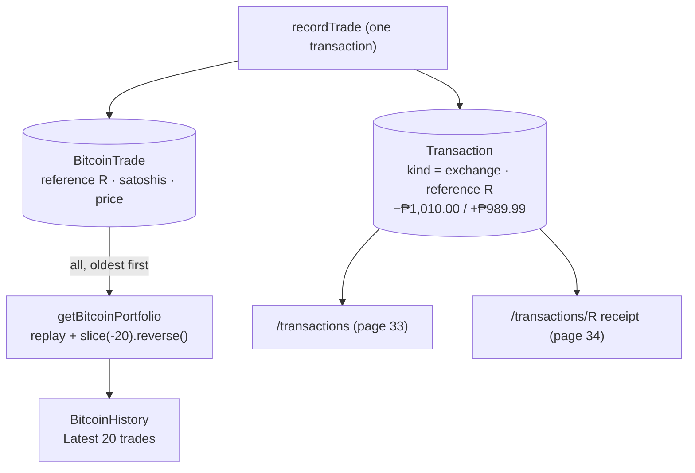

# 39 · Bitcoin trade history

At the bottom of `/bitcoin`, **Trade history · Latest 20 trades** lists the user's most recent Bitcoin trades, newest first: "Bitcoin purchase · Nov 4, 11:32 AM · +0.00017094 BTC · 1,010.00 PHP". Every trade is stored twice on purpose: once as a `BitcoinTrade` (the Bitcoin side, replayed for holdings), and once as an `exchange` row in the main history (the peso side, with its receipt). Both rows share one reference.

## At a glance

| | |
| --- | --- |
| **Route** | `/bitcoin` (the "Bitcoin trade history" section); the peso side also appears in `/transactions` ([33](33-transaction-history.md)) and its receipt ([34](34-receipts.md)) |
| **Frontend** | `bitcoin-history.tsx` (**client**: `BitcoinHistory`, `TradeRow`, `NoTrades`), fed by `bitcoin-screen.tsx` |
| **API** | `bitcoin.portfolio` (its `trades` field) |
| **Backend** | `bitcoin.service.ts` (`getBitcoinPortfolio`: `trades.slice(-20).reverse()`; `recordTrade` writes both rows) |
| **Database** | `BitcoinTrade` (read, newest 20 shown); `Transaction` (`kind = exchange`) with the same `reference` |
| **Tests** | `verify-bitcoin.ts` (the portfolio has the trade); the rows of this review's trades were read back from PostgreSQL, and the list was checked in Chromium |
| **Deep dive** | [Bitcoin §8](../05-features/12-bitcoin.md#bitcoin-historytsx), [Migration history §12](../03-database/02-migration-history.md#12-bitcoin_trade_history-from-wallets-to-event-sourcing) |

## What the user sees

| Row part | Buy | Sell |
| --- | --- | --- |
| icon | arrow down-left, mint | arrow up-right, rose |
| title | Bitcoin purchase | Bitcoin sale |
| date | "Nov 4, 11:32 AM" (the **device's** time zone) | |
| Bitcoin | **+0.00017094 BTC** | **−0.00017094 BTC** (the real minus sign) |
| pesos | **1,010.00 PHP** (total paid, fee included) | **989.99 PHP** (net received, after the fee) |
| no trades | "Your first trade starts here. Buy Bitcoin directly with your PHP account balance. Buy a little Bitcoin and watch your holdings grow." | |

The same two trades in the **main** transaction history: "Bitcoin purchase · −₱1,010.00" and "Bitcoin sale · +₱989.99", each opening a receipt.

## How it works

1. `getBitcoinPortfolio` reads **all** the user's trades, oldest first, because the holdings must be replayed from the beginning ([37](37-bitcoin-holdings.md)).
2. For the list, it returns only the **last 20, reversed**: `trades.slice(-20).reverse()`, so the newest is first.
3. `BitcoinHistory` renders a `TradeRow` per trade. `bitcoinUnits` arrives as a real `BigInt` and `createdAt` as a real `Date`, because tRPC uses **SuperJSON**.
4. Each trade also wrote an `exchange` row through `post()` with the **same reference** ([38](38-bitcoin-trading.md)). That row is what the main history, the dashboard and the receipt page show.

## Structure



## Files and locations

| Layer | File | Role |
| --- | --- | --- |
| Frontend (client) | `gobank/src/features/bitcoin/components/bitcoin-history.tsx` | the list |
| Frontend | `gobank/src/features/bitcoin/components/bitcoin-screen.tsx` | passes `portfolio.trades` |
| Service | `gobank/src/features/bitcoin/bitcoin.service.ts` | `getBitcoinPortfolio`, `recordTrade` |
| Types | `gobank/src/features/bitcoin/bitcoin.types.ts` | `btc`, `money` |
| Schema | `gobank/prisma/schema.prisma` | `BitcoinTrade` |
| Migrations | `20261006000300_bitcoin_trade_history` and later renames | how trades became the source of truth |

## Frontend

<!-- code: gobank/src/features/bitcoin/components/bitcoin-history.tsx -->
**`gobank/src/features/bitcoin/components/bitcoin-history.tsx`** · all 85 lines

```tsx
 1 │ "use client";
 2 │
 3 │ import { ArrowDownLeft, ArrowUpRight } from "lucide-react";
 4 │ import { cn } from "~/shared/lib/cn";
 5 │ import type { RouterOutputs } from "~/trpc/react";
 6 │ import { btc, money } from "../bitcoin.types";
 7 │
 8 │ type Trade = RouterOutputs["bitcoin"]["portfolio"]["trades"][number];
 9 │
10 │ const TRADE_TIME: Intl.DateTimeFormatOptions = {
11 │   month: "short",
12 │   day: "numeric",
13 │   hour: "numeric",
14 │   minute: "2-digit",
15 │ };
16 │
17 │ function TradeRow({ trade }: { trade: Trade }) {
18 │   const bought = trade.action === "buy";
19 │
20 │   return (
21 │     <div className="flex items-center gap-3 py-4">
22 │       <span
23 │         className={cn(
24 │           "grid h-9 w-9 shrink-0 place-items-center rounded-xl",
25 │           bought ? "bg-mint/10 text-mint" : "bg-rose-300/10 text-rose-300",
26 │         )}
27 │       >
28 │         {bought ? <ArrowDownLeft size={17} /> : <ArrowUpRight size={17} />}
29 │       </span>
30 │
31 │       <div className="min-w-0 flex-1">
32 │         <p className="text-[12px] font-medium">
33 │           {bought ? "Bitcoin purchase" : "Bitcoin sale"}
34 │         </p>
35 │         <p className="text-ink-faint mt-1 text-[9px]">
36 │           {trade.createdAt.toLocaleString("en-US", TRADE_TIME)}
37 │         </p>
38 │       </div>
39 │
40 │       <div className="text-right">
41 │         <p className="text-[11px] font-semibold tabular-nums">
42 │           {bought ? "+" : "−"}
43 │           {btc(trade.bitcoinUnits)} BTC
44 │         </p>
45 │         <p className="text-ink-muted mt-1 text-[10px] tabular-nums">
46 │           {money(trade.amountCentavos)} PHP
47 │         </p>
48 │       </div>
49 │     </div>
50 │   );
51 │ }
52 │
53 │ function NoTrades() {
54 │   return (
55 │     <div className="rounded-[20px] border border-dashed border-white/10 px-5 py-6 text-center">
56 │       <p className="text-ink-soft text-[12px]">Your first trade starts here.</p>
57 │       <p className="text-ink-faint mt-2 text-[11px] leading-relaxed">
58 │         Buy Bitcoin directly with your PHP account balance.
59 │         <br />
60 │         Buy a little Bitcoin and watch your holdings grow.
61 │       </p>
62 │     </div>
63 │   );
64 │ }
65 │
66 │ export function BitcoinHistory({ trades }: { trades: Trade[] }) {
67 │   return (
68 │     <section aria-label="Bitcoin trade history">
69 │       <div className="mb-3 flex items-center justify-between">
70 │         <h2 className="text-[14px] font-semibold">Trade history</h2>
71 │         <span className="text-ink-faint text-[10px]">Latest 20 trades</span>
72 │       </div>
73 │
74 │       {trades.length > 0 ? (
75 │         <div className="bg-card divide-y divide-white/[.06] rounded-[20px] border border-white/[.06] px-4">
76 │           {trades.map((trade) => (
77 │             <TradeRow key={trade.id} trade={trade} />
78 │           ))}
79 │         </div>
80 │       ) : (
81 │         <NoTrades />
82 │       )}
83 │     </section>
84 │   );
85 │ }
```
<!-- /code -->

<!-- code: gobank/src/features/bitcoin/components/bitcoin-screen.tsx 108-108 -->
**`gobank/src/features/bitcoin/components/bitcoin-screen.tsx`** · line 108

```tsx
108 │       <BitcoinHistory trades={portfolio.data?.trades ?? []} />
```
<!-- /code -->

## Backend

<!-- code: gobank/src/features/bitcoin/bitcoin.service.ts 22-42 -->
**`gobank/src/features/bitcoin/bitcoin.service.ts`** · lines 22–42

```ts
22 │ export async function getBitcoinPortfolio(userId: string) {
23 │   return db.$transaction(
24 │     async (tx) => {
25 │       const user = await tx.user.findUniqueOrThrow({
26 │         where: { id: userId },
27 │         select: { balance: true },
28 │       });
29 │       const trades = await tx.bitcoinTrade.findMany({
30 │         where: { userId },
31 │         orderBy: [{ createdAt: "asc" }, { id: "asc" }],
32 │       });
33 │
34 │       return {
35 │         ...summarizeTrades(trades),
36 │         cashCentavos: user.balance,
37 │         trades: trades.slice(-20).reverse(),
38 │       };
39 │     },
40 │     { isolationLevel: "RepeatableRead" },
41 │   );
42 │ }
```
<!-- /code -->

<!-- code: gobank/src/features/bitcoin/bitcoin.service.ts 88-113 -->
**`gobank/src/features/bitcoin/bitcoin.service.ts`** · lines 88–113

```ts
 88 │   const reference = newReference();
 89 │
 90 │   await post(tx, {
 91 │     userId,
 92 │     kind: "exchange",
 93 │     title: buying ? "Bitcoin purchase" : "Bitcoin sale",
 94 │     amount: buying ? -result.cashCentavos : result.cashCentavos,
 95 │     reference,
 96 │     details: {
 97 │       satoshis: result.bitcoinUnits.toString(),
 98 │       priceCentavos: quote.unitPriceCentavos,
 99 │       feeCentavos: result.feeCentavos,
100 │     },
101 │   });
102 │
103 │   return tx.bitcoinTrade.create({
104 │     data: {
105 │       userId,
106 │       submissionId,
107 │       reference,
108 │       action: trade.action,
109 │       bitcoinUnits: result.bitcoinUnits,
110 │       amountCentavos: result.cashCentavos,
111 │       unitPriceCentavos: quote.unitPriceCentavos,
112 │     },
113 │   });
```
<!-- /code -->

## Database

<!-- code: gobank/prisma/schema.prisma 77-91 -->
**`gobank/prisma/schema.prisma`** · lines 77–91

```prisma
77 │ model BitcoinTrade {
78 │   id                String   @id @default(cuid())
79 │   userId            String
80 │   submissionId      String
81 │   reference         String?  @unique
82 │   action            String
83 │   bitcoinUnits      BigInt
84 │   amountCentavos    Int
85 │   unitPriceCentavos Int
86 │   createdAt         DateTime @default(now())
87 │   user              User     @relation(fields: [userId], references: [id], onDelete: Cascade)
88 │
89 │   @@unique([userId, submissionId])
90 │   @@index([userId, createdAt(sort: Desc)])
91 │ }
```
<!-- /code -->

The rows written by this review's two browser trades, read back from PostgreSQL:

| | `Transaction` (main history) | `BitcoinTrade` |
| --- | --- | --- |
| buy | "Bitcoin purchase", `amount −101000`, `GBJTNPSBRE`, `details {"satoshis": "17094", "feeCentavos": 1000, "priceCentavos": 585000000}` | `buy`, 17094 sats, `amountCentavos 101000`, price 585000000, `GBJTNPSBRE` |
| sell | "Bitcoin sale", `amount +98999`, `GBG6YVGHX7`, same kind of `details` | `sell`, 17094 sats, `amountCentavos 98999`, `GBG6YVGHX7` |

| Rule (from `pg_constraint` / `pg_indexes`) | Meaning |
| --- | --- |
| `BitcoinTrade_valid CHECK (action IN ('buy','sell') AND "bitcoinUnits" > 0 AND "amountCentavos" > 0 AND "unitPriceCentavos" > 0)` | no zero or negative trades, no unknown actions, even if the code had a bug |
| unique `("userId", "submissionId")` | one trade per submission ([38 §5](38-bitcoin-trading.md#5-exactly-once-the-submissionid)) |
| unique `reference` | each trade has its own `GB…` code |
| index `("userId", "createdAt" DESC)` | fast "this user's trades" |
| `onDelete: Cascade` | deleting a user deletes their trades |

## The complicated parts, explained step by step

### 1. Two rows for one trade, written together

<!-- code: gobank/src/features/bitcoin/bitcoin.service.ts 88-113 -->
**`gobank/src/features/bitcoin/bitcoin.service.ts`** · lines 88–113

```ts
 88 │   const reference = newReference();
 89 │
 90 │   await post(tx, {
 91 │     userId,
 92 │     kind: "exchange",
 93 │     title: buying ? "Bitcoin purchase" : "Bitcoin sale",
 94 │     amount: buying ? -result.cashCentavos : result.cashCentavos,
 95 │     reference,
 96 │     details: {
 97 │       satoshis: result.bitcoinUnits.toString(),
 98 │       priceCentavos: quote.unitPriceCentavos,
 99 │       feeCentavos: result.feeCentavos,
100 │     },
101 │   });
102 │
103 │   return tx.bitcoinTrade.create({
104 │     data: {
105 │       userId,
106 │       submissionId,
107 │       reference,
108 │       action: trade.action,
109 │       bitcoinUnits: result.bitcoinUnits,
110 │       amountCentavos: result.cashCentavos,
111 │       unitPriceCentavos: quote.unitPriceCentavos,
112 │     },
113 │   });
```
<!-- /code -->

| Row | Answers | Used by |
| --- | --- | --- |
| `Transaction` (`exchange`) | "how did my **peso** balance change?" | the main history, the dashboard, receipts, the balance (`post()`) |
| `BitcoinTrade` | "how many **satoshis**, at what price?" | holdings replay ([37](37-bitcoin-holdings.md)), this list |

Both are written in the **same** Serializable transaction, with the same `reference`, so either both exist or neither does. `amountCentavos` on the trade equals the absolute `amount` of the ledger row: 101,000 for the buy and 98,999 for the sell above.

### 2. Reading everything, showing 20

<!-- code: gobank/src/features/bitcoin/bitcoin.service.ts 29-37 -->
**`gobank/src/features/bitcoin/bitcoin.service.ts`** · lines 29–37

```ts
29 │       const trades = await tx.bitcoinTrade.findMany({
30 │         where: { userId },
31 │         orderBy: [{ createdAt: "asc" }, { id: "asc" }],
32 │       });
33 │
34 │       return {
35 │         ...summarizeTrades(trades),
36 │         cashCentavos: user.balance,
37 │         trades: trades.slice(-20).reverse(),
```
<!-- /code -->

| Need | Rows |
| --- | --- |
| holdings, cost basis, realized profit | **all** trades, oldest first (a replay must start at the beginning) |
| the list on screen | `slice(-20)` = the last 20, `.reverse()` = newest first |

There is no **Load more** here. Older trades remain visible in the main transaction history, which pages through every row ([33](33-transaction-history.md)). Reading every trade on each portfolio load is fine for a personal account. A very active trader would need a stored, checked running total ([Limitations](../09-defense/03-limitations-and-future-work.md#4-technical-limitations)).

### 3. BigInt and Date survive the trip to the browser

<!-- code: gobank/src/features/bitcoin/components/bitcoin-history.tsx 17-51 -->
**`gobank/src/features/bitcoin/components/bitcoin-history.tsx`** · lines 17–51

```tsx
17 │ function TradeRow({ trade }: { trade: Trade }) {
18 │   const bought = trade.action === "buy";
19 │
20 │   return (
21 │     <div className="flex items-center gap-3 py-4">
22 │       <span
23 │         className={cn(
24 │           "grid h-9 w-9 shrink-0 place-items-center rounded-xl",
25 │           bought ? "bg-mint/10 text-mint" : "bg-rose-300/10 text-rose-300",
26 │         )}
27 │       >
28 │         {bought ? <ArrowDownLeft size={17} /> : <ArrowUpRight size={17} />}
29 │       </span>
30 │
31 │       <div className="min-w-0 flex-1">
32 │         <p className="text-[12px] font-medium">
33 │           {bought ? "Bitcoin purchase" : "Bitcoin sale"}
34 │         </p>
35 │         <p className="text-ink-faint mt-1 text-[9px]">
36 │           {trade.createdAt.toLocaleString("en-US", TRADE_TIME)}
37 │         </p>
38 │       </div>
39 │
40 │       <div className="text-right">
41 │         <p className="text-[11px] font-semibold tabular-nums">
42 │           {bought ? "+" : "−"}
43 │           {btc(trade.bitcoinUnits)} BTC
44 │         </p>
45 │         <p className="text-ink-muted mt-1 text-[10px] tabular-nums">
46 │           {money(trade.amountCentavos)} PHP
47 │         </p>
48 │       </div>
49 │     </div>
50 │   );
51 │ }
```
<!-- /code -->

| Field | In PostgreSQL | Over the API | In the browser |
| --- | --- | --- | --- |
| `bitcoinUnits` | `BIGINT` | SuperJSON keeps the type | a `BigInt`: `btc(trade.bitcoinUnits)` works directly |
| `createdAt` | `timestamp` | SuperJSON keeps the type | a `Date`: `trade.createdAt.toLocaleString("en-US", …)` |

Plain JSON cannot carry a `BigInt` at all, and would turn dates into strings. tRPC's `transformer: superjson` (in `server/trpc.ts` and the client) restores both. The date is formatted in the **browser**, so it follows the device's time zone ("Nov 4, 11:32 AM" in Manila).

### 4. What the receipt of a Bitcoin trade shows, and what it does not

The `exchange` row's receipt ([34](34-receipts.md)) shows the title, the peso amount, the reference, the date and the balance after. `details` also holds the satoshis, the price and the fee, but `ReceiptScreen` only reads `details.card`, so the receipt does **not** show the Bitcoin amount or the fill price. The Bitcoin side is only visible in this list. Showing `details.satoshis` and `details.priceCentavos` on the receipt would be a small improvement.

### 5. From wallets to a trade log (the history of the design)

The tables went through several designs (see [Migration history §12](../03-database/02-migration-history.md#12-bitcoin_trade_history-from-wallets-to-event-sourcing)). An `InvestmentWallet` stored running balances, and `InvestmentOrder` rows stored the trades. Migration `20261006000300_bitcoin_trade_history` renamed `InvestmentOrder` to `BitcoinTrade`, dropped the stored running values (`realizedCents`, `cashAfter`, `satoshisAfter`…), and **dropped the wallet table**. From then on, the trade list is the **only** source of truth, and holdings are computed by replay. Migration `20261010000000_clear_savings_bitcoin_names` then renamed the columns to today's names (`side` → `action`, `requestId` → `submissionId`, `satoshis` → `bitcoinUnits`, `phpCentavos` → `amountCentavos`, `priceCentavos` → `unitPriceCentavos`), and the `CHECK` constraint followed them, as the live definition above shows.

## Rules and limits

| Rule | Value |
| --- | --- |
| Shown | the latest 20 trades, newest first |
| Older trades | in the main transaction history (as `exchange` rows) |
| Amount shown | total paid (buy) or net received (sell), fee included |
| Time zone | the device's |
| Storage | `BitcoinTrade` + an `exchange` `Transaction`, same reference |

## Messages

| Text | When |
| --- | --- |
| Trade history · Latest 20 trades | section header |
| Bitcoin purchase / Bitcoin sale | row titles |
| +… BTC / −… BTC · … PHP | row amounts |
| Your first trade starts here. · Buy Bitcoin directly with your PHP account balance. · Buy a little Bitcoin and watch your holdings grow. | no trades |

## Tests

- `verify-bitcoin.ts`: after the buy, the portfolio has **one** trade, and the balance dropped by exactly the charge (passed with stand-in market data for this review).
- **Read back from PostgreSQL for this review:** the two pairs of rows in the Database table, with matching references and amounts.
- **Checked in Chromium for this review:** after the buy, the list showed "Bitcoin purchase · Nov 4, 11:32 AM · +0.00017094 BTC · 1,010.00 PHP".
