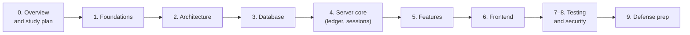

# GoBank Express: Code Study Guide

This repository explains **every part of the GoBank Express code**, in study order, so you can understand it deeply and defend it in front of a panel.

- **Source explained:** [`neilacapuccino/gobank-express`](https://github.com/neilacapuccino/gobank-express) at commit `7be1eb5` (the `main` branch on 4 Nov 2026). The exact commit is saved in [`.docs-source.json`](.docs-source.json).
- **Code excerpts are copied by a script, never retyped.** All 724 excerpts show the real file path and the real line numbers. Run `node scripts/sync-code.mjs --check` to prove that every excerpt still matches the source (see [Keeping these docs accurate](#keeping-these-docs-accurate)).
- **Every file is accounted for.** [The file index](appendix/01-file-index.md) lists all 258 files in the project, the category each belongs to, and the page that explains it.
- **Behavior was verified, not assumed.** See [What was verified](#what-was-verified).

---

## How to use this guide

Each page follows the same pattern:

1. **What you will learn**: the goal of the page.
2. **Concept boxes** (`> **Concept: …**`): the computer-science or web idea you need first, explained from zero.
3. **Code excerpts with walkthroughs**: real code, then what each part does and *why*.
4. **Why it is built this way**: the design decision and the alternatives that were rejected.
5. **Defense questions**: questions a panel is likely to ask, with model answers you can say out loud.
6. **Check yourself**: short quizzes with hidden answers (click to reveal).

If you only have one evening, read the pages marked ⭐.

---

## Table of contents

### 0. Start here
| Page | What it covers |
| --- | --- |
| ⭐ [Project overview](00-start-here/01-project-overview.md) | What GoBank Express is, who it is for, every feature, every limit |
| ⭐ [Study plan](00-start-here/02-study-plan.md) | A five-day plan to master the code before the defense |
| [Glossary](00-start-here/03-glossary.md) | Every technical term used in this guide, A to Z |

### 1. Foundations: the concepts behind the code
| Page | What it covers |
| --- | --- |
| [TypeScript and tooling](01-foundations/01-typescript-and-tooling.md) | Types, strict mode, modules, `~/` imports, Node, npm |
| [Next.js and React](01-foundations/02-nextjs-and-react.md) | App Router, server vs client components, layouts, hooks |
| ⭐ [tRPC, Zod and React Query](01-foundations/03-trpc-zod-and-react-query.md) | How the browser talks to the server, safely and with types |
| ⭐ [Prisma and PostgreSQL](01-foundations/04-prisma-and-postgresql.md) | ORM, migrations, transactions, isolation levels, row locks |
| ⭐ [Security concepts](01-foundations/05-security-concepts.md) | Hashing, salts, scrypt, AES-GCM, HMAC, cookies, OAuth and PKCE |

### 2. Architecture
| Page | What it covers |
| --- | --- |
| ⭐ [Layers and folders](02-architecture/01-layers-and-folders.md) | The four layers, the folder map, file-name rules, dependency rules |
| ⭐ [Life of a request](02-architecture/02-request-lifecycle.md) | One "Send money" tap followed through every file, browser to database and back |
| [Configuration files](02-architecture/03-configuration-files.md) | `package.json`, `tsconfig`, ESLint, Prettier, env, CI, git hooks |

### 3. Database
| Page | What it covers |
| --- | --- |
| ⭐ [Schema](03-database/01-schema.md) | Every table, column, enum, index, relation and database rule |
| [Migration history](03-database/02-migration-history.md) | All 19 migrations in order: how the database evolved and why |
| [Seed data](03-database/03-seed-data.md) | The demo accounts and billers |

### 4. Server core (`src/server`)
| Page | What it covers |
| --- | --- |
| [Database client, errors, IDs, pagination](04-server-core/01-db-errors-identifiers-pagination.md) | `db.ts`, `errors.ts`, `identifiers.ts`, `pagination.ts` |
| ⭐ [tRPC setup](04-server-core/02-trpc-setup.md) | `trpc.ts`, `root.ts`, the API route, error translation, the sign-in guard |
| ⭐ [Sessions](04-server-core/03-sessions.md) | Sign-in tokens, cookies, 30-minute idle expiry, one session per tab |
| ⭐⭐ [The ledger](04-server-core/04-ledger.md) | **The heart of the bank:** how every peso moves, safely |

### 5. Features (backend and frontend together)
| Page | What it covers |
| --- | --- |
| ⭐ [Registration and sign-in](05-features/01-registration-and-sign-in.md) | Usernames, PIN rules, PIN hashing, lockout, the 4-step sign-up |
| [Google sign-in](05-features/02-google-sign-in.md) | OAuth with PKCE, signed cookies, linking Google to an account |
| [Account and profile](05-features/03-account-and-profile.md) | Overview, profile editing, the profile-photo pipeline |
| ⭐ [Cards](05-features/04-cards.md) | Card numbers (Luhn), CVV encryption, locks, daily limit |
| ⭐ [Send money](05-features/05-send-money.md) | Recipient search, the 3-step form, the transfer |
| [Request money and notifications](05-features/06-request-money-and-notifications.md) | Requests, paying or declining, cancelling |
| [Deposit, bills and load](05-features/07-deposit-bills-and-load.md) | Cash-in, bill payments, mobile load |
| ⭐ [GoalSave](05-features/08-goalsave.md) | Savings goals and the 4% daily compound-interest math |
| [Rewards](05-features/09-rewards.md) | Earning and converting points |
| [Transactions and receipts](05-features/10-transactions-and-receipts.md) | History, filters, "Load more" paging, receipts |
| [Dashboard and navigation](05-features/11-dashboard-and-navigation.md) | Home screen, balance card, the GO menu |
| ⭐ [Bitcoin](05-features/12-bitcoin.md) | Live prices, BigInt math, fees, idempotent trades, charts |

### 6. Frontend
| Page | What it covers |
| --- | --- |
| [Pages and routing](06-frontend/01-pages-and-routing.md) | Every URL, layout and page file |
| [Shared UI kit](06-frontend/02-shared-ui-kit.md) | Buttons, text fields, PIN pad, receipts, money forms |
| [Shared helpers, hooks and the tRPC client](06-frontend/03-shared-lib-hooks-and-trpc-client.md) | Money and format helpers, shared hooks, the browser API client |
| [Styling and accessibility](06-frontend/04-styling-and-accessibility.md) | Tailwind 4 theme tokens, animations, screen-reader support |

### 7–9. Quality, security and the defense
| Page | What it covers |
| --- | --- |
| [Testing](07-testing/01-testing.md) | Every unit test, both integration scripts and the browser tests |
| ⭐ [Security model](08-security/01-security-model.md) | Every threat and the exact code that stops it |
| ⭐⭐ [Panel questions](09-defense/01-panel-questions.md) | 100+ likely questions with model answers and code locations |
| ⭐ [Live demo script](09-defense/02-demo-script.md) | A rehearsed, safe demo order with a backup plan |
| ⭐ [Limitations and future work](09-defense/03-limitations-and-future-work.md) | Honest weaknesses and how you would fix them |
| ⭐ [Cheat sheet](09-defense/04-cheat-sheet.md) | Every number, limit and rule on one page |

### 10. Feature catalog: one page per feature
| Page | What it covers |
| --- | --- |
| ⭐ [Feature catalog index](10-feature-catalog/README.md) | All 39 features, each on its own page with the same layout: what the user can do, how it works, a structure diagram, every file and its location, the frontend and backend code, the database tables, **the complicated parts explained step by step with worked examples**, rules, messages and tests. Also maps every route and every API procedure to its feature |
| [Shared systems](10-feature-catalog/00-shared-systems.md) | The parts every feature uses: the API pipeline, sessions, the ledger, errors, validation, caching, IDs, money formats and the UI kit |

### Appendix
| Page | What it covers |
| --- | --- |
| [File index](appendix/01-file-index.md) | Every file in the project, categorized, with a link to its explanation |

---

## Reading order



Already comfortable with Next.js, tRPC and Prisma? Skim section 1 and start at [Layers and folders](02-architecture/01-layers-and-folders.md).

---

## What was verified

While writing this guide, the source code was not only read but **run**, on an untouched copy of commit `7be1eb5`:

| Check | Result |
| --- | --- |
| Unit tests (`npm test`) | 63 / 63 pass |
| Typecheck and lint | pass, zero warnings |
| All 19 migrations on an empty PostgreSQL 16 | applied cleanly; constraints, indexes and enums match the schema page |
| Seed script | runs; demo data matches the seed page |
| Integration test (`verify-core.ts`) | passes on a real database |
| 20 simultaneous transfers ([experiment](experiments/concurrent-transfers.ts)) | 12 succeed, 8 refused, no money created or lost |
| 10 + 10 opposite transfers at once ([experiment](experiments/opposite-transfers.ts)) | all 20 succeed, 0 deadlocks |
| Worked examples (interest, Bitcoin, Luhn, formats) | computed by running the project's own functions |
| The SQL shown for the ledger and the features | captured from PostgreSQL's statement log, with the real parameter values |
| Races on a real database | two payments of one request, 5 payments against ₱100 of daily limit, 3 goal creations at the limit, simultaneous interest reads, 5 point conversions: in every case exactly the allowed number succeeded and nothing was paid twice ([catalog](10-feature-catalog/README.md#how-the-facts-on-these-pages-were-checked)) |
| Browser tests (`npm run test:e2e`) | **3 / 3 pass** in Chromium (the config's Google Chrome is not installed here, so a copy of the config swapped in Chromium) |
| The app in a real browser | the screens of [catalog pages 11–39](10-feature-catalog/README.md) (dashboard, GO menu, every payment, cards, GoalSave, rewards, history, receipts, Bitcoin) driven with Playwright scripts in Chromium: what is shown, which buttons are enabled, the `aria-*` values, focus and keyboard behavior; plus the session rules (reload, typed address, second tab). The welcome and sign-in screens are covered by the 3 browser tests; registration, Google linking and the profile screens (pages 01–10) were checked against the code, not in a browser |
| Bitcoin integration test (`verify-bitcoin.ts`) | **passes with stand-in market data** ([`experiments/mock-market.mjs`](experiments/mock-market.mjs) answers the 4 blocked API calls with fixed prices); not yet run against the live APIs |
| Bitcoin trading, end to end | with the same stand-in data: real buys and sells on the database, a repeated submission ID never trades twice, two simultaneous "sell everything" → one refused; the whole screen in Chromium |

The pages themselves are checked too: every excerpt matches the source (`sync-code.mjs --check`), every project file is mentioned (`--coverage`), all internal links and `#anchors` resolve (`check-links.mjs`), and all 62 diagrams parse with Mermaid 11.

---

## Keeping these docs accurate

Every code block in this guide sits between two markers like these:

```text
<!-- code: gobank/src/server/ledger.ts 80-115 -->
   ...exact lines 80 to 115, with line numbers...
<!-- /code -->
```

The script `scripts/sync-code.mjs` fills those blocks from the real source files. It needs Node.js 22 and a checkout of `gobank-express` next to this repository:

```bash
git clone https://github.com/neilacapuccino/gobank-express.git ../gobank-express
```

Check that every excerpt matches the source (it exits with an error if anything differs):

```bash
node scripts/sync-code.mjs --check
```

After the app code changes, refresh every excerpt (line numbers in the prose may then need a manual look):

```bash
node scripts/sync-code.mjs
```

List any project file that no page mentions:

```bash
node scripts/sync-code.mjs --coverage
```

Check every internal link and heading anchor:

```bash
node scripts/check-links.mjs
```

> **Tip:** line numbers in the explanations refer to the numbers printed in the left column of each excerpt, so you can say "line 93 of `ledger.ts`" during the defense and point at it.
